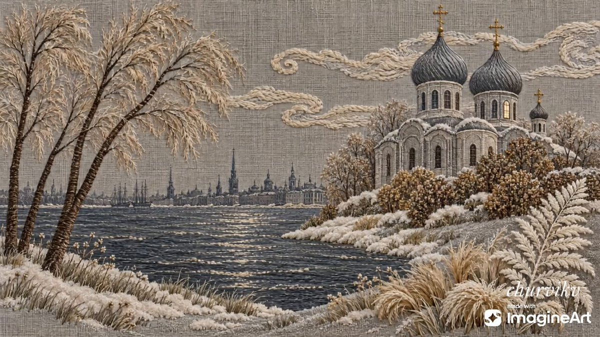

# 刺绣风冬夜教堂河景：窗灯渐亮的织物质感动画（Kling 4.0 图生视频）

- 原帖链接：https://x.com/churvikv/status/2119868184341991472
- 作者：Viki（@churvikv）
- 时间：2026-11-10 03:02 (UTC+8 / Asia/Taipei)
- 互动摘要：点赞 59 · 转发 13 · 回复 24 · 引用 2 · 书签 3 · 浏览 601（采集快照：2026-11-10 09:05 UTC+8）
- 模型/工具：Kling 4.0（视频）+ GPT Image 2.5 Sunburst（首帧图），经 ImagineArt
- 标签：其它
- 媒体路径：
  - `media/video-stills/2119868184341991472_still.jpg`（视频封面截图，）
  - 视频本体未入库，仅保留原帖链接：https://x.com/churvikv/status/2119868184341991472
- 入库日期：2026-11-10
- prompt 来源：https://x.com/churvikv/status/2119868184341991472
- 备注：prompt 即主帖正文中「Prompt to video:」之后的部分，整段摘录（含前文说明）。视频仅保留原帖链接。

## prompt 原文

```text
The golden lights in the windows become shimmering stitches on the linen fabric of the evening.

Created in @ImagineArt_X
🎥Model: Kling 4.0.  
🏞 Model: GPT Image 2.5 Sunburst

Prompt to video:
Embroidery art style, textile texture preserved throughout - visible linen fabric background with stitched threads. Winter landscape with Orthodox church, river, and distant city. As evening falls, warm golden lights gradually illuminate in the church windows and city buildings across the river, flickering softly like candles. Snow-covered trees sway gently in the winter wind. The river surface ripples subtly with reflected light. Stitched clouds drift slowly across the sky. Snowflakes fall gently. The golden crosses on the church domes shimmer. Peaceful winter evening atmosphere
```

---

个人学习归档，非商业。prompt 与媒体版权归原作者 @churvikv，引用请回到原帖。
