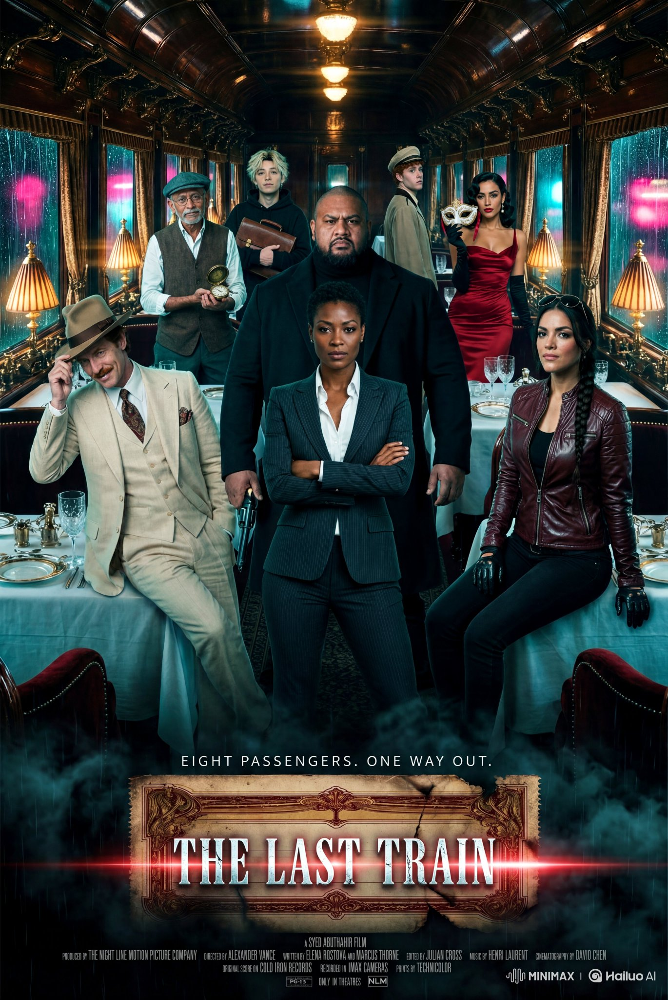
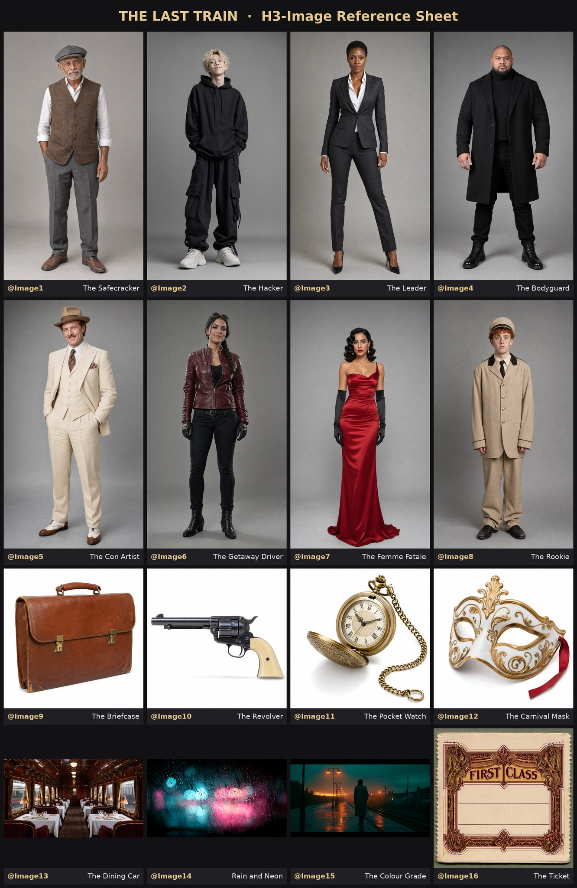

# 16 张参考图合成的复古列车劫案电影海报（MiniMax-H3-Image）

- 原帖链接：https://x.com/abulu8/status/2119877677641498942
- 作者：Syed Abuthahir ∞（@abulu8）
- 时间：2026-11-10 03:39 (UTC+8 / Asia/Taipei)
- 互动摘要：点赞 135 · 转发 4 · 回复 6 · 引用 0 · 书签 2 · 浏览 1545（采集快照：2026-11-10 20:30 UTC+8）
- 模型/工具：MiniMax-H3-Image（作者抢先体验）
- 标签：其它
- 媒体路径：
  - `media/images/2119877677641498942_1.jpg`（）
  - `media/images/2119877677641498942_2.jpg`（）
- 入库日期：2026-11-10
- prompt 来源：https://x.com/abulu8/status/2119877677641498942
- 备注：prompt 即主帖正文「Prompt 👇」之后部分，原样摘录；需准备 @Image1–@Image16 共 16 张参考图（第 2 张图为作者的参考图板）。

## prompt 原文

```text
Aspect ratio 2:3, 4K. Create an original cinematic heist movie poster using all 16 references. Characters @Image1 to @Image8 must keep their exact faces, hairstyles, body builds and outfits from their full-body references.

Prop mapping: @Image1 (the safecracker) holds the gold pocket watch from @Image11 open in his palm. @Image2 (the hacker) clutches the leather briefcase from @Image9 to his chest. @Image4 (the bodyguard) holds the revolver from @Image10 lowered at his side. @Image7 (the femme fatale) holds the carnival mask from @Image12 beside her face.

Setting: the 1940s train dining car from @Image13, at night, with rain streaking the windows and pink and cyan neon reflections as in @Image14. Apply the teal-and-amber colour grade, anamorphic flare and 35mm grain from @Image15.

Composition: @Image3 (the leader) stands front and centre, full figure, arms crossed. @Image5 (the con artist) leans on a table to her left, tipping his fedora. @Image6 (the getaway driver) sits on the table edge to her right, sunglasses on her head. @Image4 looms behind @Image3. @Image1, @Image2 and @Image7 are layered in depth down the aisle. @Image8 (the rookie) is in the far background, glancing nervously over his shoulder toward the camera.

Bottom third: the vintage ticket from @Image16 reworked into a haunting thriller title block. Keep its art deco border and perforated edge, but make it aged, scorched and torn at one corner, half sinking into deep black smoke and cold teal mist, with faint rain streaks across it and a thin trail of red light like a passing train's tail lamp. Small tagline above the ticket in thin, widely spaced capitals: "EIGHT PASSENGERS. ONE WAY OUT." On the ticket, the title "THE LAST TRAIN" in tall, condensed, distressed serif capitals with wide letter spacing, cold silver-white with a faint red inner glow, slightly cracked, and a thin horizontal light streak cutting through the letters like headlights in fog. Below the ticket, a classic Hollywood billing block: tiny, tightly packed, condensed sans-serif credits in muted grey, centred, three lines, starting with "A SYED ABUTHAHIR FILM" and followed by small cast and crew style lines. Under that, a small "ONLY IN THEATRES" line with tiny original fictional rating and studio marks. Spell "THE LAST TRAIN" and "A SYED ABUTHAHIR FILM" exactly as written. No real studio logos, no watermarks, no other names in the credits.
```

---

个人学习归档，非商业。prompt 与媒体版权归原作者 @abulu8，引用请回到原帖。
