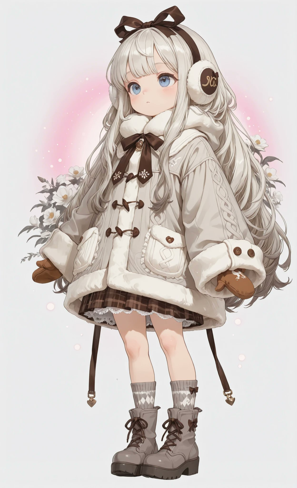
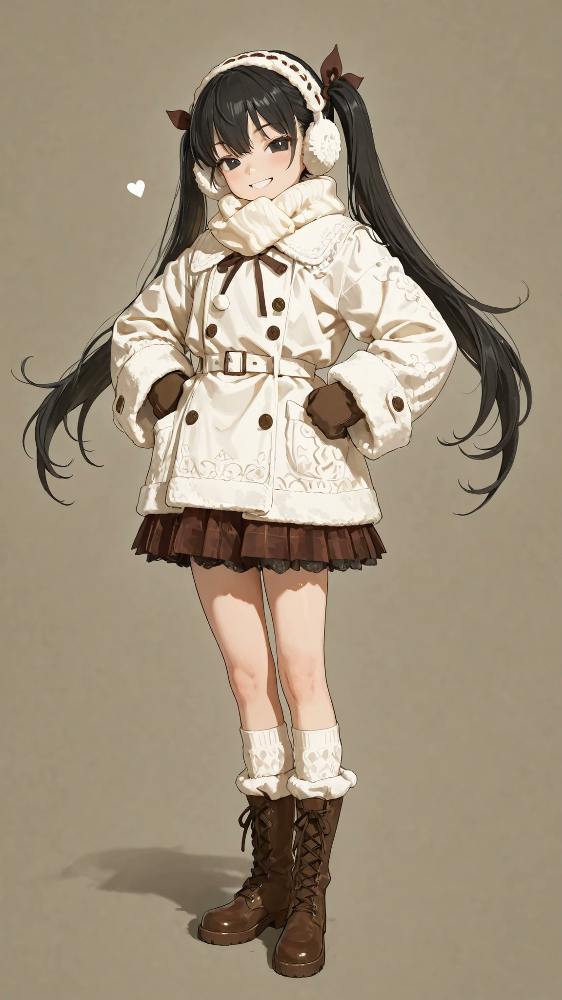
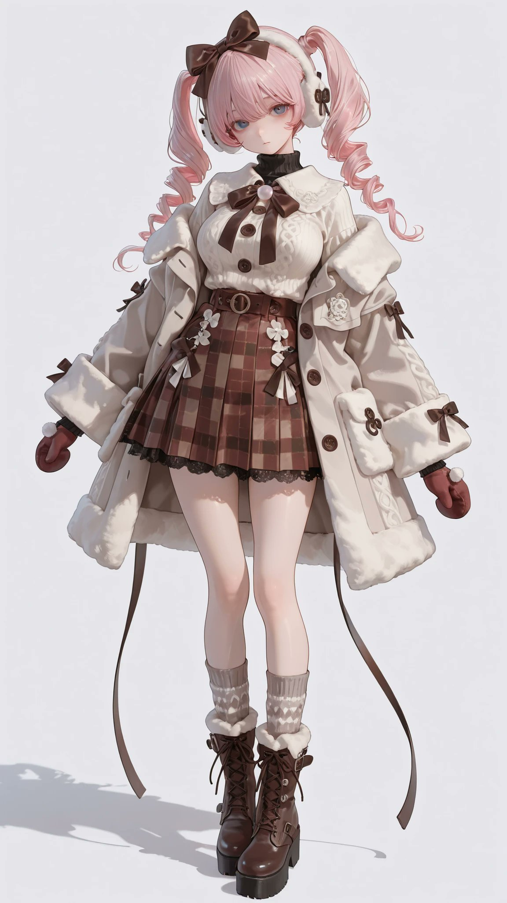

# 初冬毛领大衣 + 格纹裙 + 系带靴：暖系冬装（衣装 prompt）

- 原帖链接：https://x.com/AliceLavli/status/2119897823172809024
- 作者：アリス服飾店（@AliceLavli）
- 时间：2026-11-10 05:00 (UTC+8 / Asia/Taipei)
- 互动摘要：点赞 198 · 转发 41 · 回复 9 · 引用 16 · 书签 60 · 浏览 4265（采集快照：2026-11-10 20:30 UTC+8）
- 模型/工具：未注明（通用；作者写可用于 SD / SeaArt / PixAI / ChatGPT / Gemini / Grok / Midjourney / niji）
- 标签：二次元
- 媒体路径：
  - `media/images/2119897823172809024_1.jpg`（）
  - `media/images/2119897823172809024_2.jpg`（）
  - `media/images/2119897823172809024_3.jpg`（）
  - `media/images/2119897823172809024_4.jpg`（）
- 入库日期：2026-11-10
- prompt 来源：https://x.com/AliceLavli/status/2119897823172809024
- 备注：prompt 即主帖正文英文段，原样摘录。

## prompt 原文

```text
light gray wool coat with loose flared thigh length silhouette, dropped shoulders and long wide sleeves, ivory fleece edging around sleeve cuffs, large ivory fleece pointed collar beneath charcoal cable knit neck warmer, charcoal knitted neck warmer with two cream buttons and short hanging cords, three thin black cord bows fastening coat front with long narrow tails, large rounded patch pockets at hips, chocolate brown ribbon bow beneath collar with white fabric flower and dangling pearl bead strands, brown charcoal and ivory tartan skirt with broad soft pleats, skirt extending below coat hem with ivory scalloped lace underskirt, light gray opaque knitted tights, slouched charcoal ribbed socks, brown lace up mid calf boots with thick taupe platform soles, gray brown fluffy boot cuffs and ivory geometric knitted panels around lower shafts, burgundy knitted mittens with ivory geometric motifs, oversized shaggy tan earmuffs with slim beige fabric covered headband, soft brushed gray wool and coordinated brown plaid fabrics
```

---

个人学习归档，非商业。prompt 与媒体版权归原作者 @AliceLavli，引用请回到原帖。
