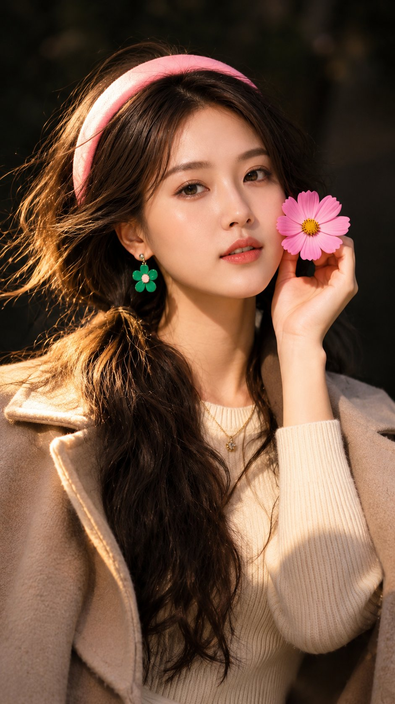

# 金色斜阳下的奶油针织 + 驼色大衣近景人像（GPT Image 2.6，参考图驱动）

- 原帖链接：https://x.com/auqibhabib/status/2119787453926215958
- 作者：auqib（@auqibhabib）
- 时间：2026-11-09 21:41 (UTC+8 / Asia/Taipei)
- 互动摘要：点赞 28 · 转发 0 · 回复 23 · 引用 0 · 书签 2 · 浏览 855（采集快照：2026-11-11 09:20 UTC+8）
- 模型/工具：GPT Image 2.6（ChatGPT）
- 标签：真人
- 媒体路径：
  - `media/images/2119787453926215958_1.jpg`（）
- 入库日期：2026-11-11
- prompt 来源：https://x.com/auqibhabib/status/2119787453926215958
- 备注：prompt 即主帖正文「Prompt:」之后部分（含 Negative prompt），原样摘录；需配一张人像参考图。原帖共 3 图，入库首图。

## prompt 原文

```text
Draw Ultra realistic close-up portrait of a beautiful young East Asian woman with the exact facial structure and soft feminine features from the reference image, natural glowing skin, subtle makeup, glossy peach lips, soft dimples, warm gentle smile, relaxed confident expression, medium-length dark brown wavy hair with natural volume and soft flyaways, direct eye contact with camera.

Keep the exact composition, framing, pose, lighting, shadows, and cinematic mood from the original portrait reference. Warm golden hour sunlight hitting half of the face and body, dramatic soft shadows across the chest and background, dark blurred background with rich contrast and shallow depth of field.

Outfit should be elegant minimal aesthetic fashion: cream ribbed knit top, soft beige wool overcoat casually draped over shoulders, delicate gold necklace, luxury clean-girl aesthetic, cozy premium fashion vibe.

Photo should feel natural and candid, not overposed. Preserve realistic skin texture, natural facial proportions, cinematic highlights, smooth warm color grading, luxury lifestyle photography look, ultra detailed, DSLR quality, 85mm lens, f/1.8 depth of field, high sharpness on eyes and face, soft background bokeh, premium Instagram aesthetic, realistic lighting, photorealistic, 4k.

Negative prompt: cartoon, anime, exaggerated smile, oversaturated skin, plastic skin, distorted face, bad anatomy, low quality, blurry eyes, extra accessories, text, watermark, overediting, harsh HDR, duplicate features, unnatural pose, fake AI look, over sharpened skin.
```

---

个人学习归档，非商业。prompt 与媒体版权归原作者 @auqibhabib，引用请回到原帖。
