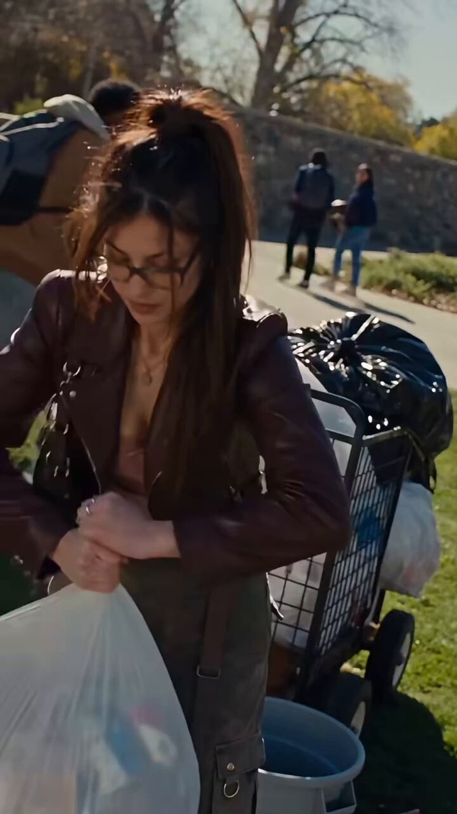

# 校园街拍：棕色皮夹克眼镜女生边走边拂面（图生视频 prompt）

- 原帖链接：https://x.com/SeeratFatima112/status/2119811146157085054
- 作者：Seerat Fatima（@SeeratFatima112）
- 时间：2026-11-09 23:15 (UTC+8 / Asia/Taipei)
- 互动摘要：点赞 91 · 转发 7 · 回复 22 · 引用 0 · 书签 16 · 浏览 13452（采集快照：2026-11-11 20:25 UTC+8）
- 模型/工具：Seedance 2.5（视频，图生视频）
- 标签：真人
- 媒体路径：
  - `media/video-stills/2119811146157085054_still.jpg`（视频封面截图，）
  - 视频本体未入库，仅保留原帖链接：https://x.com/SeeratFatima112/status/2119811146157085054
- 入库日期：2026-11-11
- prompt 来源：https://x.com/SeeratFatima112/status/2119811154939871637
- 备注：prompt 在作者自回复（2119811154939871637），为图生视频 prompt，需上传一张人物参考图，原样摘录。视频仅保留原帖链接。

## prompt 原文

```text
AI Image-to-Video Prompt:

Create an ultra-realistic cinematic street-fashion video using the uploaded image as the exact visual reference.

A stylish young woman wearing a dark brown leather jacket, fitted brown top, black trousers, eyeglasses, and a high ponytail walks confidently along a sunny outdoor university campus. She briefly raises her hand toward her face, gently brushes something away, then lowers her hand while continuing to walk naturally.

Her hair moves softly in the breeze. Background pedestrians walk naturally, creating an authentic candid street atmosphere.

Camera: Smooth handheld tracking shot, slightly low angle, natural camera movement, subtle cinematic motion blur, realistic depth of field.

Visual Style: Photorealistic Hollywood cinematography, warm afternoon sunlight, natural skin texture, realistic facial expressions, detailed clothing, soft shadows, 4K quality, 9:16 vertical.

Important: Preserve the woman's exact facial identity, hairstyle, glasses, outfit, body proportions, and original environment. Natural human movements, no face distortion, no outfit changes, no text, no subtitles, no watermark.
```

---

个人学习归档，非商业。prompt 与媒体版权归原作者 @SeeratFatima112，引用请回到原帖。
