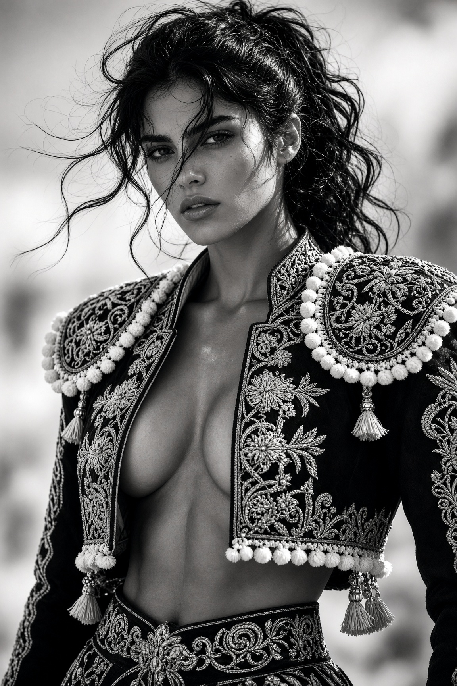

# 黑白斗牛士风时装大片：刺绣短夹克女性肖像（Midjourney 参数写法）

- 原帖链接：https://x.com/BubbaArtwork/status/2119889461571879014
- 作者：Bubba Digital Artwork（@BubbaArtwork）
- 时间：2026-11-10 04:26 (UTC+8 / Asia/Taipei)
- 互动摘要：点赞 38 · 转发 2 · 回复 3 · 引用 0 · 书签 21 · 浏览 1297（采集快照：2026-11-11 09:20 UTC+8）
- 模型/工具：未注明（prompt 末尾带 –ar 2:3 –stylize 250 –v 6，Midjourney 参数写法）
- 标签：真人
- 媒体路径：
  - `media/images/2119889461571879014_1.jpg`（）
- 入库日期：2026-11-11
- prompt 来源：https://x.com/BubbaArtwork/status/2119889461571879014
- 备注：prompt 即主帖正文「Detailed image generation prompt based on the attached photo:」之后部分，原样摘录；人物设定为 mid-20s 成年女性。

## prompt 原文

```text
Ultra-realistic black-and-white editorial fashion portrait of a striking young woman, mid-20s, sharp Mediterranean/Spanish features, intense direct gaze, full lips slightly parted, strong jawline, high cheekbones. Windblown dark wavy hair with loose strands across her face and forehead, messy high ponytail. Dramatic high-contrast monochrome lighting, strong side light carving facial structure, subtle rim light on hair and shoulders.
She wears an ornate traditional Spanish-style cropped bolero jacket / torera jacket, heavily embroidered with dense floral and geometric patterns, open at the front revealing deep cleavage and toned midriff. Jacket features large rounded shoulder pads covered in intricate embroidery, thick white pom-pom fringe trim along the edges and shoulders, decorative tassels, metallic-looking buttons and appliqué details. Jacket is cropped short, structured, dark fabric with high-contrast white embroidery. Matching ornate embroidered waistband / high-waisted bottoms partially visible. Skin has realistic texture, subtle sheen of light on collarbones and chest.
Pose: three-quarter body angle, shoulders squared toward camera, confident and slightly confrontational stance. Shot from slightly low angle, medium close-up framing from mid-torso up. Shallow depth of field, heavily blurred bright outdoor background (suggesting sunlit plaza or open field). Fine film grain, sharp focus on eyes and embroidery details, cinematic high-contrast black and white, 85mm lens look, fashion editorial style.
–ar 2:3 –stylize 250 –v 6
(Negative prompt: color, color cast, soft focus, blurry face, plastic skin, deformed hands, extra limbs, low detail, cartoon, anime, overexposed, washed out, modern clothing, zipper, hoodie, plain fabric)
```

---

个人学习归档，非商业。prompt 与媒体版权归原作者 @BubbaArtwork，引用请回到原帖。
