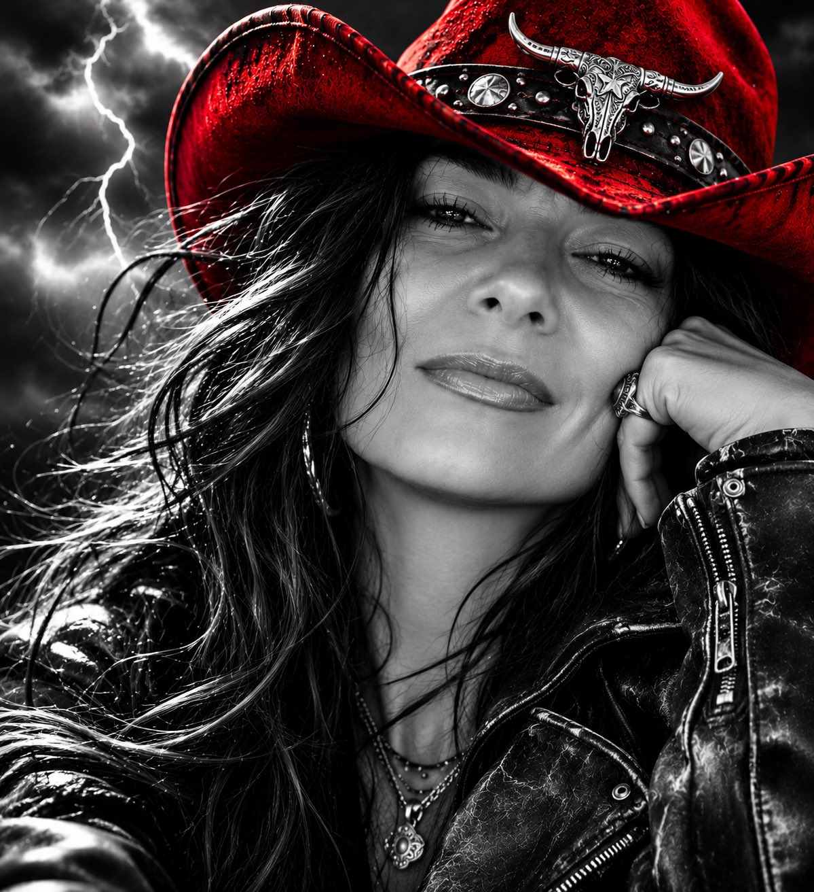

# 黑白电影感人像，唯一彩色是 AI 为你挑的帽子（上传照片模板）

- 原帖链接：https://x.com/KSJ_Kreative/status/2119923941623939392
- 作者：KSJ（@KSJ_Kreative）
- 时间：2026-11-10 06:43 (UTC+8 / Asia/Taipei)
- 互动摘要：点赞 50 · 转发 2 · 回复 17 · 引用 6 · 书签 5 · 浏览 1572（采集快照：2026-11-11 09:20 UTC+8）
- 模型/工具：未注明（通用图像模型，需上传本人照片）
- 标签：真人
- 媒体路径：
  - `media/images/2119923941623939392_1.jpg`（）
- 入库日期：2026-11-11
- prompt 来源：https://x.com/KSJ_Kreative/status/2119923941623939392
- 备注：prompt 即主帖正文「Prompt:」之后部分，原样摘录；需上传一张本人照片作身份参考。

## prompt 原文

```text
Use the uploaded photo as the exclusive identity reference. Preserve exact facial features and natural likeness.

Create a bold, ultra-realistic black-and-white cinematic portrait with a confident, slightly rebellious expression, captivating eyes, and a subtle smirk. One hand rests casually against the face. Add dramatic windswept hair, edgy clothing suited to the individual, intense shadows, and a stormy sky filled with lightning.

The ONLY color is a striking statement hat. AI must creatively choose the hat’s style, color, shape, and details based on each person’s unique appearance, personality, and vibe. From cowboy hats to fedoras and beyond, make every hat unexpected, distinctive, and unforgettable.

High-fashion editorial photography, powerful cinematic lighting, dramatic contrast, and realistic skin texture.

Universal for men and women. Preserve natural masculine or feminine features without altering identity. No distorted anatomy or exaggerated expressions.
```

---

个人学习归档，非商业。prompt 与媒体版权归原作者 @KSJ_Kreative，引用请回到原帖。
