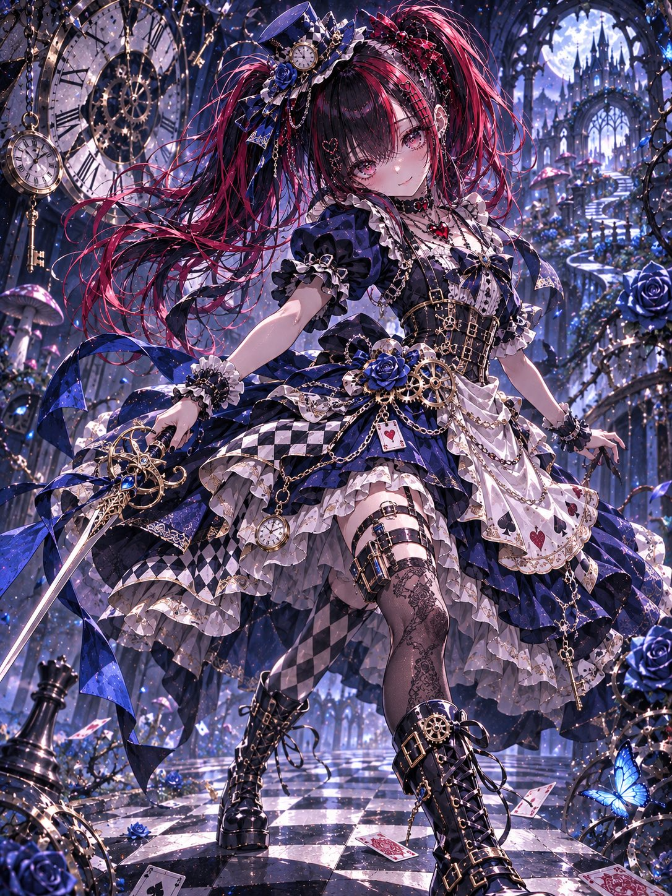
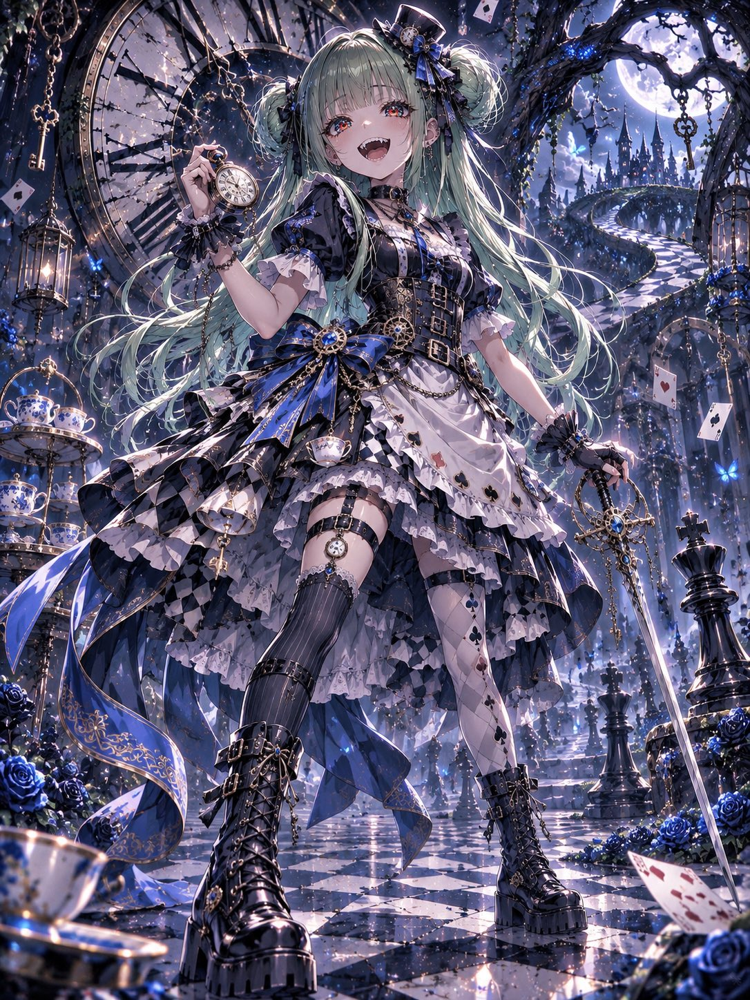
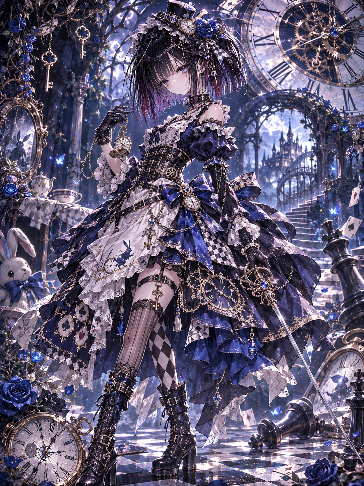
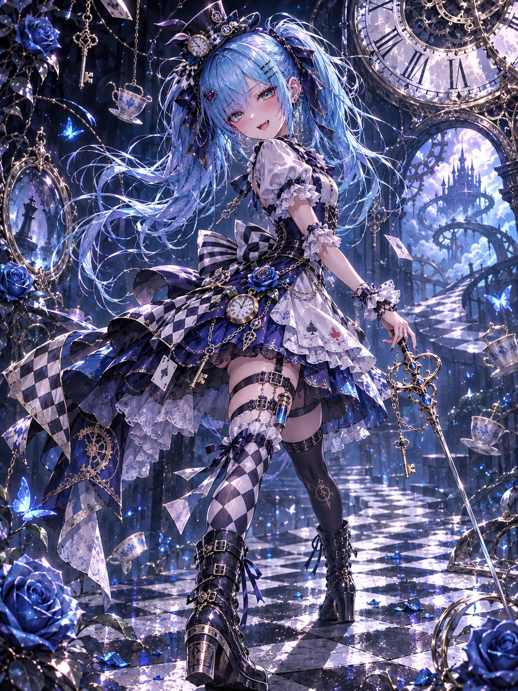

# 发条爱丽丝：破碎仙境的机械战斗女王（#るん衣装プロンプト 第268弾）

- 原帖链接：https://x.com/ENJU1123PIPI/status/2120109210692464968
- 作者：るんちゃん🦋（@ENJU1123PIPI）
- 时间：2026-11-10 19:00 (UTC+8 / Asia/Taipei)
- 互动摘要：点赞 94 · 转发 32 · 回复 6 · 引用 9 · 书签 17 · 浏览 3633（采集快照：2026-11-11 20:25 UTC+8）
- 模型/工具：未注明（角色参考图驱动的通用衣装 prompt）
- 标签：二次元
- 媒体路径：
  - `media/images/2120109210692464968_1.jpg`（）
  - `media/images/2120109210692464968_2.jpg`（）
  - `media/images/2120109210692464968_3.jpg`（）
  - `media/images/2120109210692464968_4.jpg`（）
- 入库日期：2026-11-11
- prompt 来源：https://x.com/ENJU1123PIPI/status/2120109211913011471
- 备注：prompt 在作者自回复（2120109211913011471），英文分 IDENTITY PRESERVATION / COSTUME DESIGN / POSE & COMPOSITION / ENVIRONMENT / MASTERPIECE ART DIRECTION 段，需附一张角色图，原样摘录。

## prompt 原文

```text
CLOCKWORK ALICE — QUEEN OF THE BROKEN WONDERLAND

Transform the attached character into a breathtaking dark fantasy Alice, blending iconic Wonderland elegance (60%) with sophisticated mechanical battle fashion (40%).

IDENTITY PRESERVATION

Use the attached character as the sole identity reference. Faithfully preserve their face, hairstyle, hair color, eye colors, body proportions, accessories, gender presentation, and distinctive personality. Maintain their original visual identity without redesigning their recognizable features.

COSTUME DESIGN

Create an exquisitely detailed Alice-inspired combat ensemble in royal blue, midnight navy, black, ivory white, and antique gold, accented with sapphire gemstones and polished silver.

Design a luxurious layered dress featuring a sculpted clockwork corset, delicate puffed sleeves, asymmetrical white apron panels, intricate lace, elaborate ruffles, embroidered card suits, checkerboard accents, and flowing ribbons.

Integrate miniature mechanical gears, engraved pocket watches, ornate keys, delicate chains, metallic filigree, sapphire ornaments, and mechanical roses directly into the garment’s construction.

Add elegant asymmetrical stockings, decorative thigh straps, tailored lace-up battle boots, and a distinctive clockwork hair accessory that complements the original hairstyle.

Every accessory must feel purposefully designed, with believable materials, precise craftsmanship, and harmonious visual layering.

Adapt the silhouette appropriately for masculine characters while retaining the same Wonderland-inspired design language.

POSE & COMPOSITION

Create a striking full-body cinematic composition with an expressive, natural pose and sophisticated perspective.

The character moves confidently through Wonderland, holding an ornate clock-hand rapier or antique pocket watch.

Flowing fabric, ribbons, and hair respond naturally to movement. Emphasize elegant body language, dynamic silhouettes, balanced anatomy, and a captivating expression.

Avoid exaggerated foreshortening or reaching toward the viewer.

ENVIRONMENT

An extraordinary dark clockwork Wonderland filled with colossal floating clocks, suspended golden keys, shattered timepieces, twisted rose gardens, enormous chess pieces, impossible staircases, and mysterious gothic architecture.

A luminous moon illuminates distant fantasy towers while sapphire butterflies, drifting playing cards, and delicate magical particles float through the atmosphere.

Create exceptional environmental depth with layered foreground elements, atmospheric perspective, and a richly detailed background that complements the character without overwhelming them.

MASTERPIECE ART DIRECTION

Premium Japanese anime illustration, exceptionally beautiful facial rendering, expressive line-weight variation, razor-sharp outer contours, delicate interior linework, sophisticated multi-layer cel shading, and subtle painterly transitions.

Extraordinary stained-glass irises with crystalline reflections, luminous color refractions, intricate radial patterns, and brilliant dimensional catchlights.

Meticulously rendered individual hair strands, silky highlights, translucent lace, velvet fabric, polished leather, engraved metals, realistic gemstone refraction, and intricate costume embroidery.

Dramatic cinematic lighting with cool sapphire moonlight, warm golden rim illumination, deep ambient shadows, controlled bloom, delicate reflected light, and rich tonal separation.

Exceptional color harmony, dimensional depth, highly refined textures, crisp focal details, stunning visual storytelling, and professional illustration finish.

Vertical 3:4 composition, ultra-detailed 8K aesthetic, one character only, no text, no watermark, no additional characters, no anatomical distortions, no extra fingers, no malformed hands, no excessive exposure.
```

---

个人学习归档，非商业。prompt 与媒体版权归原作者 @ENJU1123PIPI，引用请回到原帖。
