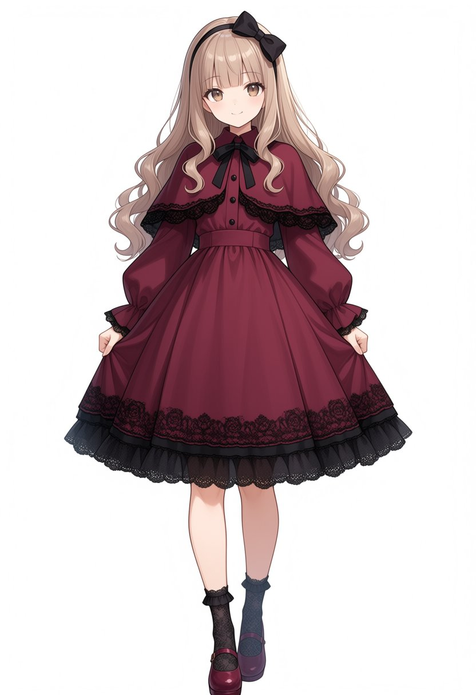
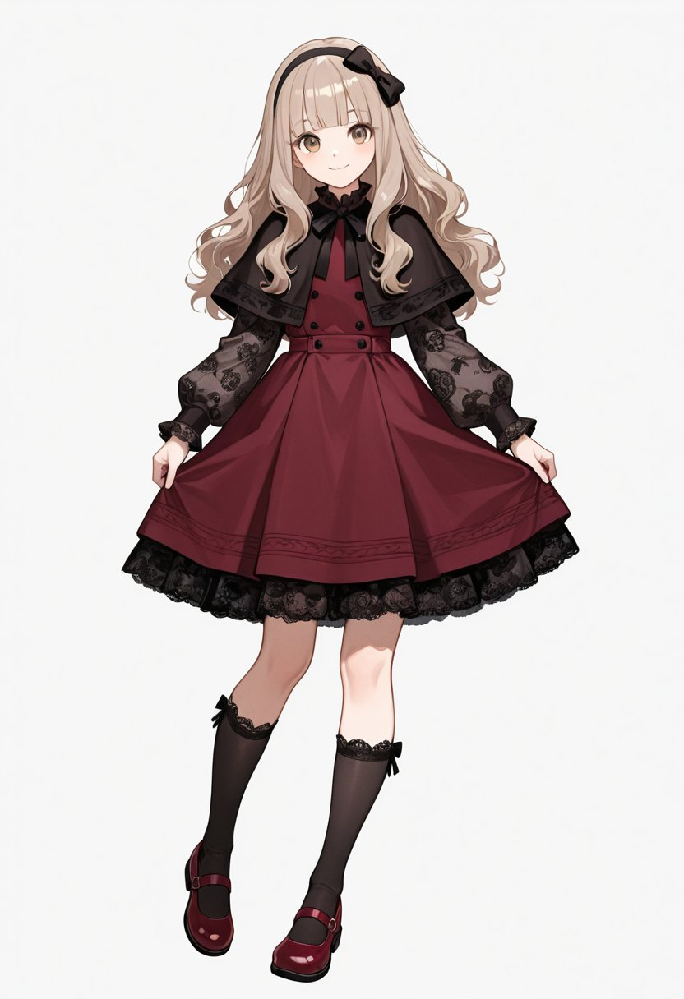

# 酒红丝绒连衣裙 + 黑蕾丝披肩 + 玛丽珍鞋：衣装标签 prompt（#双人プロンプト）

- 原帖链接：https://x.com/inmnftrai/status/2120113960066404666
- 作者：稲嶺双人@AIイラスト（@inmnftrai）
- 时间：2026-11-10 19:18 (UTC+8 / Asia/Taipei)
- 互动摘要：点赞 24 · 转发 1 · 回复 1 · 引用 0 · 书签 1 · 浏览 197（采集快照：2026-11-11 09:20 UTC+8）
- 模型/工具：未注明（标签式 prompt，适合 SD 系 / NovelAI 类）
- 标签：二次元
- 媒体路径：
  - `media/images/2120113960066404666_1.jpg`（）
  - `media/images/2120113960066404666_2.jpg`（）
  - `media/images/2120113960066404666_3.jpg`（）
  - `media/images/2120113960066404666_4.jpg`（）
- 入库日期：2026-11-11
- prompt 来源：https://x.com/inmnftrai/status/2120113962897527052
- 备注：prompt 在作者自回复（2120113962897527052），为逗号分隔的衣装标签，原样摘录。

## prompt 原文

```text
black headband with bow, burgundy velour dress, long sleeves, puffy sleeves, black lace sleeve hem, black lace skirt hem, burgundy velour capelet, black lace capelet hem, black neck ribbon, black lace socks, burgundy mary janes
```

---

个人学习归档，非商业。prompt 与媒体版权归原作者 @inmnftrai，引用请回到原帖。
