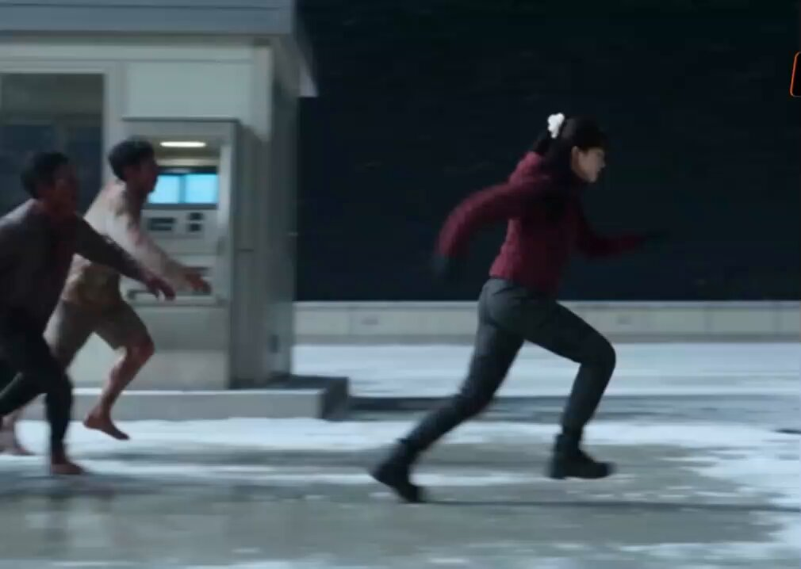
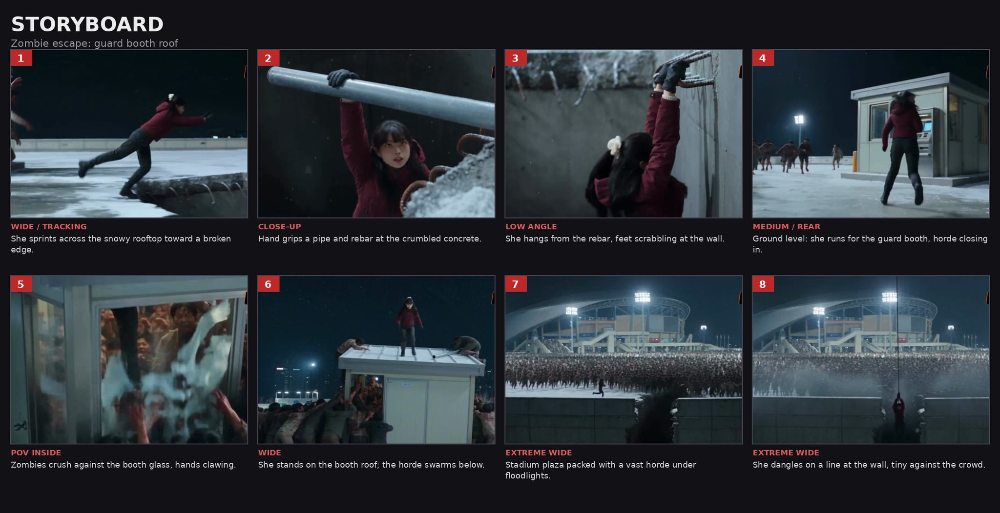

# 雪夜屋顶逃亡：丧尸潮惊悚短片的 8 格分镜表 prompt

- 原帖链接：https://x.com/sophiawithai/status/2120157608044646881
- 作者：Sophia（@sophiawithai）
- 时间：2026-11-10 22:12 (UTC+8 / Asia/Taipei)
- 互动摘要：点赞 47 · 转发 4 · 回复 6 · 引用 0 · 书签 15 · 浏览 127893（采集快照：2026-11-11 20:25 UTC+8）
- 模型/工具：Seedance 2.5（视频）；分镜表图像生成模型未注明
- 标签：真人
- 媒体路径：
  - `media/video-stills/2120157608044646881_still.jpg`（视频封面截图，）
  - `media/images/2120157608044646881_reply1.jpg`（作者自回复中的分镜表图，）
  - 视频本体未入库，仅保留原帖链接：https://x.com/sophiawithai/status/2120157608044646881
- 入库日期：2026-11-11
- prompt 来源：https://x.com/sophiawithai/status/2120157759379313097
- 备注：作者自回复（2120157759379313097）给出的是一张 8 格电影分镜表（storyboard sheet）的生成 prompt，并附分镜图；视频由 Seedance 2.5 生成。原样摘录。视频仅保留原帖链接；分镜图另存 `media/images/`。

## prompt 原文

```text
A professional cinematic storyboard sheet, 4 columns by 2 rows, 8 frames with thin dark borders on a dark charcoal background, numbered red tabs in each frame's top-left corner, a short shot label and caption under each frame. Title "STORYBOARD" at top. Consistent character in every frame: a young Korean woman with a black ponytail, wearing a maroon puffer jacket, dark pants and boots. Night, snow, cold blue-teal lighting, gritty realistic zombie-thriller look.

1. Wide tracking shot: she sprints across a snowy rooftop toward a broken concrete edge.
2. Close-up: her gloved hand grips a metal pipe and exposed rebar at the crumbled edge.
3. Low angle: she hangs from the rebar against a concrete wall, feet scrabbling.
4. Medium rear shot: she runs toward a small guard booth with an ATM, a horde chasing from the background under a floodlight.
5. Inside the booth: zombies press against the glass, hands clawing, faces smeared on the window.
6. Wide shot: she stands on the booth roof while zombies swarm and climb up below.
7. Extreme wide: a stadium plaza packed with thousands of zombies under floodlights.
8. Extreme wide: she is a tiny figure hanging from a line on a wall in front of the vast horde.
```

---

个人学习归档，非商业。prompt 与媒体版权归原作者 @sophiawithai，引用请回到原帖。
