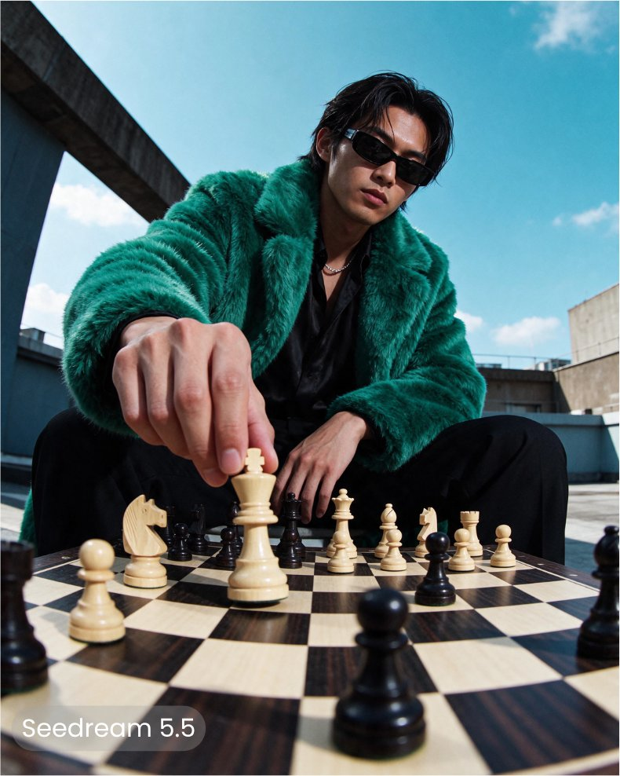
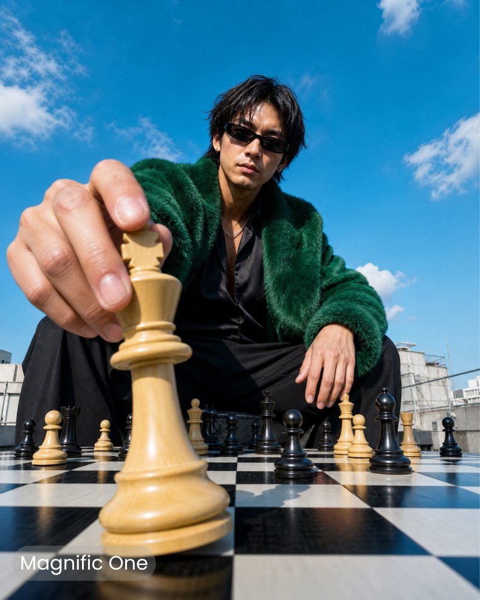
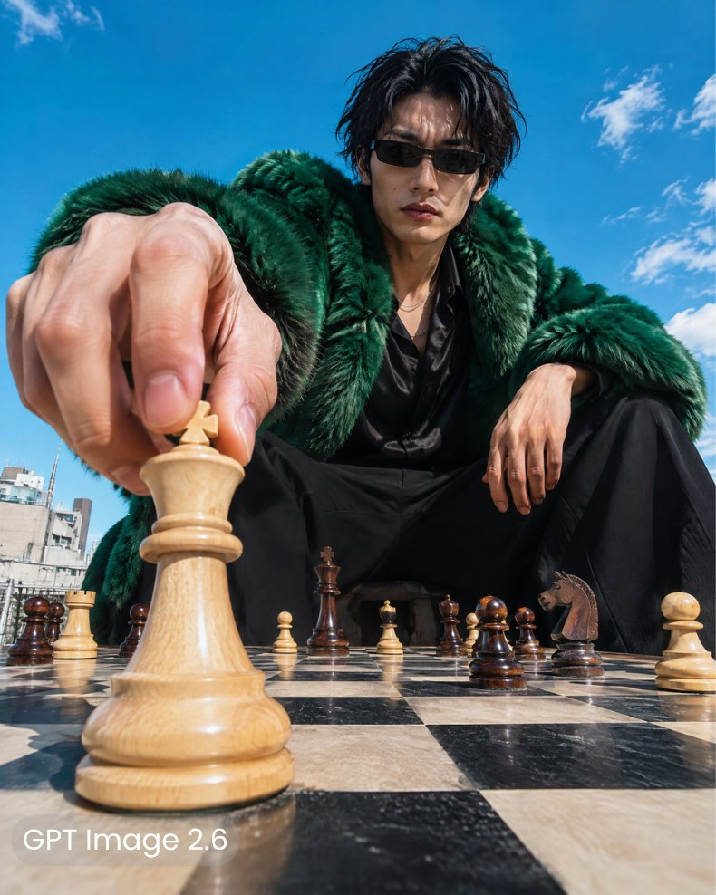
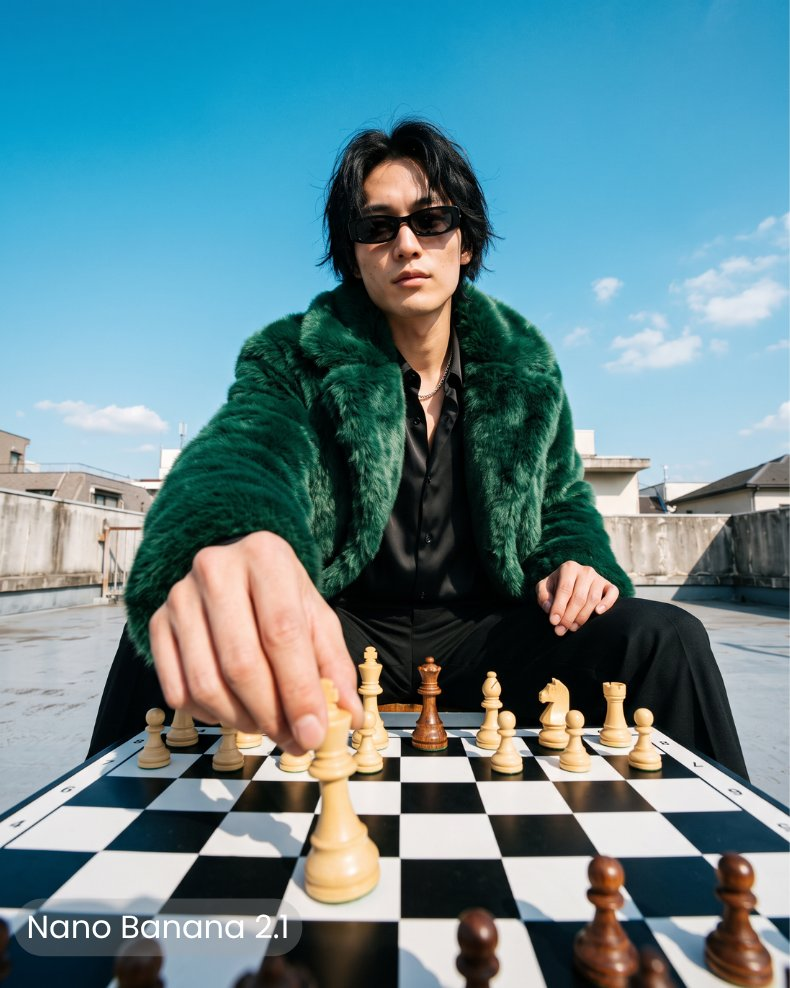

# 屋顶下棋的翡翠绿毛草大衣男：棋盘贴地超广角时尚大片（四模型同 prompt 对比）

- 原帖链接：https://x.com/MayorKingAI/status/2120198834508955990
- 作者：MayorkingAI（@MayorKingAI）
- 时间：2026-11-11 00:56 (UTC+8 / Asia/Taipei)
- 互动摘要：点赞 74 · 转发 2 · 回复 32 · 引用 2 · 书签 42 · 浏览 8154（采集快照：2026-11-11 20:25 UTC+8）
- 模型/工具：Seedream 5.5 / Magnific One / GPT Image 2.6 / Nano Banana 2.1（作者在 Magnific 内测试，四图依次对应）
- 标签：真人
- 媒体路径：
  - `media/images/2120198834508955990_1.jpg`（）
  - `media/images/2120198834508955990_2.jpg`（）
  - `media/images/2120198834508955990_3.jpg`（）
  - `media/images/2120198834508955990_4.jpg`（）
- 入库日期：2026-11-11
- prompt 来源：https://x.com/MayorKingAI/status/2120198847343493496
- 备注：prompt 在作者自回复（2120198847343493496）「Prompt:」之后，原样摘录（含首句说明「I tested all four models directly in @magnific」一并保留）。四张图分别为 Seedream 5.5、Magnific One、GPT Image 2.6、Nano Banana 2.1 的结果。

## prompt 原文

```text
I tested all four models directly in @magnific

Prompt: An ultra-realistic high-fashion editorial photograph of a striking 28-year-old Japanese man with sharp facial features, a defined jawline, slightly messy medium-length black hair and narrow rectangular black sunglasses, sitting confidently on a rooftop terrace while playing chess.

He wears an oversized luxurious emerald-green faux-fur coat over a black silk shirt, tailored black trousers and a subtle silver chain necklace. His expression is calm, confident and slightly intimidating, looking directly toward the camera.

Camera composition: An extreme low-angle shot taken from the very edge of a chessboard, with the camera positioned only a few centimeters above the board's surface. The black-and-white chessboard dominates the entire bottom third of the frame, its squares appearing exceptionally large in the foreground and rapidly shrinking toward the seated man.

The man is centered in the composition, visible from approximately the knees upward, leaning slightly forward. His right arm extends directly toward the camera, with his hand dramatically enlarged by perspective. He is gripping the top of a polished ivory wooden king chess piece between his thumb and index finger, moving it toward an empty square near the camera. The king is dramatically oversized in the immediate foreground due to the wide-angle perspective, while the remaining chess pieces appear progressively smaller toward the background.

His other hand rests naturally near his knee. The chess pieces are physically accurate and positioned naturally on the board, with realistic contact shadows and detailed polished wooden surfaces.

Environment: An open urban rooftop with subtle concrete architectural details, low surrounding rooftops and an enormous vivid cyan-blue sky with a few soft, scattered white clouds. The bright sky occupies the upper half of the composition, creating strong visual contrast against the emerald-green coat.

Photography: Shot on a Sony A1 II with a 20mm wide-angle lens, camera placed at chessboard level, f/8, ISO 100, 1/1000s. Deep environmental perspective, exaggerated foreground scale, realistic optical distortion, crisp textures across the chessboard and subject. Bright natural midday sunlight, accurate skin tones, natural facial asymmetry, individual hair strands, detailed fabric and fur fibers, subtle imperfections and physically realistic shadows.

Authentic luxury fashion campaign photography, bold editorial framing, natural photographic color grading, exceptionally realistic skin texture, no artificial skin smoothing, no CGI appearance, no illustration, no plastic textures, no excessive cinematic effects.
```

---

个人学习归档，非商业。prompt 与媒体版权归原作者 @MayorKingAI，引用请回到原帖。
