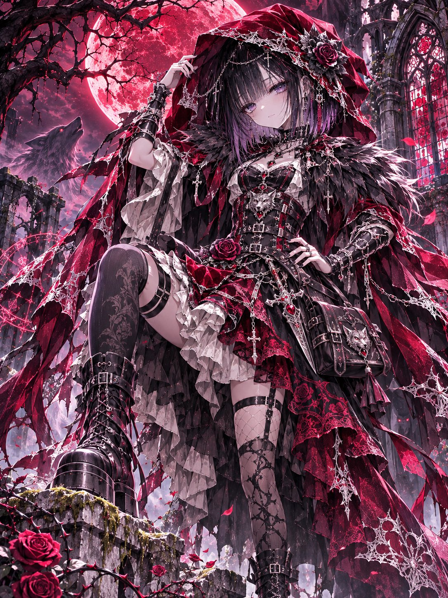
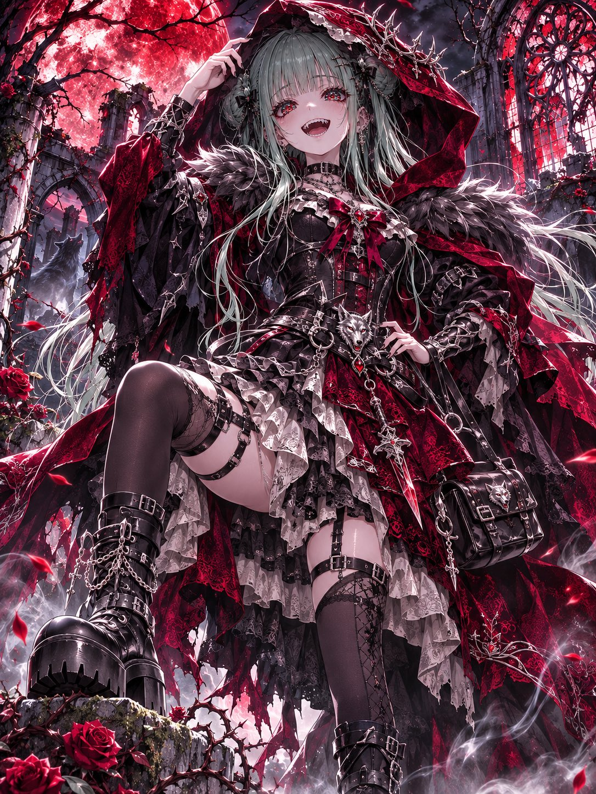
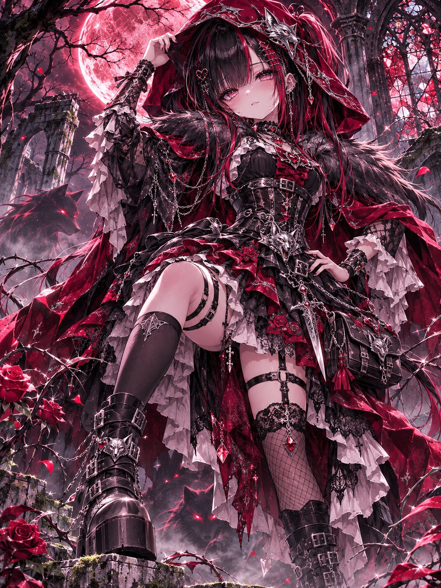
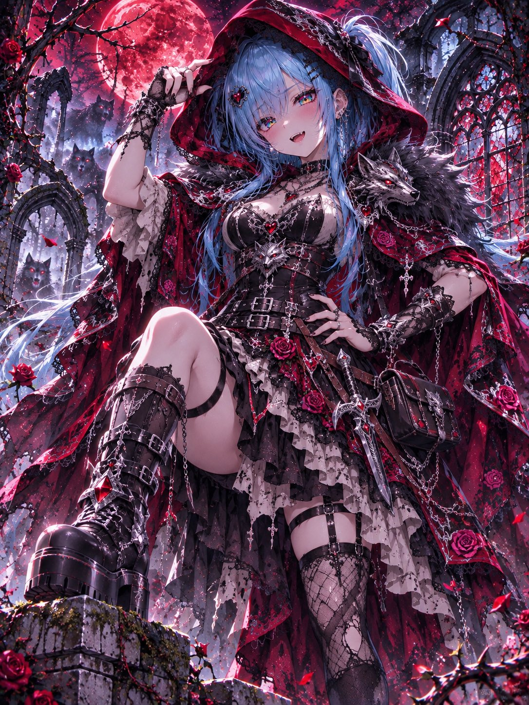

# 堕落小红帽 × 哥特狼之女王：换装 prompt（#るん衣装プロンプト 第269弹）

- 原帖链接：https://x.com/ENJU1123PIPI/status/2120282854898749655
- 作者：るんちゃん🦋（@ENJU1123PIPI）
- 时间：2026-11-11 06:30 (UTC+8 / Asia/Taipei)
- 互动摘要：点赞 41 · 转发 8 · 回复 2 · 引用 2 · 书签 2 · 浏览 724（采集快照：2026-11-11 09:20 UTC+8）
- 模型/工具：未注明（参考角色图驱动的通用图像模型 prompt）
- 标签：二次元
- 媒体路径：
  - `media/images/2120282854898749655_1.jpg`（）
  - `media/images/2120282854898749655_2.jpg`（）
  - `media/images/2120282854898749655_3.jpg`（）
  - `media/images/2120282854898749655_4.jpg`（）
- 入库日期：2026-11-11
- prompt 来源：https://x.com/ENJU1123PIPI/status/2120282856597397727
- 备注：prompt 在作者自回复（2120282856597397727），英文分 CONCEPT / OUTFIT / POSE & COMPOSITION / BACKGROUND / ART STYLE & QUALITY 段，需附一张角色图，原样摘录。

## prompt 原文

```text
FALLEN RED RIDING HOOD — QUEEN OF WOLVES

Little Red Riding Hood × Dark Corruption × Gothic Wolf Queen

Use the attached character as the absolute identity reference. Preserve the original face, hairstyle, hair color, eye color, body proportions, accessories, and personality. Redesign only the outfit while maintaining the character’s recognizable identity.

CONCEPT

Transform the character into a beautiful, mysterious Wolf Queen who rules the cursed enchanted forest.

Design balance: 60% Red Riding Hood × 40% Dark Wolf Queen.

Color palette: Deep crimson, jet black, charcoal, antique silver, and ruby red.

OUTFIT

An oversized crimson hood with black velvet lining, torn gothic edges, and intricate silver embroidery.

A luxurious gothic-lolita battle dress featuring a fitted black leather corset, silver wolf emblems, engraved thorn patterns, and an asymmetric layered skirt of crimson velvet, black lace, and ivory ruffles.

Black wolf-fur collar, elegant lace sleeves, metallic buckles, silver chains, wolf-fang jewelry, dark roses, ruby heart ornaments, and decorative leather harnesses.

Asymmetric patterned stockings, an ornamental thigh strap, heavy gothic platform boots, and a small antique leather satchel.

Integrate subtle glowing crimson runes, shadowy claw motifs, enchanted thorns, and corrupted rose patterns.

Optional weapon: An elegant silver dagger or crimson wolf-claw sword.

Keep the iconic Red Riding Hood silhouette rather than generic heavy armor.

POSE & COMPOSITION

Dramatic low three-quarter camera angle with strong cinematic perspective.

The character stands confidently on ancient moss-covered ruins, one boot resting on a broken stone.

One hand gently adjusts the crimson hood while the other rests on the waist. The cape flows dramatically in the wind.

Expression: Fearless, slightly smug, mysteriously beautiful, and irresistibly cute, with captivating direct eye contact.

BACKGROUND

A cursed fairy-tale forest beneath an enormous blood-red moon.

Twisted black trees, thorn-covered cathedral ruins, shattered stained-glass windows, glowing crimson roses, drifting petals, silver mist, and mysterious red-eyed spectral wolves.

Dark magical particles swirl around the character, creating a majestic, haunting atmosphere.

ART STYLE & QUALITY

Masterpiece anime illustration, delicate yet sharp expressive linework, refined facial anatomy, rich dimensional cel shading, extraordinary multilayered glass irises with intricate reflections and brilliant catchlights.

Highly detailed hair strands, luxurious velvet and leather textures, intricate silver ornaments, cinematic crimson moonlight, dramatic highlights and shadows, dynamic fabric movement, exceptional gothic craftsmanship.

Vertical 3:4 composition, ultra-detailed, 8K quality.

One character only. No text, logos, watermarks, extra limbs, malformed hands, distorted anatomy, excessive exposure, or gore.
```

---

个人学习归档，非商业。prompt 与媒体版权归原作者 @ENJU1123PIPI，引用请回到原帖。
