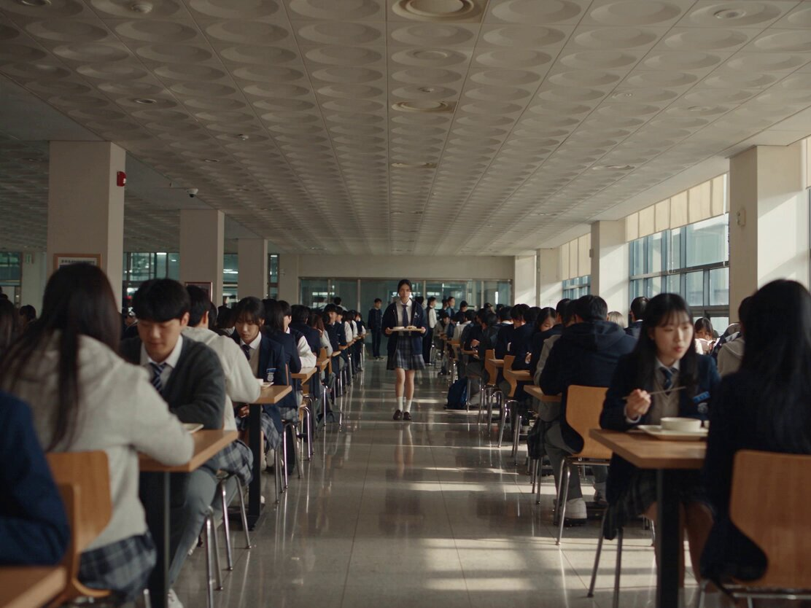

# 灯笼河畔的猫之灵：30 秒日式催泪奇幻短片（分时段脚本）

- 原帖链接：https://x.com/KrishnaBio1/status/2120331928264188026
- 作者：KrishnaG（@KrishnaBio1）
- 时间：2026-11-11 09:45 (UTC+8 / Asia/Taipei)
- 互动摘要：点赞 54 · 转发 13 · 回复 35 · 引用 0 · 书签 4 · 浏览 901（采集快照：2026-11-11 20:25 UTC+8）
- 模型/工具：Seedance 2.5（视频）
- 标签：真人
- 媒体路径：
  - `media/video-stills/2120331928264188026_still.jpg`（视频封面截图，）
  - 视频本体未入库，仅保留原帖链接：https://x.com/KrishnaBio1/status/2120331928264188026
- 入库日期：2026-11-11
- prompt 来源：https://x.com/KrishnaBio1/status/2120331929283449161
- 备注：prompt 在作者自回复（2120331929283449161），按 0–30s 分时段脚本 + AUDIO / STYLE，原样摘录（末尾 t.co 链接一并保留）。视频仅保留原帖链接。

## prompt 原文

```text
Cinematic ultra-realistic emotional fantasy drama short film, 16:9, 30 seconds, 24fps, shot like a high-budget Japanese feature film, the present-day apartment scenes in soft cold blue light with rain on the windows, the memory scenes in warm golden light, a magical riverside at night filled with floating paper lanterns and fireflies, a glowing soft white-gold spirit cat, shallow depth of field, crisp detail, subtle film grain, slow gentle camera movement, deeply moving and tender mood.
👩 HEROINE: A young Japanese woman in her late 20s, shoulder-length black hair with soft bangs, gentle tired eyes, wearing a cream knit sweater, a long grey skirt and a light beige coat in the present, and a cozy white cardigan in the memory scenes. Keep her face and outfit identical in every shot.
🐱 CAT: A small, fluffy ginger-and-white cat with big round amber eyes, a white chest and a curled tail. In the present she appears as a glowing spirit, a soft luminous gold-white outline made of floating light particles. In the memories she is a warm, playful real kitten.
🏠 0–4s: A quiet apartment at night, rain tapping on the window. The heroine opens the door, steps inside and looks at an empty cat bed beside the window. She says softly: "I'm home."
✨ 4–8s: She sits on the floor beside the bed, hugging her knees. A faint golden glow appears on the cushion, and the spirit cat slowly forms from drifting light, blinks, and gives a tiny soft meow.
🌅 8–13s: Warm golden flashbacks: the kitten jumps onto her lap while she reads by the window, then chases a pink ribbon across the wooden floor, then falls asleep on her shoulder in a patch of afternoon sunlight as she smiles.
💧 13–18s: Back to the present, close-up. The glowing cat touches her nose to the heroine's nose and wraps her tail around her wrist. The heroine closes her eyes, tears falling, a trembling smile on her face. She whispers: "I missed you so much."
🏮 18–24s: The spirit cat hops down and walks to the door, looking back as if asking her to follow. The scene dissolves to a quiet riverside at night. Hundreds of glowing paper lanterns float on the water and rise gently into the sky, fireflies drifting around them. The glowing cat trots ahead along a path of golden light, and the heroine follows slowly, wonder on her face.
🌉 24–28s: On a small wooden bridge, the heroine kneels and the cat leaps into her arms. She hugs her tightly while lantern light reflects in her tears. She says: "Thank you for choosing me, every single day." The cat nuzzles her cheek and purrs.
🌌 28–30s: The cat's body softly dissolves into golden particles that rise upward and join the floating lanterns in the night sky. The heroine watches them go, then smiles through her tears. Slow pull-back to a wide shot of the lantern-filled river and the lone figure on the bridge. Fade out.
🎧 AUDIO: Soft rain fading into gentle river water, a quiet cat purr and meow, a slow heartbeat, a delicate piano-and-strings score that swells gently with the lanterns, quiet sobs, clear natural English dialogue.
🎬 STYLE: Realistic emotional fantasy drama, restrained heartfelt performances, cool-blue and warm-gold color contrast, wholesome and non-graphic, consistent faces, no text, no subtitles, no logos, no watermark.

https://t.co/fzSNtrloN0
```

---

个人学习归档，非商业。prompt 与媒体版权归原作者 @KrishnaBio1，引用请回到原帖。
