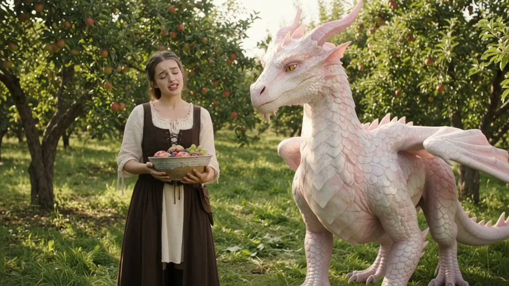

# 魔法花园里的少女与白色幼龙：喂水果的 10 秒奇幻短片

- 原帖链接：https://x.com/Arzoo12sh/status/2120341378316304453
- 作者：Arzoo Ai（@Arzoo12sh）
- 时间：2026-11-11 10:22 (UTC+8 / Asia/Taipei)
- 互动摘要：点赞 98 · 转发 29 · 回复 35 · 引用 0 · 书签 15 · 浏览 1416（采集快照：2026-11-11 20:25 UTC+8）
- 模型/工具：Seedance 2.5（视频）
- 标签：真人
- 媒体路径：
  - `media/video-stills/2120341378316304453_still.jpg`（视频封面截图，）
  - 视频本体未入库，仅保留原帖链接：https://x.com/Arzoo12sh/status/2120341378316304453
- 入库日期：2026-11-11
- prompt 来源：https://x.com/Arzoo12sh/status/2120341386751025153
- 备注：prompt 在作者自回复（2120341386751025153），原样摘录。视频仅保留原帖链接。

## prompt 原文

```text
A beautiful young woman wearing a traditional medieval-inspired dress stands in a magical enchanted garden beside a majestic baby white dragon. She gently holds a basket filled with colorful fresh fruits and offers them to the adorable dragon. The dragon slowly approaches, curiously sniffs the fruit, and interacts affectionately with her. The woman smiles, gently touches the dragon's head, and enjoys a magical moment together. Lush green trees, blooming flowers, soft golden sunlight, cinematic fantasy atmosphere, ultra-realistic dragon scales, detailed facial expressions, natural body movements, smooth cinematic camera movements, shallow depth of field, photorealistic 4K quality, stunning fantasy realism, no text, no watermark. 10-second cinematic video, 16:9 aspect ratio.
```

---

个人学习归档，非商业。prompt 与媒体版权归原作者 @Arzoo12sh，引用请回到原帖。
