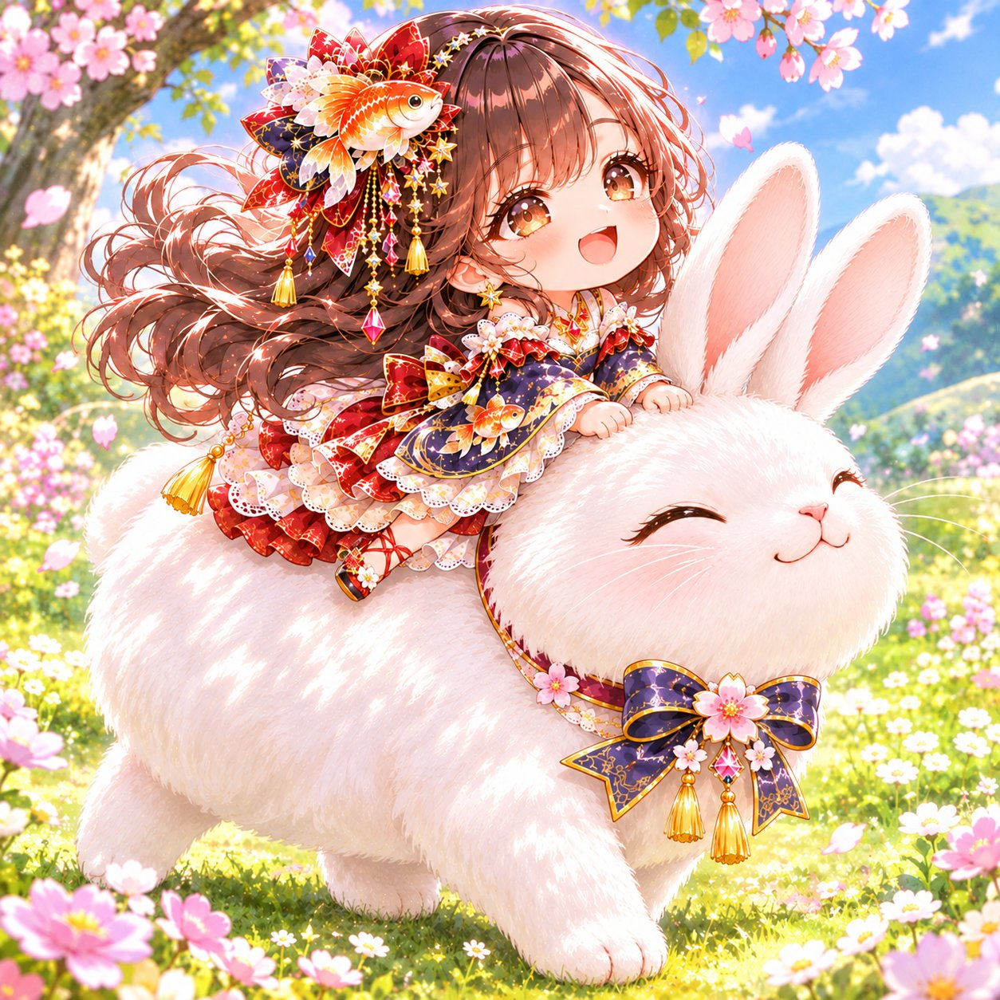
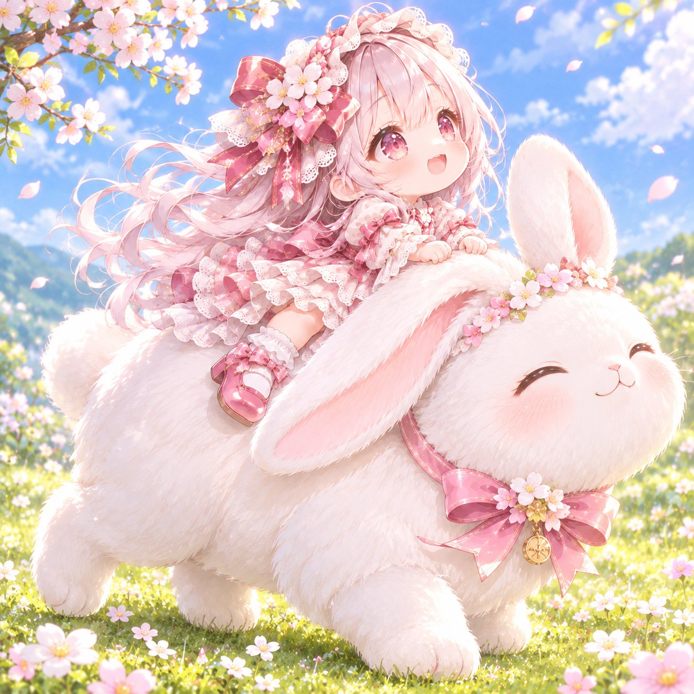

# 骑白兔散步：二头身 Q 版推し坐在大白兔背上（#ゆきプロンプト）

- 原帖链接：https://x.com/AIXyu1v/status/2120411224882192837
- 作者：ゆき　AIイラストXで収益化（@AIXyu1v）
- 时间：2026-11-11 15:00 (UTC+8 / Asia/Taipei)
- 互动摘要：点赞 53 · 转发 8 · 回复 2 · 引用 9 · 书签 14 · 浏览 1667（采集快照：2026-11-11 20:25 UTC+8）
- 模型/工具：未注明（参考图驱动的通用图像模型 prompt）
- 标签：二次元
- 媒体路径：
  - `media/images/2120411224882192837_1.jpg`（）
  - `media/images/2120411224882192837_2.jpg`（）
- 入库日期：2026-11-11
- prompt 来源：https://x.com/AIXyu1v/status/2120411226849321280
- 备注：prompt 在作者自回复（2120411226849321280），日文分【シーン】【可愛さのポイント】【構図・背景】【仕上がり】【禁止事項】段，需附一张角色图，原样摘录。

## prompt 原文

```text
【プロンプト】
# うさぎの背中でおさんぽ 🐰🌸

添付画像のキャラクターを、**二頭身の可愛いミニキャラ**にして描いてください。

髪型・髪色・瞳の色・衣装・アクセサリーなど、元キャラの特徴を忠実に再現してください。

【シーン】
春の暖かな日差しが降り注ぐ、花いっぱいの草原。

大きくてふわふわの白いうさぎが、のんびりお散歩しています。

ミニキャラはうさぎの背中にちょこんと座り、柔らかな毛並みに小さな両手でしがみつきながら、楽しそうに微笑んでいます。

うさぎは穏やかな表情でゆっくり歩き、長い耳が優しく揺れています。

【可愛さのポイント】
・ミニキャラの数倍も大きな白いうさぎ
・ふわふわの背中にちょこんと座る姿
・小さな手で毛並みをぎゅっと掴む仕草
・風になびく髪と揺れるうさぎの耳
・一緒にお出かけする幸せな雰囲気

【構図・背景】
うさぎ1匹とミニキャラ1人を画面中央に大きく配置。

少し斜め前からの構図で、うさぎの全身とミニキャラの表情がよく見えるようにしてください。

背景は小さな花が咲く緑の草原。淡い青空、柔らかな雲、優しい木漏れ日。

【仕上がり】
高品質な癒し系アニメイラスト。丸みのある二頭身、繊細でふわふわの毛並み、柔らかな光、淡いパステルカラー、絵本のような温かな世界観。

【禁止事項】
元キャラの特徴変更、人物やうさぎの追加、うさぎの耳や足の増殖、ミニキャラが宙に浮く、不自然な騎乗姿勢、身体の融合、余分な手足、怖い表情、複雑な背景、文字、ロゴ、透かし。
```

---

个人学习归档，非商业。prompt 与媒体版权归原作者 @AIXyu1v，引用请回到原帖。
