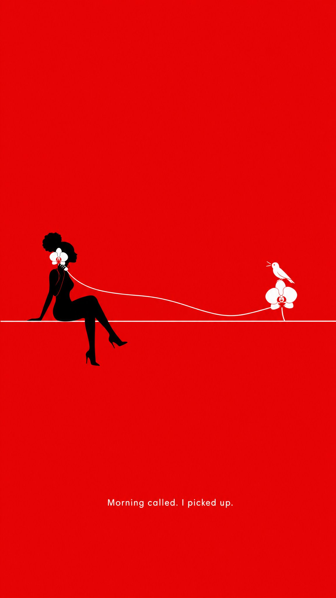

# 「Morning called. I picked up.」：猩红底极简漫画海报（prompt 在 ALT）

- 原帖链接：https://x.com/abulu8/status/2120418134998081565
- 作者：Syed Abuthahir ∞（@abulu8）
- 时间：2026-11-11 15:27 (UTC+8 / Asia/Taipei)
- 互动摘要：点赞 49 · 转发 3 · 回复 33 · 引用 0 · 书签 1 · 浏览 434（采集快照：2026-11-11 20:25 UTC+8）
- 模型/工具：未注明
- 标签：其它
- 媒体路径：
  - `media/images/2120418134998081565_1.jpg`（）
- 入库日期：2026-11-11
- prompt 来源：https://x.com/abulu8/status/2120418134998081565
- 备注：prompt 在图片 ALT 文本中（作者主帖写「Prompt in ALT」），原样摘录。

## prompt 原文

```text
Ultra-minimal comic poster, flat scarlet background, a tiny black adult woman silhouette sitting with legs crossed on a thin white line, holding a white orchid like a telephone receiver to her ear, a thin white stem-cord stretching to another bloom where a tiny white bird talks back, vast negative space, small clean white sans-serif text 'Morning called. I picked up.' near the bottom, white, black and red, cheeky and charming, flat vector, exact text.
```

---

个人学习归档，非商业。prompt 与媒体版权归原作者 @abulu8，引用请回到原帖。
