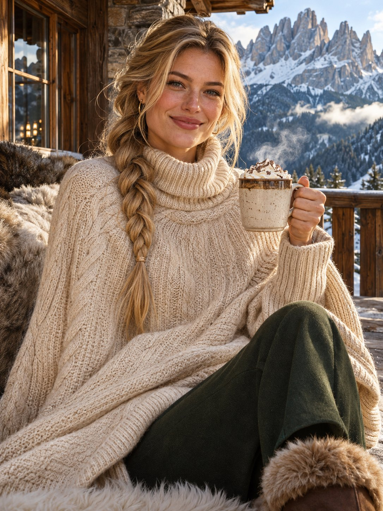

# 多洛米蒂山庄露台：奶油羊绒斗篷毛衣 + 热可可的晨间人像（含 Negative Prompt）

- 原帖链接：https://x.com/antrospike/status/2120418751606870252
- 作者：Antrospike（@antrospike）
- 时间：2026-11-11 15:30 (UTC+8 / Asia/Taipei)
- 互动摘要：点赞 34 · 转发 4 · 回复 20 · 引用 1 · 书签 2 · 浏览 768（采集快照：2026-11-11 20:25 UTC+8）
- 模型/工具：未注明
- 标签：真人
- 媒体路径：
  - `media/images/2120418751606870252_1.jpg`（）
- 入库日期：2026-11-11
- prompt 来源：https://x.com/antrospike/status/2120418752240222320
- 备注：prompt 在作者自回复（2120418752240222320），分 Style / Main Prompt / Negative Prompt 三行，原样摘录。

## prompt 原文

```text
Style: Ultra-realistic luxury alpine lifestyle portrait, warm morning light, 50mm lens, rich knit textures.
Main Prompt: Create an image of a model with blonde hair in a thick low side braid, wearing a cream cashmere long cape-sweater, tailored dark green trousers and fur-lined boots, sitting on a terrace of a luxury Dolomites chalet with jagged peaks behind her and a steaming cup of cocoa in her hand. Warm elegant smile. Waist-up. Vertical portrait format 3:4.
Negative Prompt: no text, no watermark, no extra fingers, no crowds, no logos.
```

---

个人学习归档，非商业。prompt 与媒体版权归原作者 @antrospike，引用请回到原帖。
