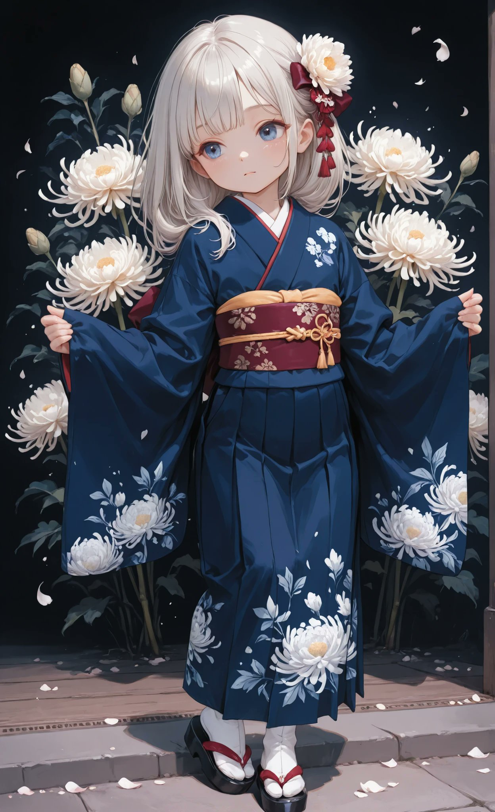
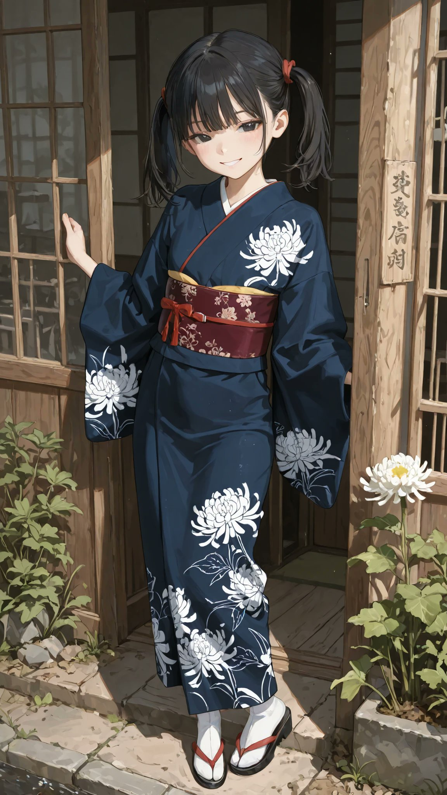

# 藏青底白菊纹和服 + 酒红太鼓结腰带（衣装 prompt）

- 原帖链接：https://x.com/AliceLavli/status/2120471609882345723
- 作者：アリス服飾店（@AliceLavli）
- 时间：2026-11-11 19:00 (UTC+8 / Asia/Taipei)
- 互动摘要：点赞 66 · 转发 8 · 回复 1 · 引用 1 · 书签 17 · 浏览 690（采集快照：2026-11-11 20:25 UTC+8）
- 模型/工具：未注明（通用；作者写可用于 SD / SeaArt / PixAI / ChatGPT / Gemini / Grok / Midjourney / niji）
- 标签：二次元
- 媒体路径：
  - `media/images/2120471609882345723_1.jpg`（）
  - `media/images/2120471609882345723_2.jpg`（）
  - `media/images/2120471609882345723_3.jpg`（）
  - `media/images/2120471609882345723_4.jpg`（）
- 入库日期：2026-11-11
- prompt 来源：https://x.com/AliceLavli/status/2120471609882345723
- 备注：prompt 即主帖正文第三段（英文衣装描述），原样摘录；前两段日文为介绍语。

## prompt 原文

```text
navy blue kimono with white chrysanthemum prints, navy blue fabric across entire kimono bodice and both sleeves, navy blue overlapping front panels and navy blue ankle length skirt, matching navy blue kimono collar, white chrysanthemum blossoms printed directly on navy blue kimono fabric, layered white chrysanthemum petals arranged in scattered floral clusters, white chrysanthemum patterns concentrated along lower sleeves and kimono hem, traditional straight cut kimono construction, long rectangular kimono sleeves with softly hanging sleeve ends, left kimono front panel overlapping right front panel, neatly closed kimono neckline with slim white undercollar, continuous navy blue fabric from waist to hem, burgundy obi sash with subtle woven chrysanthemum texture, wide structured burgundy obi wrapped around waist, matching burgundy taiko obi bow at back, burgundy obiage tucked above obi, burgundy braided obijime tied across obi center, white tabi socks, burgundy zori sandals with burgundy straps
```

---

个人学习归档，非商业。prompt 与媒体版权归原作者 @AliceLavli，引用请回到原帖。
