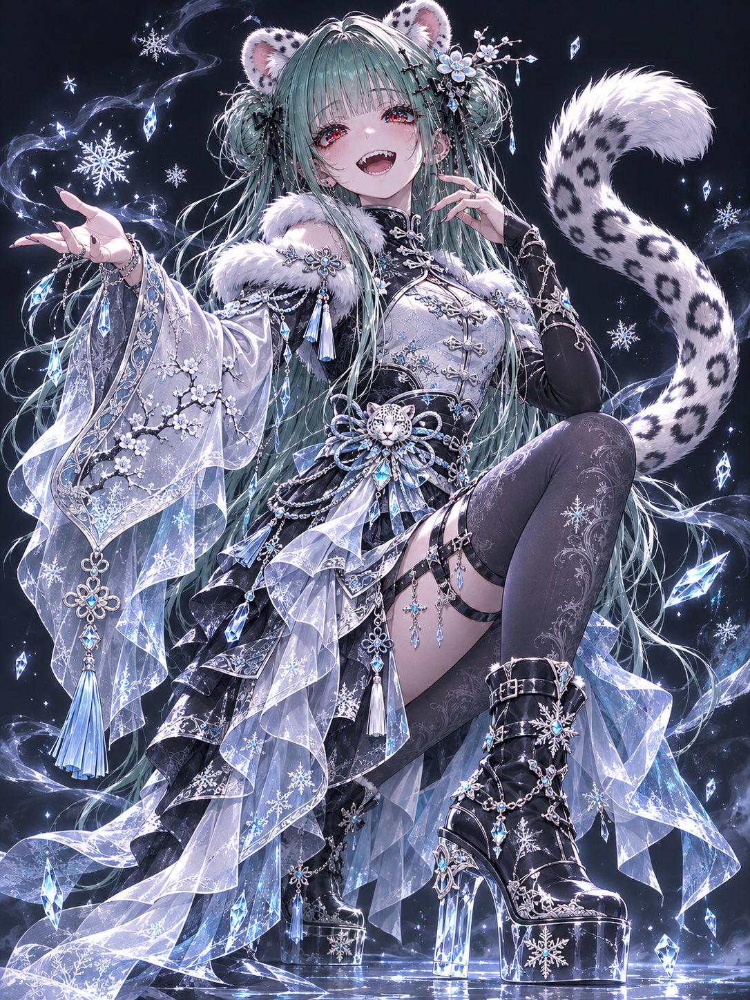
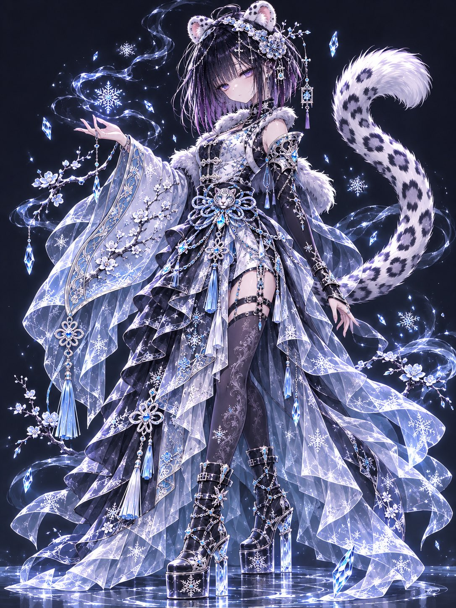
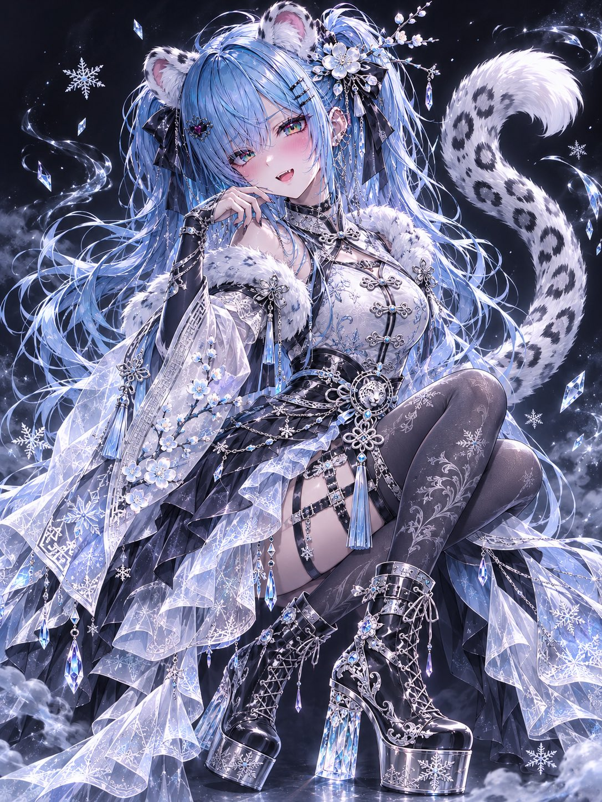
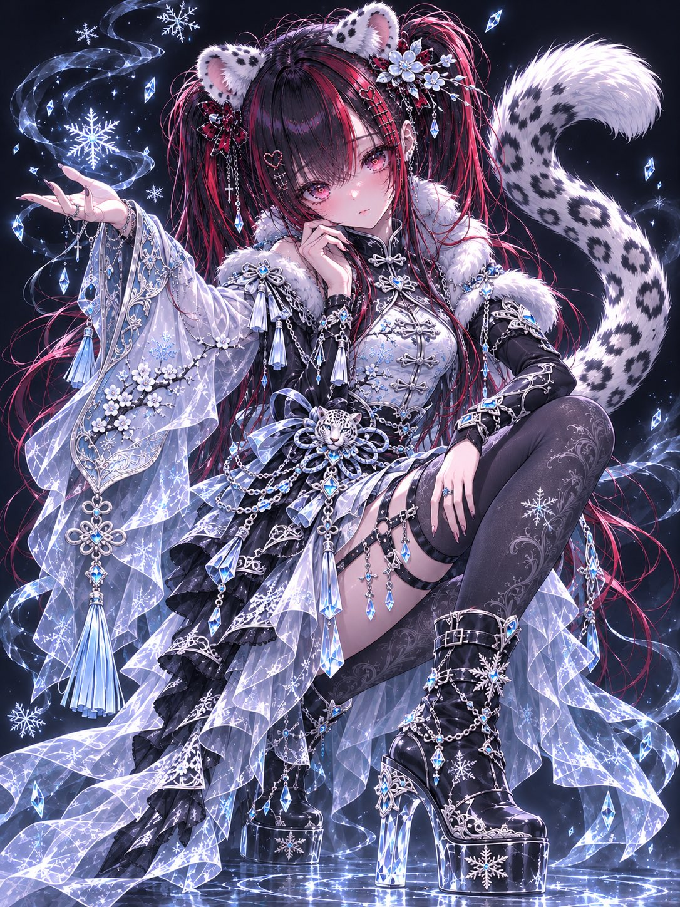

# 冰晶雪豹：中华哥特幻想衣装 + 雪豹耳尾（#るん衣装プロンプト 第270弾）

- 原帖链接：https://x.com/ENJU1123PIPI/status/2120471616975241378
- 作者：るんちゃん🦋（@ENJU1123PIPI）
- 时间：2026-11-11 19:00 (UTC+8 / Asia/Taipei)
- 互动摘要：点赞 44 · 转发 15 · 回复 5 · 引用 4 · 书签 5 · 浏览 654（采集快照：2026-11-11 20:25 UTC+8）
- 模型/工具：未注明（角色参考图驱动的通用衣装 prompt）
- 标签：二次元
- 媒体路径：
  - `media/images/2120471616975241378_1.jpg`（）
  - `media/images/2120471616975241378_2.jpg`（）
  - `media/images/2120471616975241378_3.jpg`（）
  - `media/images/2120471616975241378_4.jpg`（）
- 入库日期：2026-11-11
- prompt 来源：https://x.com/ENJU1123PIPI/status/2120471618116075652
- 备注：prompt 在作者自回复（2120471618116075652），需附一张角色图，原样摘录。主帖「4枚の手はみたらだめよ」为作者自嘲出图手部瑕疵。

## prompt 原文

```text
ICE CRYSTAL SNOW LEOPARD — CHINESE GOTHIC FANTASY

Use the attached character image as the absolute identity reference. Preserve the original face, hairstyle, hair color, eye color, body proportions, accessories, personality, and distinctive illustration style.

Add soft, rounded snow leopard ears with white fur, black markings, and pale pink inner details. Include one long, luxurious fluffy tail with dark rosette patterns and a white tip, naturally attached to the body.

Design an extravagant ice-crystal Chinese gothic outfit combining pearl white, jet black, icy blue, and polished silver.

Feature a fitted high-collar cheongsam-inspired bodice with intricate silver frog closures, delicate lace, snow leopard embroidery, and sculpted waist ornaments. An asymmetric layered skirt flows into translucent frost-patterned fabrics, elegant side panels, white fur trim, silver chains, crystal tassels, icy gemstones, and decorative Chinese knots.

One arm has a long, flowing Chinese-style sleeve embroidered with frozen plum blossoms, while the other wears a fitted black sleeve with delicate silver armor.

Add decorative thigh straps, elegant opaque patterned stockings, and ornate black-and-silver platform boots with crystalline heels and snowflake engravings.

Complete the design with frozen plum blossom hair ornaments, dangling crystal charms, and a small snow leopard emblem at the waist.

Surround the character with floating ice crystals, delicate snowflakes, shimmering frost magic, and translucent frozen mist.

Create a cute yet majestic appearance, blending Chinese elegance, gothic fantasy, and snow leopard charm.

Use a dynamic three-quarter full-body composition, graceful twisting pose, natural anatomy, flowing fabrics, and clearly visible ears and tail. Emphasize sophisticated perspective and a captivating expression.

Visual Quality: Masterpiece Japanese anime illustration, ultra-high resolution, crisp expressive outlines, delicate inner linework, strong cel shading, detailed fabric textures, precise embroidery, glass-like irises, realistic crystal refractions, luminous reflections, dramatic cinematic lighting, and rich contrast.

Simple dark background emphasizing the character and icy effects.

Negative: No text, extra characters, extra ears, multiple tails, animal muzzle, distorted anatomy, malformed hands, or excessive blur.
```

---

个人学习归档，非商业。prompt 与媒体版权归原作者 @ENJU1123PIPI，引用请回到原帖。
