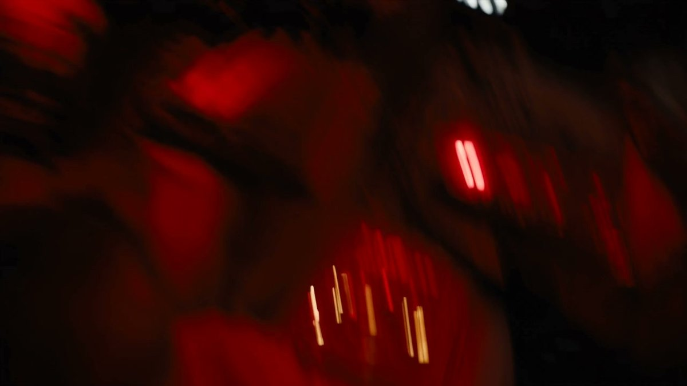

# 坠毁飞船与未知星球：30 秒科幻恐怖预告片分时段脚本（Seedance 2.5）

- 原帖链接：https://x.com/CharaspowerAI/status/2120230038041673811
- 作者：Pierrick Chevallier | IA（@CharaspowerAI）
- 时间：2026-11-11 03:00 (UTC+8 / Asia/Taipei)
- 互动摘要：点赞 67 · 转发 6 · 回复 15 · 引用 0 · 书签 47 · 浏览 3060（采集快照：2026-11-12 09:08 UTC+8）
- 模型/工具：Seedance 2.5（视频，Dreamina）
- 标签：其它
- 媒体路径：
  - `media/video-stills/2120230038041673811_still.jpg`（视频封面截图，）
  - 视频本体未入库，仅保留原帖链接：https://x.com/CharaspowerAI/status/2120230038041673811
- 入库日期：2026-11-12
- prompt 来源：https://x.com/CharaspowerAI/status/2120230060795875728
- 备注：prompt 在作者自回复（2120230060795875728），按 0-30 秒分段，prompt 自带 non-graphic / no gore 约束，原样摘录。视频仅保留原帖链接。

## prompt 原文

```text
Ultra-realistic sci-fi horror trailer, 30 seconds, original industrial survival aesthetic. ARRI Alexa 35, anamorphic lenses, cockpit close-ups, shaky crash energy, helmet lights, slow push-ins, wide planetary reveals, subtle handheld tension, practical ship lighting, dense fog, metallic interiors, oppressive atmosphere, premium Hollywood realism, non-graphic.

Main crew: four adult space explorers, clearly distinct. Commander: calm adult woman. Pilot: adult man, tense but skilled. Science officer: adult woman, observant and uneasy. Engineer: adult man, rugged and practical. Stable suits, helmets and faces throughout.

Damaged spacecraft, hostile unknown planet, black rocky terrain, toxic mist, strange organic-looking formations, narrow canyons, abandoned alien structure, dim emergency-lit corridors.

0-5s: Trailer hook Violent cockpit turbulence. Warning lights flash. Close-up on gloved hands gripping controls.

Computer voice: “Impact imminent.”

The ship crashes through thick orange clouds.

5-10s: Aftermath Silence. Emergency lights flicker inside the damaged ship. The commander removes her helmet.

Voice-over: “They were never meant to land here.”

10-16s: First exploration The crew steps onto the unknown planet. Huge wide shot: endless dark landscape, drifting mist, towering rock spires. Helmet lights scan strange shapes in the distance.

Pilot whispers: “We’re not alone.”

16-22s: Threat escalation Inside a vast alien structure, flashlight beams reveal wet walls, strange egg-like forms, moving shadows just out of sight, and a faint organic sound echoing through the corridor.

Science officer: “Something is watching us.”

22-27s: Panic beat One crew member turns quickly as a motion tracker spikes. Red emergency light flashes. A door slams shut behind them. Breathing intensifies.

Voice-over: “On this world… curiosity has a price.”

27-30s: Final cliffhanger Close-up on the commander’s terrified face as she raises her light. Reflection in her visor: a towering biomechanical silhouette unfolding in the darkness behind the team.

Hard cut to black.

Original sci-fi horror design, oppressive industrial realism, stable crew continuity, readable geography, unseen threat for most of the trailer, strong atmosphere, premium sound-driven tension, no gore, no visible attack, no text, no logos.
```

---

个人学习归档，非商业。prompt 与媒体版权归原作者 @CharaspowerAI，引用请回到原帖。
