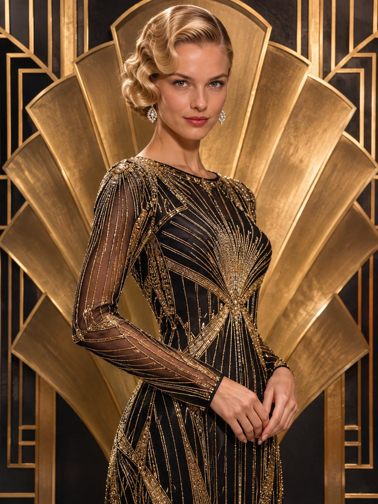

# Art Deco 金色扇形背景 × 黑金串珠礼服 × 复古手推波纹发型人像

- 原帖链接：https://x.com/antrospike/status/2120381001872429454
- 作者：Antrospike（@antrospike）
- 时间：2026-11-11 13:00 (UTC+8 / Asia/Taipei)
- 互动摘要：点赞 46 · 转发 3 · 回复 17 · 引用 3 · 书签 3 · 浏览 903（采集快照：2026-11-12 09:08 UTC+8）
- 模型/工具：未注明
- 标签：真人
- 媒体路径：
  - `media/images/2120381001872429454_1.jpg`（）
- 入库日期：2026-11-12
- prompt 来源：https://x.com/antrospike/status/2120381002878963890
- 备注：prompt 在作者自回复（2120381002878963890），含 Style / Main Prompt / Negative Prompt 三段，原样摘录。

## prompt 原文

```text
Style: Ultra-realistic fine-art portrait fused with Art Deco geometric design, real photographic face, gold line patterns, 85mm lens.
Main Prompt: Create an image of a model with blonde hair in sleek finger waves, wearing a long-sleeve black and gold beaded gown with a modest neckline, in front of a symmetrical Art Deco fan-shaped golden backdrop with geometric lines. Elegant poised gaze toward the camera. Three-quarter portrait. Vertical portrait format 3:4.
Negative Prompt: no text, no lettering, no watermark, no extra fingers, no cartoon look.
```

---

个人学习归档，非商业。prompt 与媒体版权归原作者 @antrospike，引用请回到原帖。
