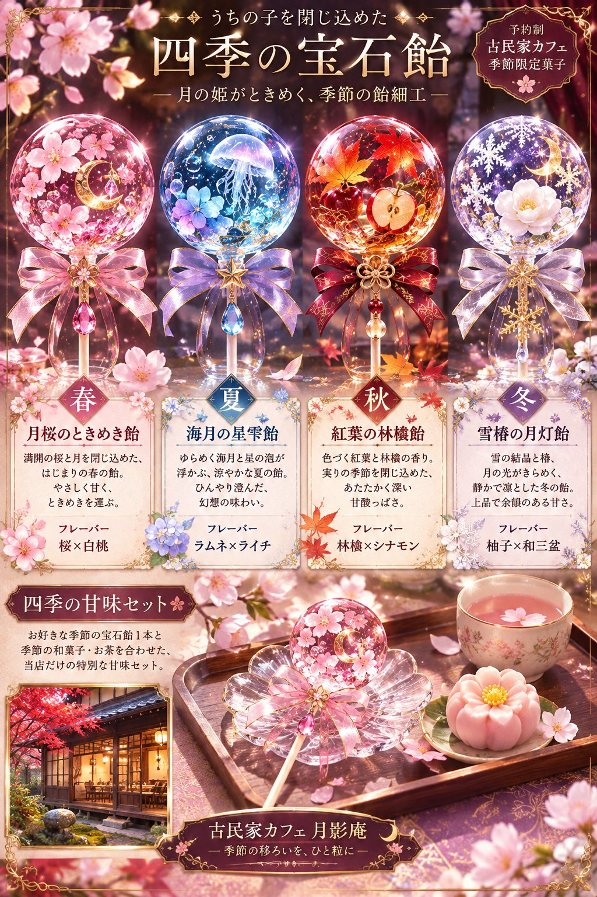
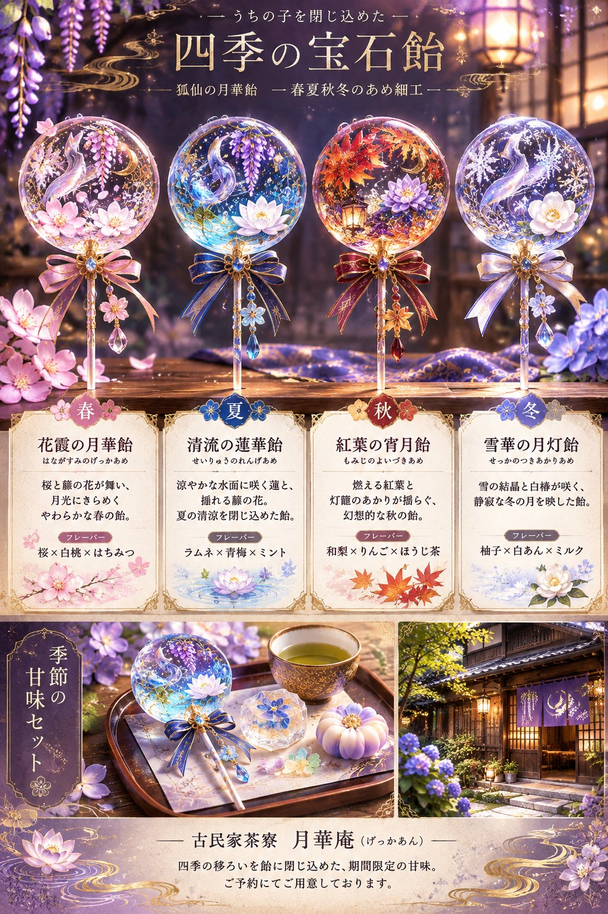
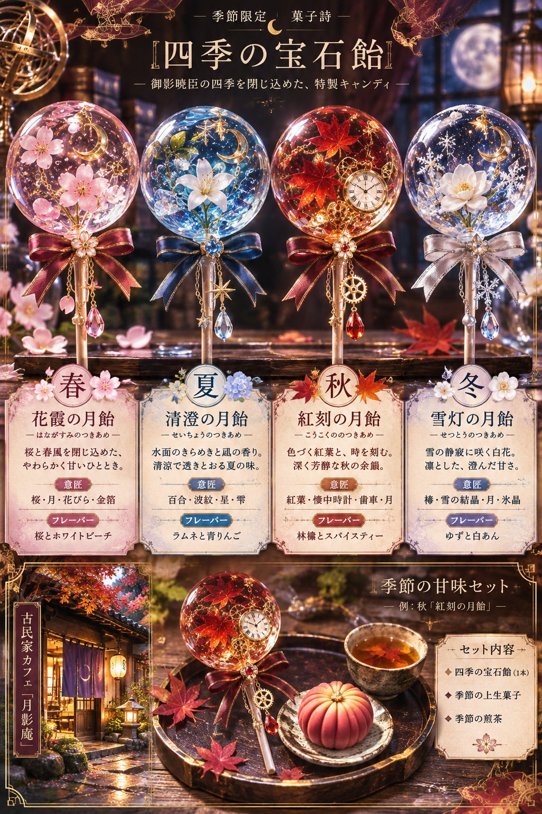
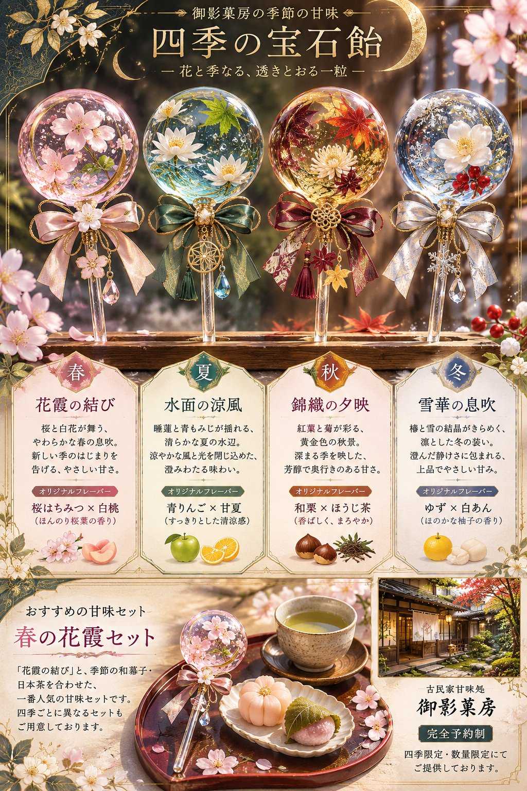

# 把自家角色封进四季宝石糖：和风高级糖果目录页（日文 prompt）

- 原帖链接：https://x.com/irohachang77/status/2120430169253175708
- 作者：のらる（@irohachang77）
- 时间：2026-11-11 16:15 (UTC+8 / Asia/Taipei)
- 互动摘要：点赞 65 · 转发 5 · 回复 1 · 引用 7 · 书签 43 · 浏览 2185（采集快照：2026-11-12 09:08 UTC+8）
- 模型/工具：未注明（角色参考图驱动的通用图像模型 prompt）
- 标签：其它
- 媒体路径：
  - `media/images/2120430169253175708_1.jpg`（）
  - `media/images/2120430169253175708_2.jpg`（）
  - `media/images/2120430169253175708_3.jpg`（）
  - `media/images/2120430169253175708_4.jpg`（）
- 入库日期：2026-11-12
- prompt 来源：https://x.com/irohachang77/status/2120430212932571160
- 备注：prompt 在作者自回复（2120430212932571160），日文，需附一张角色插画；成图为不含人物的糖果商品目录，故标「其它」。原样摘录。

## prompt 原文

```text
🌸💎 うちの子を閉じ込めた、四季の宝石飴

添付イラストのキャラクターの色彩・雰囲気・象徴モチーフを読み取り、春夏秋冬をイメージした4本の透明な球形キャンディに変換してください。

【飴細工】

- 1人のキャラクターから春・夏・秋・冬の4種類を制作。
- キャラクターの象徴モチーフと四季それぞれの花・植物などを、透明な飴の中に繊細に封入。
- キャラクターらしさを残しつつ、季節ごとに色彩と意匠を変える。
- 持ち手は細く上品に。小さなリボンを添える。
- 宝石のような透明感と、実在する高級飴細工の質感。

【カタログ構成】

上部：約60％
完成した4本の飴細工を春・夏・秋・冬の順に横一列で展示。

中段：約25％
各季節の飴の名前・意匠・オリジナルフレーバーを日本語で紹介。

下段：約15％
飴細工1本と季節の和菓子、お茶を添えた甘味セット。古民家カフェの小さな風景写真も配置。

【仕上がり】

京都や鎌倉の予約制古民家カフェに置かれた、季節限定の高級和菓子カタログ風。

木製トレー・和紙・繊細な金装飾・柔らかな自然光。和洋折衷で上品、幻想的な商品写真。

人物は描かず、飴細工を主役にする。
縦長カタログ構図。文字は読みやすく整える。
```

---

个人学习归档，非商业。prompt 与媒体版权归原作者 @irohachang77，引用请回到原帖。
