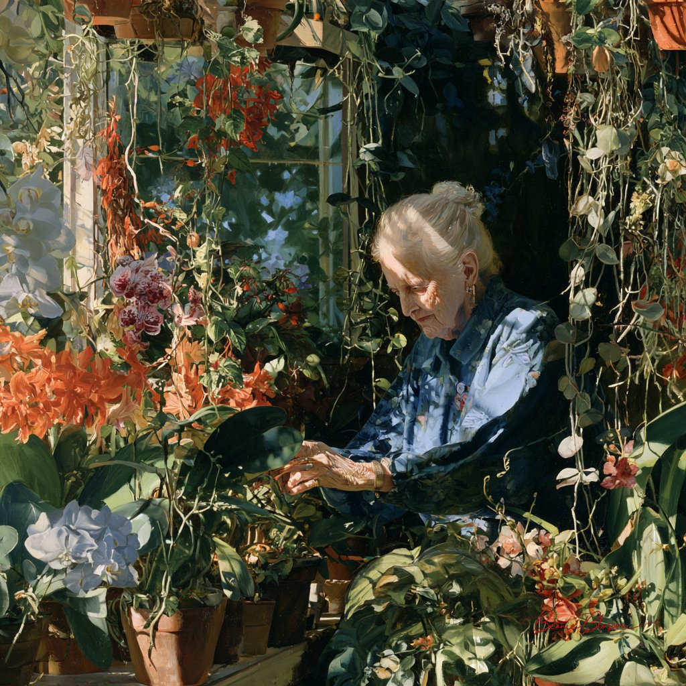

# 温室里照料兰花的老奶奶：一句话写实氛围 prompt（#PromptShare）

- 原帖链接：https://x.com/BeanieBlossom/status/2120440402792890463
- 作者：Beanie Blossom（@BeanieBlossom）
- 时间：2026-11-11 16:56 (UTC+8 / Asia/Taipei)
- 互动摘要：点赞 48 · 转发 3 · 回复 15 · 引用 0 · 书签 3 · 浏览 639（采集快照：2026-11-12 09:08 UTC+8）
- 模型/工具：未注明
- 标签：真人
- 媒体路径：
  - `media/images/2120440402792890463_1.jpg`（）
- 入库日期：2026-11-12
- prompt 来源：https://x.com/BeanieBlossom/status/2120440402792890463
- 备注：prompt 即主帖正文「Prompt:」之后的一句（到「Feel free to join in」之前），原样摘录；作者邀请大家用同一 prompt 接力。

## prompt 原文

```text
An elderly woman with twinkling eyes tends to a vibrant, overflowing greenhouse filled with exotic orchids and trailing vines, sunlight dappling through the glass, clay pots, humid air, soft focus
```

---

个人学习归档，非商业。prompt 与媒体版权归原作者 @BeanieBlossom，引用请回到原帖。
