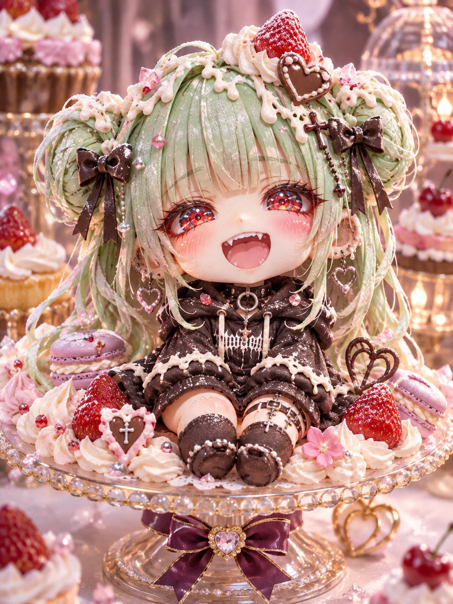
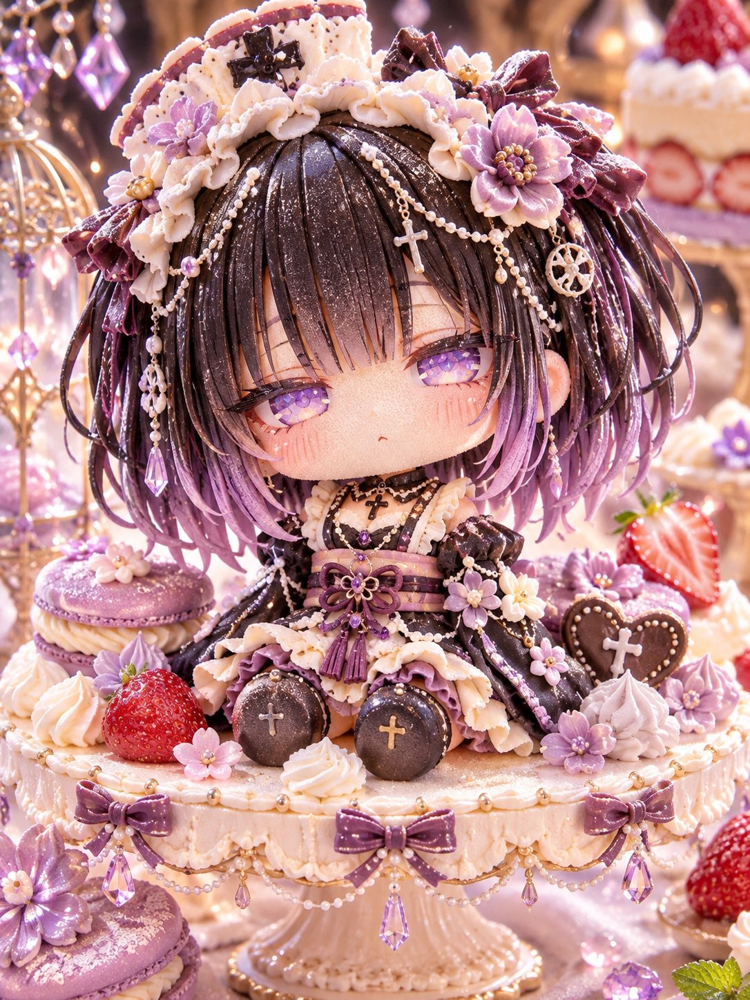
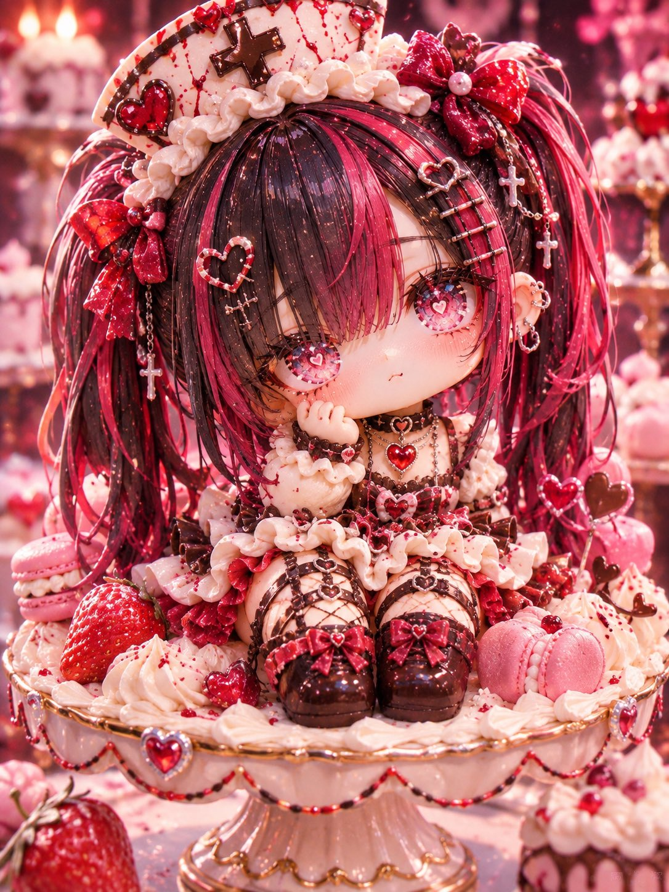
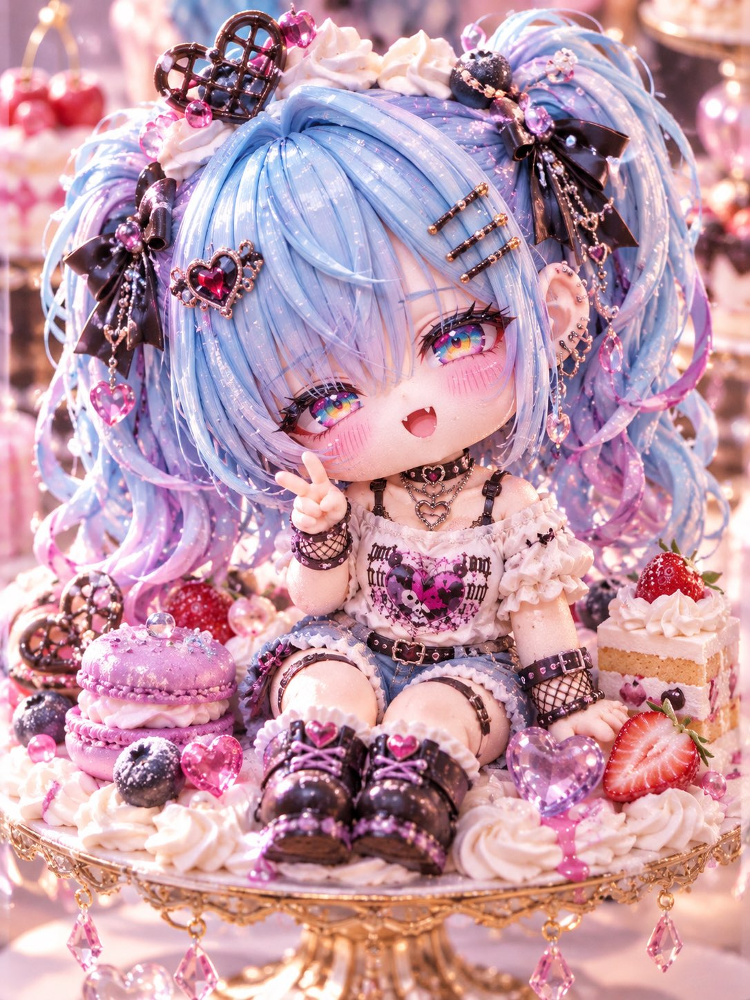

# Q 版角色变身蛋糕翻糖人偶：迷你甜点台（#るんプロンプト 第259弾）

- 原帖链接：https://x.com/ENJU1123PIPI/status/2120486698111172918
- 作者：るんちゃん🦋（@ENJU1123PIPI）
- 时间：2026-11-11 20:00 (UTC+8 / Asia/Taipei)
- 互动摘要：点赞 66 · 转发 20 · 回复 1 · 引用 8 · 书签 12 · 浏览 2022（采集快照：2026-11-12 09:08 UTC+8）
- 模型/工具：未注明（角色参考图驱动的通用图像模型 prompt）
- 标签：二次元
- 媒体路径：
  - `media/images/2120486698111172918_1.jpg`（）
  - `media/images/2120486698111172918_2.jpg`（）
  - `media/images/2120486698111172918_3.jpg`（）
  - `media/images/2120486698111172918_4.jpg`（）
- 入库日期：2026-11-12
- prompt 来源：https://x.com/ENJU1123PIPI/status/2120486698970952164
- 备注：prompt 在作者自回复（2120486698970952164），需附一张角色图作身份参考，原样摘录。

## prompt 原文

```text
SWEET CHIBI CAKE SCULPTURE — MINIATURE PATISSERIE

Use the attached character image as the identity reference. Preserve the original face, hairstyle, hair and eye colors, expression, outfit, accessories, and distinctive features.

Transform the character into an irresistibly cute, palm-sized edible cake sculpture with 2–2.5-head-tall chibi proportions, an oversized round head, chubby cheeks, tiny body, and short rounded limbs.

Craft the entire figure from fluffy sponge cake, smooth fondant, whipped cream, marzipan, and chocolate. Recreate the hair, clothing, and accessories as intricate edible decorations, preserving the character's original colors and personality.

Add delicate frosting lace, cream swirls, chocolate bows, sugar pearls, glossy fruit jelly, miniature candies, and sparkling sugar crystals. Emphasize realistic cake textures, soft cream, and premium Japanese patisserie craftsmanship.

Place the single full-body cake character on an elegant miniature cake stand surrounded by pastel macarons, strawberries, tiny pastries, and whipped cream. Dreamy bakery background, warm cinematic lighting, soft bokeh, shallow depth of field, professional macro food photography.

Ultra-detailed, adorable, luxurious edible miniature art, vertical 3:4 composition.

Avoid realistic human skin, human anatomy, plastic figurine textures, flat illustrations, extra limbs, multiple characters, altered identity, text, logos, and watermarks.
```

---

个人学习归档，非商业。prompt 与媒体版权归原作者 @ENJU1123PIPI，引用请回到原帖。
