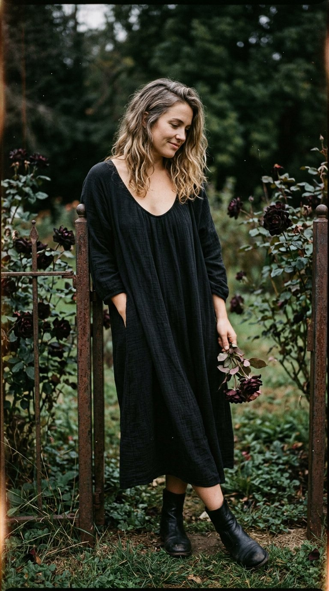

# 黑玫瑰主题：Kodak Portra 胶片质感的蜂蜜金发女子全身人像

- 原帖链接：https://x.com/dreamydigiarts/status/2120509350351647188
- 作者：dreamy digital arts（@dreamydigiarts）
- 时间：2026-11-11 21:30 (UTC+8 / Asia/Taipei)
- 互动摘要：点赞 21 · 转发 0 · 回复 6 · 引用 1 · 书签 5 · 浏览 746（采集快照：2026-11-12 20:25 UTC+8）
- 模型/工具：Nano Banana 2（作者在 @weryai 上生成）
- 标签：真人
- 媒体路径：
  - `media/images/2120509350351647188_1.jpg`（）
- 入库日期：2026-11-12
- prompt 来源：https://x.com/dreamydigiarts/status/2120509350351647188
- 备注：prompt 即主帖正文「Prompt 👇」之后部分，原样摘录。

## prompt 原文

```text
Photorealistic 35mm analog Kodak Portra film photograph, extremely hyper-realistic natural finish, candid natural full body portrait. Beautiful adult woman late 20s to early 30s with unique realistic face. Real skin texture pores. Messy honey-blonde waves. Normal slim-thick body. Soft quiet elegant expression looking slightly away. Soft moody natural light. Black rose beauty theme: honey-blonde full body with black roses, elegant dark dress or soft black fabric, natural candid. Strong authentic film grain, true analog Portra color, painterly stillness, 35mm. Vertical.
```

---

个人学习归档，非商业。prompt 与媒体版权归原作者 @dreamydigiarts，引用请回到原帖。
