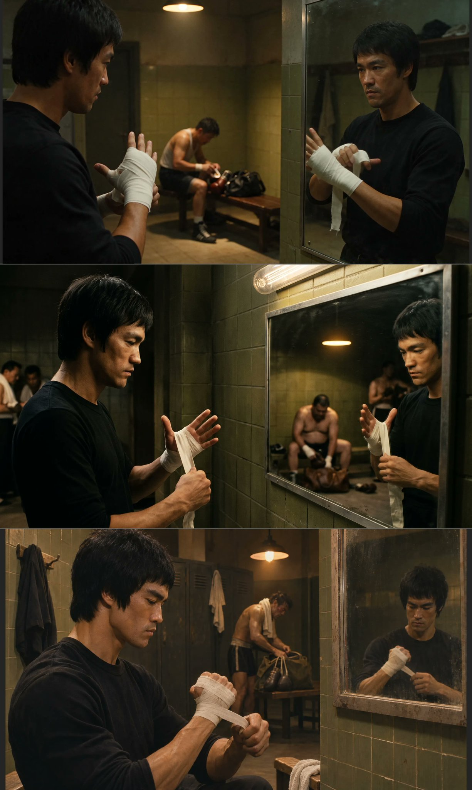

# 「Before the Bell」：更衣室缠拳带 + 镜面反射的拳击电影剧照（三模型同 prompt 对比）

- 原帖链接：https://x.com/maxescu/status/2120554917400396139
- 作者：Alex Patrascu（@maxescu）
- 时间：2026-11-12 00:31 (UTC+8 / Asia/Taipei)
- 互动摘要：点赞 20 · 转发 0 · 回复 9 · 引用 0 · 书签 8 · 浏览 3567（采集快照：2026-11-12 20:25 UTC+8）
- 模型/工具：Seedream 5.5 / Nano Banana 2.1 / GPT Image 2.6（作者同 prompt 对比，合成一张图）
- 标签：真人
- 媒体路径：
  - `media/images/2120554917400396139_1.jpg`（）
- 入库日期：2026-11-12
- prompt 来源：https://x.com/maxescu/status/2120554930847334852
- 备注：prompt 在作者自回复（2120554930847334852），需附一张角色设定图（character sheet）作身份参考，原样摘录。主帖问「谁把镜子画对了」，考察镜面反射几何。

## prompt 原文

```text
Create one finished 16:9 sports film still titled Before the Bell. Work from the attached character sheet as an identity reference for the lead. Take the face and recognizable identifying features from the sheet, then cast that character in this single new composition. Preserve adult age, face shape, hairline, eyes, and body scale. Follow the wardrobe and props described for the new scene. Render one continuous image with coherent perspective and lighting; the reference sheet's multi-angle layout belongs only to the input. An understated locker-room still, the lead in a black warmup shirt wraps white cotton tape around his left knuckles. Hold the foreground hand contact and show his recognizable profile in the left half; a wall mirror at right shows a geometrically possible reversed reflection of the same action. In the depth an exhausted adult boxer stows gear under a separate pool of light. Warm tungsten ceiling fixture, olive tile shadow, no modern LED look, 50 mm 35 mm negative style. No visible branding or captions. Let gesture and gaze follow the immediate action, with background people reacting to the space around them. Keep the leading subject and requested graphic elements readable at 2K.
```

---

个人学习归档，非商业。prompt 与媒体版权归原作者 @maxescu，引用请回到原帖。
