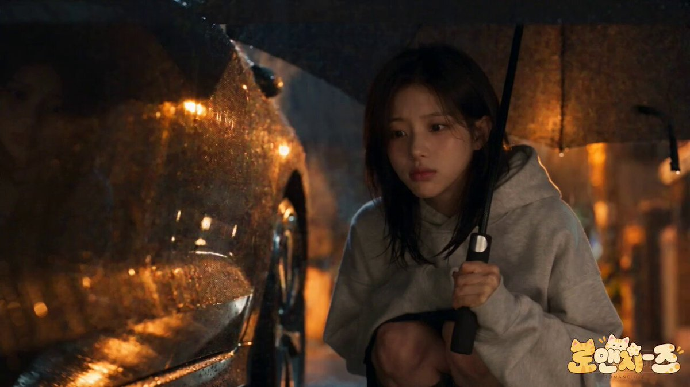

# 雨夜捡到小橘猫：30 秒韩影风治愈动物短片（分时段脚本）

- 原帖链接：https://x.com/KrishnaBio1/status/2120692554521772051
- 作者：KrishnaG（@KrishnaBio1）
- 时间：2026-11-12 09:38 (UTC+8 / Asia/Taipei)
- 互动摘要：点赞 30 · 转发 5 · 回复 17 · 引用 0 · 书签 10 · 浏览 774（采集快照：2026-11-12 20:25 UTC+8）
- 模型/工具：Seedance 2.5（视频）
- 标签：真人
- 媒体路径：
  - `media/video-stills/2120692554521772051_still.jpg`（视频封面截图，）
  - 视频本体未入库，仅保留原帖链接：https://x.com/KrishnaBio1/status/2120692554521772051
- 入库日期：2026-11-12
- prompt 来源：https://x.com/KrishnaBio1/status/2120692556174426458
- 备注：prompt 在作者自回复（2120692556174426458），按 0–30s 分时段脚本 + AUDIO / STYLE，原样摘录。视频仅保留原帖链接。

## prompt 原文

```text
Cinematic ultra-realistic heartwarming animal-drama short film, 16:9, 30 seconds, 24fps, shot like a high-budget Korean feature film, the opening in a rainy night street with warm golden bokeh from streetlamps and car lights, then a cozy warm apartment interior, then a bright sunny leafy neighborhood in the morning, shallow depth of field, crisp detail, subtle film grain, slow gentle camera movement, soft, tender and healing mood.
👩 HEROINE: A young Korean woman in her late 20s, shoulder-length black hair with soft bangs, a gentle and kind face. She wears a grey oversized hoodie on the rainy night, a black t-shirt and plaid pajama pants at home, and a sage-green cardigan over a white top with white shorts the next day. Keep her face identical in every shot.
🐱 KITTEN: A small, chubby orange-and-cream tabby kitten with big round amber eyes, a pink nose, a fluffy short tail and slightly damp fur at the start. Curious, shy and incredibly cute. Keep the kitten identical in every shot.
🐈 OTHER CATS: A grey striped tabby with green eyes and a calico cat with orange, black and white patches, both relaxed neighborhood cats.
🌧️ 0–5s: A quiet rainy night street, raindrops glittering in the lamplight. The heroine walks under a black umbrella and stops when she hears a tiny meow. She crouches beside a parked car and finds the little orange kitten shivering on the wet pavement. She whispers: "Hey there… are you lost?"
🧥 5–9s: She gently lifts the kitten and tucks it inside her hoodie, shielding it with her umbrella. Close-up of the kitten's nose peeking out, rain dripping off the umbrella edge, golden reflections on the road. She says: "Don't worry, you're coming home with me."
🛁 9–14s: A cozy apartment with a warm lamp and wooden furniture. She gently dries the kitten with a soft towel, then sets down a bowl of food. The kitten eats hungrily, little paws on the bowl's rim, while she sits in her pajamas watching with a soft smile. She says: "Eat slowly, little one. Nobody's going to take it."
☀️ 14–18s: Next morning. The kitten stretches and yawns on a sunlit lawn, then sits upright with its ears perked, staring at the street as if remembering something. The heroine kneels beside it and says: "You miss your brother, don't you? Let's find him."
🚶‍♀️ 18–23s: A leafy sunny neighborhood. The heroine carries the kitten in her arms along a quiet street and kneels to offer treats to a grey tabby and a calico cat. She asks them: "Have you seen an orange kitten just like this one?" The cats tilt their heads and look away, the kitten meowing softly in her arms.
🌿 23–27s: They reach a stone gateway framed by green vines and a lovely garden. The kitten's ears suddenly shoot up, its eyes widening. The heroine looks at it in surprise, her smile growing.
💛 27–30s: The kitten leaps from her arms and runs through the gate to a slightly bigger orange cat, and the two nuzzle each other happily. The heroine watches with misty eyes and says: "Goodbye, little one." The kitten turns, runs back and jumps into her arms. She laughs: "Okay, okay. I'm not going anywhere either." Slow pull-back, fade out.
🎧 AUDIO: Gentle rain fading into soft morning birdsong, tiny kitten meows and purrs, a light warm piano-and-guitar score that brightens in the final scene, clear natural English dialogue.
🎬 STYLE: Realistic wholesome animal drama, natural performances from both actress and animals, warm gold, teal and green color contrast, family-friendly and non-graphic, consistent faces and animals, no text, no subtitles, no logos, no watermark.
```

---

个人学习归档，非商业。prompt 与媒体版权归原作者 @KrishnaBio1，引用请回到原帖。
