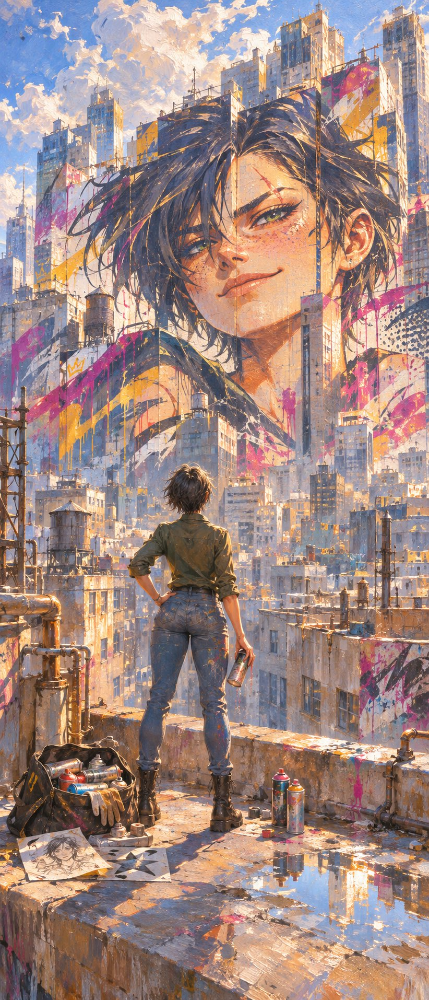
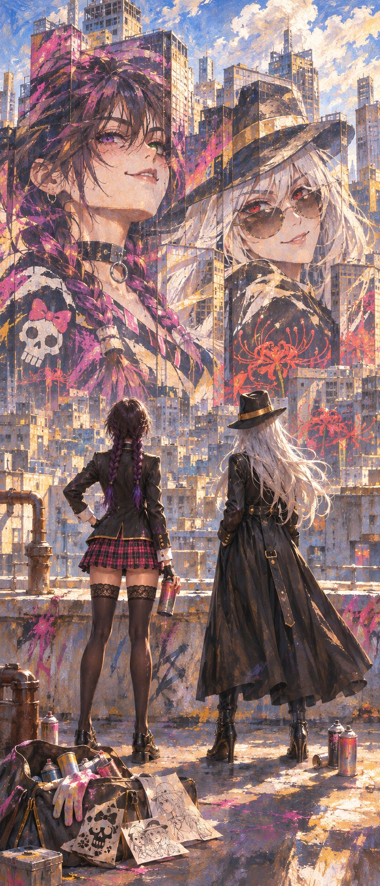
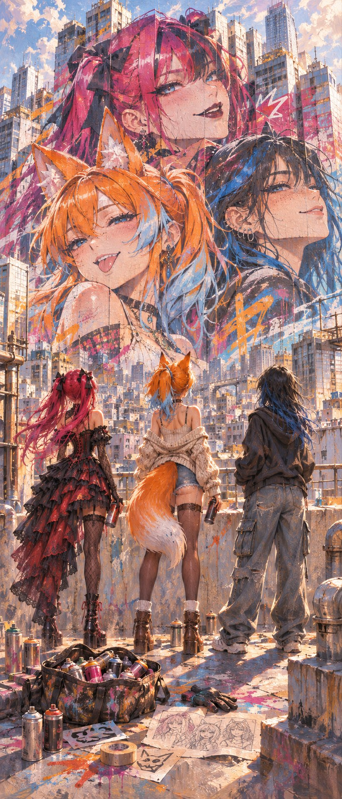
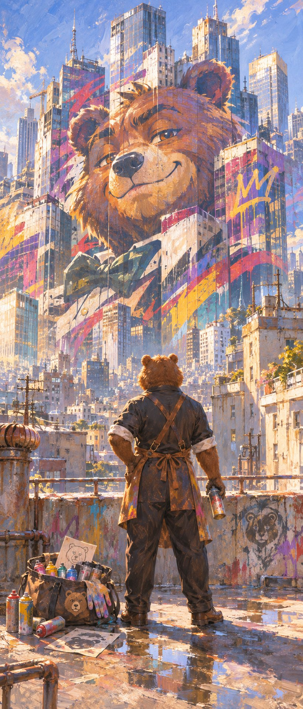

# Sorolla 光影 × 摩天楼错视涂鸦：屋顶背影角色与巨型壁画（角色设定图驱动）

- 原帖链接：https://x.com/Le_Tavernicole/status/2120714388369785306
- 作者：Le Tavernicole（@Le_Tavernicole）
- 时间：2026-11-12 11:04 (UTC+8 / Asia/Taipei)
- 互动摘要：点赞 31 · 转发 7 · 回复 8 · 引用 5 · 书签 8 · 浏览 752（采集快照：2026-11-12 20:25 UTC+8）
- 模型/工具：未注明（末尾带 `--ar 9:21`）
- 标签：二次元
- 媒体路径：
  - `media/images/2120714388369785306_1.jpg`（）
  - `media/images/2120714388369785306_2.jpg`（）
  - `media/images/2120714388369785306_3.jpg`（）
  - `media/images/2120714388369785306_4.jpg`（）
- 入库日期：2026-11-12
- prompt 来源：https://x.com/Le_Tavernicole/status/2120714421878075531
- 备注：prompt 在作者自回复（2120714421878075531），Markdown 分章节（含 [EMOTION/TONE] / [CHARACTER MODE] 等可替换项），需附角色设定图；回复开头自动带出的 @ 提及已省略，其余原样摘录。四张图为作者用多位圈内创作者 OC 跑出的结果。

## prompt 原文

```text
# UNIVERSAL SOROLLA × ANAMORPHIC SKYLINE STREET ART

### Monumental Urban Luminism × Rooftop Contemplation × Architectural Graffiti Illusion × Character Identity Preservation

**[EMOTION/TONE: dreamy / mischievous / rebellious / contemplative]**

**[CHARACTER MODE: single character / multiple characters — automatically adapt to the number of uploaded references]**

**[ASPECT RATIO: 9:21 — ultra-tall cinematic vertical composition]**

Masterpiece, best quality, ultra-detailed, Full HD 8K, monumental cinematic composition, lyrical realism, Spanish Luminism, Impressionist natural light painting, Joaquim Sorolla–inspired emotional fine-art landscape, monumental urban perspective, architectural anamorphosis, poetic atmospheric realism, extraordinary sense of scale, sophisticated oil-painting technique.

Create an original ultra-vertical **9:21 fine-art oil painting** combining the luminous Impressionist language of Joaquim Sorolla with a monumental piece of rebellious street art spread across a gigantic urban skyline.

The main artistic style of the ENTIRE image must be **Sorolla's Spanish Luminism**, characterized by radiant sunlight, luminous color vibration, confident oil brushwork, poetic atmospheric depth, warm reflected light, painterly movement, and deeply human emotional expression.

The street-art aesthetic must appear primarily **inside the enormous graffiti artwork painted on the distant buildings**, establishing a striking contrast between traditional fine-art painting and contemporary urban rebellion.

The final composition must feel like a poetic encounter between classical painting and modern street culture.

---

## 1. STRICT CHARACTER IDENTITY PRESERVATION

Use the uploaded character reference image or images as the sole authoritative sources for character identity.

Preserve exactly:

- Original hairstyle, hair length, texture, silhouette, and canonical color.
- Original body type, anatomy, height, and proportions.
- Original skin, fur, scales, or other species-specific coloration.
- Original clothing design, outfit structure, accessories, and recognizable visual motifs.
- Distinctive ears, horns, tails, wings, prosthetics, cybernetics, or other anatomical features.
- Natural shoulder width, torso length, waist, hips, limb proportions, and overall silhouette.
- Original facial anatomy, eye colors, markings, and defining features, especially in the street-art portraits.
- Established personality and character identity.

Do not redesign, idealize, slim, enlarge, or otherwise alter the original character's body.

Adapt the character faithfully to the environment and painterly technique.

**ABSOLUTE CAMERA RULE:**

The physical character must be seen **completely from behind**, standing on a rooftop and looking toward the distant horizon.

The character must NEVER turn toward the viewer.

No visible front-facing face, no over-the-shoulder glance, no three-quarter frontal pose.

The full silhouette, from head to feet, must remain visible.

---

## 2. MAIN SCENE — THE ROOFTOP OBSERVERS

The viewer observes a vast modern city from the rooftop of a tall building.

In the foreground, occupying **ONLY THE LOWER HALF OF THE IMAGE**, stands the uploaded character, facing away from the viewer.

The character is completely visible from behind, standing naturally near the rooftop edge, silently contemplating the extraordinary skyline stretching into the distance.

The pose embodies [EMOTION/TONE] through restrained, believable body language:

- A relaxed but expressive posture.
- Subtle asymmetry in the shoulders and stance.
- Natural weight distribution between the legs.
- Hair and clothing gently moving in the rooftop breeze.
- A contemplative head angle directed toward the enormous artwork across the city.
- A quiet sense of pride, wonder, rebellion, or nostalgia.

**The character holds a spray-paint can in one hand**, lowered naturally at their side, suggesting that they have participated in the creation of the monumental urban artwork.

At their feet rests an open street-art equipment bag containing:

- Several colorful spray-paint cans.
- Replacement aerosol caps and nozzles.
- Paint-stained gloves.
- Small stencil sheets.
- Folded sketches and graffiti design papers.
- Additional street-art equipment and painting accessories.

A few individual spray cans may rest on the rooftop surface beside the bag.

These objects must feel naturally integrated into the scene, painted with believable physical detail and spontaneous Impressionist brushwork.

The rooftop itself displays weathered concrete, warm sunlit patches, shallow puddles reflecting the sky, subtle traces of old paint, rooftop ventilation structures, and architectural details.

**IMPORTANT COMPOSITION RULE:**

The rooftop character must remain relatively small compared with the enormous city.

The human figure occupies approximately the bottom 30–40% of the image height, never extending beyond the image's midpoint.

The composition must convey the overwhelming scale of the skyline rather than presenting a conventional character portrait.

---

## 3. MULTIPLE-CHARACTER MODE — SHARED CONTEMPLATION

**If multiple character references are uploaded, include ALL referenced characters standing together on the rooftop.**

Each character must retain their individual identity, recognizable silhouette, original proportions, species anatomy, colors, clothing, and accessories.

All characters must:

- Be completely visible from behind.
- Face the same distant skyline.
- Stand naturally alongside one another.
- Occupy only the lower half of the image.
- Display subtle variations in posture and emotional expression.
- Appear to admire the gigantic artwork they have created together.

Their poses must suggest a shared moment of quiet satisfaction and wonder.

One character may hold a spray-paint can, another may rest their hands on the rooftop railing, while another stands with arms relaxed or hands in pockets.

The figures must feel like a coherent group rather than isolated individuals positioned artificially.

Their equipment bags, spray cans, and street-art tools may be shared or distributed naturally around their feet.

**All characters remain facing away from the viewer.**

No duplicate characters, no merged anatomy, no missing character, and no unrequested additional figures.

---

## 4. MONUMENTAL CITYSCAPE — VERTICAL ARCHITECTURAL IMMENSITY

Beyond the rooftop stretches a vast and breathtaking modern metropolis.

The city is composed of countless buildings extending toward the distant horizon:

- Gigantic skyscrapers.
- Glass-and-steel office towers.
- Weathered concrete apartment buildings.
- Narrow high-rise structures.
- Industrial rooftops.
- Architectural terraces and balconies.
- Towering facades covered in windows.
- Older buildings nestled between modern architectural giants.

The skyscrapers must rise dramatically through the entire upper portion of the composition, with their highest structures reaching **almost to the very top edge of the 9:21 image**.

Use extraordinary vertical perspective and carefully controlled architectural depth to convey the monumental height of the city.

Foreground towers are detailed and richly textured, while distant buildings gradually dissolve into atmospheric sunlight, coastal haze, and luminous painterly depth.

The skyline must feel immense, complex, and physically believable.

The 9:21 framing emphasizes the dramatic contrast between the small observers below and the towering urban environment above.

The eye travels vertically from the rooftop equipment and characters toward the colossal painted skyline.

---

## 5. THE IMPOSSIBLE GRAFFITI — ONE GIANT ANAMORPHIC ARTWORK

**THIS IS THE CENTRAL VISUAL FEATURE OF THE COMPOSITION.**

Across the upper section of the cityscape, multiple skyscrapers and building facades collectively display an extraordinary, monumental street-art painting.

The artwork is a gigantic, stylized portrait of the uploaded character or characters, expressing a distinctly **mischievous, playful, rebellious personality**.

However, the painting is NOT located on a single flat wall.

Instead, the mural is divided across numerous separate buildings at different distances and architectural angles.

Each skyscraper contains only a fragment of the overall portrait:

- One facade may contain part of a face.
- Another building carries the continuation of the eyes.
- A narrower tower holds fragmented hair and colorful shapes.
- An adjacent structure completes part of the character's silhouette.
- Additional surfaces contain connected stencil patterns, outlines, and expressive paint marks.

**FORCED-PERSPECTIVE OPTICAL ILLUSION:**

From the exact viewpoint of the rooftop observer and the image's camera, these physically separated graffiti fragments align into **ONE PERFECT, COHERENT, MONUMENTAL STREET-ART COMPOSITION**.

The building surfaces act as fragments of a giant three-dimensional canvas.

Their perspective distortions compensate for architectural distances and angles.

The illusion must resemble a real-world anamorphic installation: a complete painting visible from one precise observation point.

The visual effect must feel astonishing yet geometrically intentional.

The portrait must NOT float in the sky.

It must NOT resemble a hologram, projection, digital billboard, or supernatural apparition.

Every visible painted fragment must remain physically attached to an actual architectural surface.

**The complete mural exists only because the camera angle aligns the separated painted surfaces into a unified image.**

The architecture itself participates in the composition.

Building edges, glass sections, balconies, and intervening structures must interact meaningfully with the artwork without destroying the readability of the unified portrait.

---

## 6. STREET-ART PORTRAIT — MISCHIEVOUS EXPRESSIVITY

The enormous composite portrait must preserve the uploaded character's recognizable facial identity while transforming it into a bold, expressive street-art aesthetic.

The portrait's emotional identity is **mischievous, rebellious, playful, and charismatic**.

Features include:

- A distinctive mischievous smile or confident smirk.
- Slightly raised or expressive eyebrows.
- Bold, luminous eyes with a teasing gaze.
- Original hairstyle and recognizable character motifs.
- Dramatic asymmetrical stencil elements.
- Expressive aerosol gradients.
- Bold color-blocked facial structure.
- Vibrant outlines and graphic contrast.
- Explosive paint splashes.
- Organic paint drips.
- Layered halftone textures.
- Rough overspray clouds.
- Fragmented urban symbols.
- Distressed stencil patterns.
- Dynamic ribbons of colored aerosol paint.

The mural must look genuinely painted with spray cans, stencils, and layered pigments rather than rendered as a pristine digital illustration.

Every fragment shares the same painterly direction, color logic, and graphic language.

### MULTIPLE-CHARACTER MURAL RULE

If multiple characters are uploaded, the gigantic anamorphic artwork must depict **ALL of them together in ONE unified street-art composition**.

Their recognizable portraits may overlap, intertwine, or appear side by side within an ambitious graphic arrangement.

Each character must remain individually identifiable.

The overall artwork must resemble a single professionally planned monumental mural rather than multiple disconnected portraits.

The portraits can interact visually through mischievous expressions, playful glances, overlapping silhouettes, and connected colors.

**ONE unified illusion, ONE enormous composition, spanning MANY separate buildings.**

The mural must never become a series of independent advertisements or separate graffiti artworks.

---

## 7. SOROLLA LUMINISM — PRIMARY PAINTING STYLE

Although the skyline contains modern graffiti, the final image is first and foremost a luminous oil painting inspired by Joaquim Sorolla.

Use his signature artistic qualities:

- Radiant Mediterranean sunlight.
- Brilliant reflected whites.
- Golden afternoon illumination.
- Warm ochre and amber highlights.
- Cool lavender-blue architectural shadows.
- Soft broken Impressionist color.
- Natural atmospheric perspective.
- Airy painterly transitions.
- Confident, fluid oil brushwork.
- Glowing edges where sunlight meets architecture.
- Beautiful interplay of warm and cool reflected light.
- Subtle atmospheric haze.
- Lively surface texture.
- Poetic realism and emotional naturalism.

The painterly treatment must remain consistent across the image.

The rooftops, characters, distant buildings, sunlit windows, and sky must all be interpreted through Sorolla's lyrical realism.

The immense graffiti painting may introduce stronger graphic shapes and more saturated colors, but it must still be rendered as part of the physical scene through the broader oil-painting technique.

**The main scene is NOT painted in graffiti style.**

The city and characters are Sorolla-inspired oil painting.

Only the artwork applied to the buildings uses bold spray-paint and street-art visual language.

---

## 8. LIGHTING — LUMINOUS URBAN POETRY

The city is bathed in glorious natural sunlight, creating an atmosphere of warmth, artistic wonder, and contemplative freedom.

Bright sunlight touches the upper skyscrapers, reflecting from glass facades and illuminating the painted mural.

Soft cool shadows gather between the towers.

Subtle atmospheric haze diffuses distant architectural edges.

The rooftop observer is gently illuminated by natural backlighting and reflected light from the surrounding city.

The characters' silhouettes remain clearly visible, with delicate warm rim lighting around their hair, shoulders, and clothing.

The street-art mural feels especially vibrant as its colors react to sunlight and shadow across different building surfaces.

Light must enhance the extraordinary optical illusion without making the painted fragments seem detached from their architecture.

The image should evoke the sensation of standing high above a city during a quiet, breathtaking moment of artistic accomplishment.

---

## 9. CINEMATIC COMPOSITION — 9:21 VERTICAL MASTERPIECE

Create an extraordinarily tall cinematic composition with carefully organized visual hierarchy.

**LOWER SECTION — ROOFTOP**

The full-body characters are shown entirely from behind.

Their spray-paint equipment is clearly visible.

The rooftop provides the foreground anchor and emotional human perspective.

**MIDDLE SECTION — ARCHITECTURAL TRANSITION**

The city opens outward and upward.

Buildings overlap through atmospheric depth.

The first fragments of the enormous graffiti composition begin to align across separate skyscraper facades.

**UPPER SECTION — MONUMENTAL OPTICAL ILLUSION**

The assembled giant street-art portrait dominates the visual experience.

Separate buildings combine into a breathtaking coherent image.

The portrait's mischievous gaze becomes the emotional centerpiece.

Towering architecture continues almost to the top of the frame.

The sky remains visible only as naturally integrated atmospheric space between and above the tallest structures.

### CAMERA AND PERSPECTIVE

- Ultra-vertical 9:21 framing.
- Camera positioned behind the rooftop characters.
- Natural, subtly elevated rooftop viewpoint.
- Strong cinematic architectural perspective.
- Characters viewed fully from behind.
- Wide spatial depth and monumental vertical scale.
- Physically credible forced-perspective mural alignment.
- No fisheye distortion.
- No character close-up.
- The skyline occupies most of the image.
- The upper architecture and anamorphic illusion are the primary visual destination.

The viewer must feel as though they are standing just behind the characters, witnessing the same miraculous urban artwork.

---

## 10. EMOTIONAL NARRATIVE — THE ARTISTS ADMIRING THEIR CREATION

The composition tells a subtle story without dialogue.

A character, or group of characters, stands above the city holding the tools of street artists.

Before them rises an impossible-seeming masterpiece: a gigantic playful portrait of themselves, stretched across an entire collection of skyscrapers.

The contrast between the enormous artwork and the modest human figures suggests creativity, freedom, ambition, audacity, and wonder.

The characters are not celebrating theatrically.

They are quietly admiring their accomplishment.

Their backs are turned to the viewer, inviting the audience to share their perspective rather than observe their faces.

The colossal graffiti portraits provide the emotional counterpoint: mischievous, vibrant, rebellious, and full of personality.

The combination creates a poetic duality:

**Below: the real artists, small and contemplative.**

**Above: their larger-than-life painted identities, monumental and rebellious.**

The painting captures a fleeting moment when personal creativity transforms an entire city into a work of art.

---

## 11. STRICT VISUAL CONSTRAINTS

- Main art style MUST remain Sorolla-inspired luminous oil painting.
- Street-art aesthetics belong primarily to the painted architectural mural.
- Aspect ratio MUST be 9:21.
- Physical character(s) must remain fully visible from behind.
- No character may face the viewer or look back.
- Character(s) and rooftop equipment must remain entirely within the lower half.
- At least one visible spray-paint can must be held by a character.
- An equipment bag with additional spray cans and street-art tools must be present at their feet.
- Skyscrapers must dominate the vertical composition and rise almost to the top.
- The upper city must contain ONE unified, monumental anamorphic graffiti composition.
- The mural must be painted across multiple distinct building surfaces.
- The separated fragments must align from the camera viewpoint into a coherent artwork.
- The mural must depict the recognizable uploaded character(s), with mischievous expressions.
- Multiple uploaded characters must all appear on the rooftop AND within the same unified mural.
- No floating portrait, hologram, projection, or billboard.
- No separate unrelated graffiti portraits.
- No duplicated characters or incorrect anatomical features.
- No cropped feet, missing hands, or incomplete figures.
- No arbitrary changes to original outfit, proportions, or canonical colors.
- No generic photorealistic rendering, glossy 3D aesthetics, or flat digital-art treatment.
- No dominant anime style overriding Sorolla's painterly realism.

---

## 12. FINAL ARTISTIC DIRECTION

Masterpiece, ultra-detailed monumental Spanish Luminism, Joaquim Sorolla–inspired urban oil painting, breathtaking 9:21 vertical composition, full-body back-view rooftop observers, faithful character identity, wind-swept hair and clothing, spray-paint can in hand, open graffiti equipment bag at feet, immense modern skyline, towering skyscrapers, enormous anamorphic graffiti optical illusion, unified mischievous street-art portraits spanning separate building facades, perspective-aligned architectural mural fragments, radiant golden sunlight, lavender-blue shadows, shimmering atmospheric reflections, confident Impressionist brushwork, emotional storytelling, poetic urban rebellion, contemplative wonder, extraordinary architectural scale, magnificent sense of depth.

**The ultimate visual objective: a tiny rooftop artist admiring a colossal, mischievous portrait of themselves that appears perfectly assembled across dozens of skyscrapers, with the entire breathtaking moment captured as a luminous Sorolla oil painting.**

**--ar 9:21**
```

---

个人学习归档，非商业。prompt 与媒体版权归原作者 @Le_Tavernicole，引用请回到原帖。
