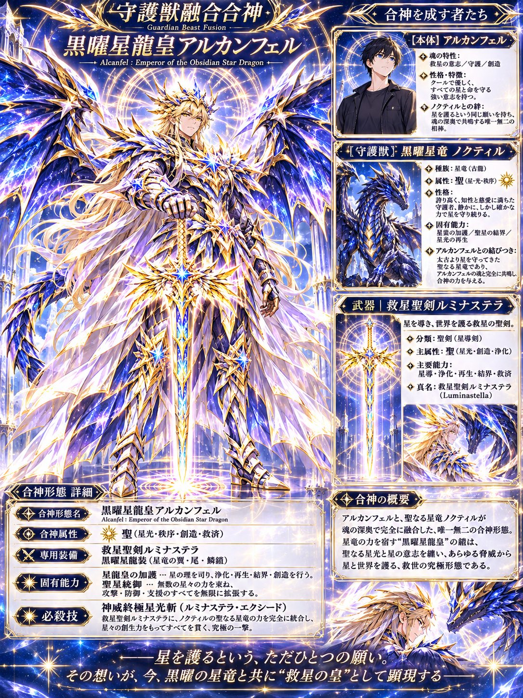
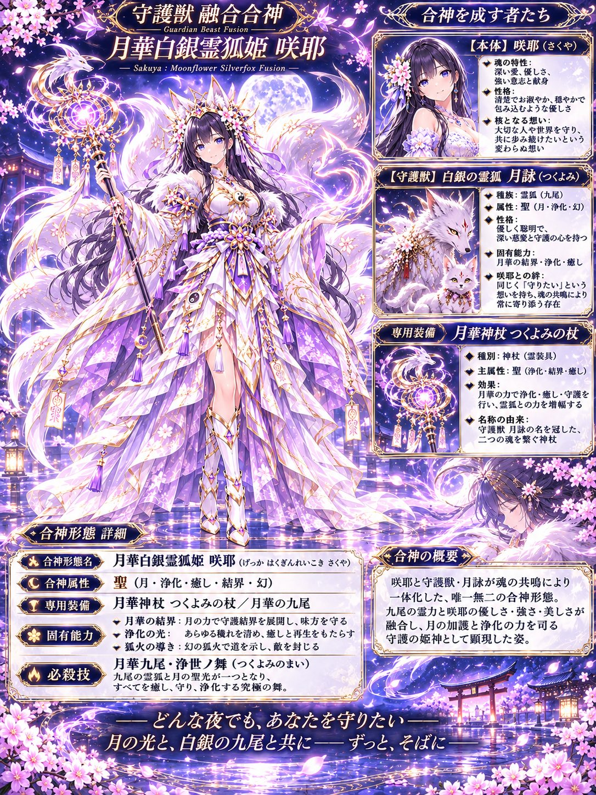

# 守护兽融合合神诊断：人物 + 专属守护兽铠甲化的 3:4 设定海报

- 原帖链接：https://x.com/archanfel000/status/2120729652633436603
- 作者：ある（@archanfel000）
- 时间：2026-11-12 12:05 (UTC+8 / Asia/Taipei)
- 互动摘要：点赞 12 · 转发 2 · 回复 2 · 引用 3 · 书签 9 · 浏览 835（采集快照：2026-11-12 20:25 UTC+8）
- 模型/工具：未注明（主帖标签 #ChatGPT）
- 标签：二次元
- 媒体路径：
  - `media/images/2120729652633436603_1.jpg`（）
  - `media/images/2120729652633436603_2.jpg`（）
- 入库日期：2026-11-12
- prompt 来源：https://x.com/archanfel000/status/2120729748280410611
- 备注：prompt 在作者自回复（2120729748280410611），日文分 ①守護獣診断 / ②融合合神 / ③画像構成 / ④画風・品質 段，可附人物参考图，原样摘录。

## prompt 原文

```text
あなたとあなたの守護獣が融合合神したら？

守護獣融合合神診断

対象人物の性格・価値観・精神性・行動傾向から、その人だけの守護獣を新規診断し、守護獣を鎧として装着した「融合合神形態」を画像生成してください。

① 守護獣診断

人物の本質を分析し、以下を設定する。

守護獣名・種族・守護ランク
属性・外見・性格
固有能力・守護する理由

守護獣は既存作品から流用せず、人物にふさわしい独自の存在とする。

② 融合合神

守護獣が神聖な鎧へ変化し、人物と一体化する。

人物本来の顔・髪・瞳・体型を維持
守護獣の角・翼・尾・毛並み・鱗・模様などを鎧や装飾に反映
属性に応じた武器・オーラ・特殊能力を付与
人物と守護獣双方の特徴が分かる独創的なデザイン

合神形態名・属性・専用武装・固有能力・必殺技を設定する。

③ 画像構成

縦長3:4の豪華な設定ポスターを1枚生成。

メイン画像（約70％）
融合合神形態を全身で大きく描写。鎧の精密な造形、属性エフェクト、神秘的な背景で圧倒的な存在感を演出。

別窓A｜人物
融合前の人物を描き、名前・性格・魂の特性を簡潔に紹介。

別窓B｜守護獣
融合前の守護獣を描き、名前・種族・属性・能力・守護する理由を紹介。

設定欄
合神形態名・属性・専用武装・固有能力・必殺技を表示。

④ 画風・品質

美麗で緻密な日本のファンタジーアニメ調。立体的な陰影、精巧な鎧、幻想的な光彩、豪華な装飾枠を使用。

参考画像がある場合は人物の外見を忠実に再現。人物・守護獣・合神形態のデザインに統一感を持たせる。

日本語は正確かつ読みやすく配置し、メイン画像を最優先する。

「守護獣の魂を纏い、唯一無二の神装へ至る」
```

---

个人学习归档，非商业。prompt 与媒体版权归原作者 @archanfel000，引用请回到原帖。
