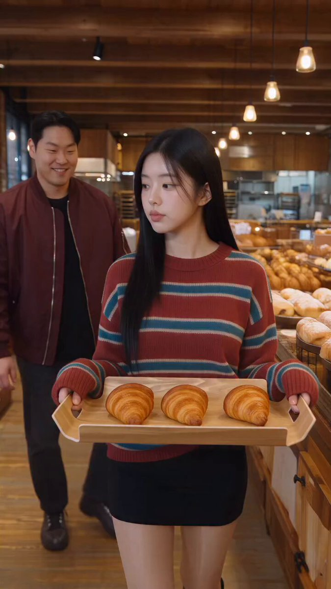

# 韩式面包店里的搞笑功夫对打：10 秒图生视频 prompt

- 原帖链接：https://x.com/SeeratFatima112/status/2120737283729166500
- 作者：Seerat Fatima（@SeeratFatima112）
- 时间：2026-11-12 12:35 (UTC+8 / Asia/Taipei)
- 互动摘要：点赞 49 · 转发 4 · 回复 12 · 引用 0 · 书签 11 · 浏览 3858（采集快照：2026-11-12 20:25 UTC+8）
- 模型/工具：Seedance 2.5（视频，图生视频）
- 标签：真人
- 媒体路径：
  - `media/video-stills/2120737283729166500_still.jpg`（视频封面截图，）
  - 视频本体未入库，仅保留原帖链接：https://x.com/SeeratFatima112/status/2120737283729166500
- 入库日期：2026-11-12
- prompt 来源：https://x.com/SeeratFatima112/status/2120737290851148188
- 备注：prompt 在作者自回复（2120737290851148188），需上传一张人物/场景参考图，原样摘录。视频仅保留原帖链接。

## prompt 原文

```text
Create a 10-second ultra-realistic cinematic action-comedy video inside a cozy Korean-style bakery. Preserve the exact appearance, clothing, hairstyles, body proportions, and environment of all characters from the reference image.

Scene Action:
A plus-sized young woman wearing a red-and-blue striped sweater, black shorts, and black knee-high boots is engaged in a playful martial arts fight with a stocky man wearing an olive-green jacket and black pants.

The man suddenly throws a fast punch toward her. She dramatically leans backward, narrowly dodging his punch with impressive flexibility. Her long dark hair swings naturally with the movement. Without losing balance, she quickly shifts her weight, ducks, and prepares a counterattack.

The man looks surprised by her unexpected agility and tries to regain his fighting stance. In the background, another man wearing a burgundy jacket watches the ridiculous fight with a shocked expression.

Camera & Motion:

- Dynamic handheld cinematic camera.
- Medium-wide shots showing full-body movements.
- Smooth tracking following the fighters.
- Fast but realistic martial arts movements.
- Natural body physics, realistic balance, and believable reactions.
- Subtle camera shake during punches and dodges.

Environment:
Maintain the warm wooden ceiling, exposed brick walls, hanging lights, bakery shelves filled with fresh bread, and realistic indoor lighting.

Style: Ultra-realistic cinematic action comedy, expressive facial reactions, detailed clothing physics, natural movement, high-quality 4K visuals.

Important: No scene transitions, no character changes, no extra people, no distorted limbs, and no unrealistic floating movements. Keep the entire fight continuous and entertaining.
```

---

个人学习归档，非商业。prompt 与媒体版权归原作者 @SeeratFatima112，引用请回到原帖。
