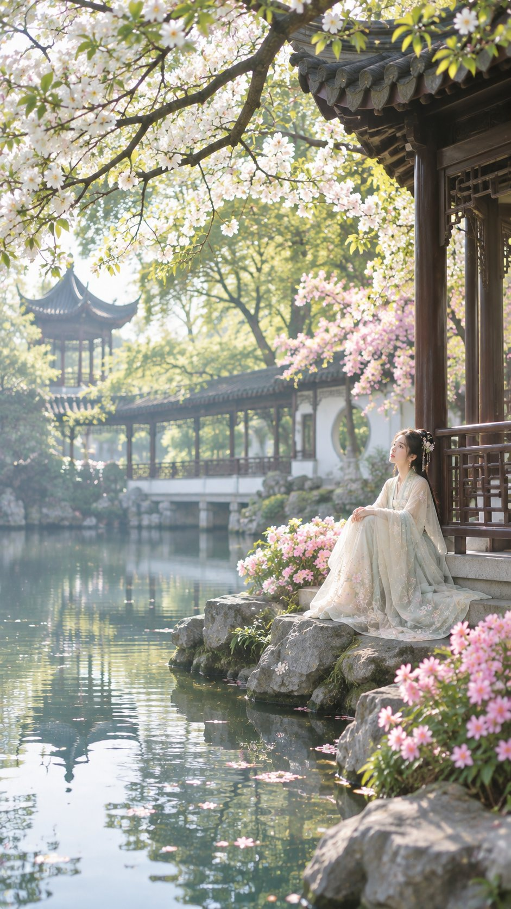

# 江南春日园林：临水古亭旁的汉服女子（中文古风写实 prompt）

- 原帖链接：https://x.com/krienknight/status/2120758493695344804
- 作者：cyberkk（@krienknight）
- 时间：2026-11-12 14:00 (UTC+8 / Asia/Taipei)
- 互动摘要：点赞 13 · 转发 0 · 回复 7 · 引用 1 · 书签 3 · 浏览 864（采集快照：2026-11-12 20:25 UTC+8）
- 模型/工具：GPT Image 2.6（作者写「gpt生图」「升级到image2.6后」）
- 标签：真人
- 媒体路径：
  - `media/images/2120758493695344804_1.jpg`（）
- 入库日期：2026-11-12
- prompt 来源：https://x.com/krienknight/status/2120758494093820343
- 备注：prompt 在作者自回复（2120758494093820343），中文分段描述人物 / 姿态 / 场景 / 光影 / 画质，原样摘录。

## prompt 原文

```text
中国古风唯美摄影，江南春日园林，繁花盛开的中式古典庭院，一位容貌清丽绝美的年轻汉服女子，身穿淡米白色与浅青绿色渐变的精致刺绣汉服，轻薄半透明纱质披帛，衣裙层层叠叠，绣有细腻的粉色花卉纹样，长发盘成精美古典发髻，佩戴珍珠流苏发簪与白色花朵头饰，妆容清透自然，气质温婉优雅。

女子安静地侧坐在临水古亭旁的天然青灰色岩石上，双手轻搭膝前，裙摆自然铺展在石阶与岩石上，微微抬头，凝望远方盛开的春花，神情宁静柔美。

画面右侧为深棕色木质中式亭台，雕花木窗、传统青瓦飞檐，建筑结构精致典雅。前景与画面顶部布满盛开的白色樱花与淡粉色花枝，繁密花朵自然垂落，嫩绿色树叶透过阳光，粉色花丛环绕女子身旁。

左侧是宽阔宁静的碧绿色湖面，水面倒映春日花树、古建筑与天空，漂浮着零星粉白花瓣。远景是蜿蜒的江南水榭长廊、白墙黛瓦、圆形漏窗与古典六角亭，掩映在层层翠绿树木之间。

春日清晨，温暖柔和的金色阳光穿过花枝与树叶，形成自然丁达尔光效，空气中弥漫轻柔薄雾，逆光拍摄，柔和光晕，通透空气感，梦幻朦胧的光影，清新淡雅的粉绿配色，低饱和电影级调色。

超写实古风人像摄影，东方美学，仙气飘逸，诗意氛围，唯美浪漫，细腻真实的皮肤质感，精致服饰纹理，真实自然的花卉细节，丰富环境层次，电影级构图，人物位于画面右下三分之一处，环境占据画面主体，大场景环境人像，纵向构图，85mm人像镜头质感，柔焦背景，浅景深，高动态范围，8K超高清，极致细节，专业摄影，画面干净，无文字，无水印。
```

---

个人学习归档，非商业。prompt 与媒体版权归原作者 @krienknight，引用请回到原帖。
