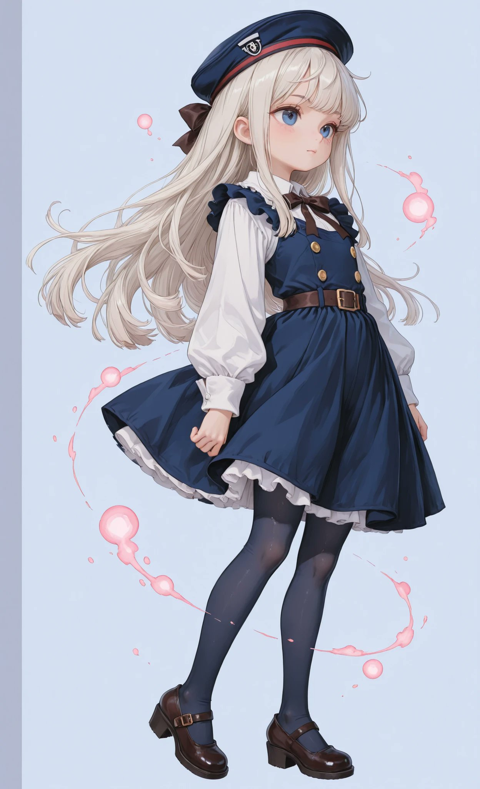
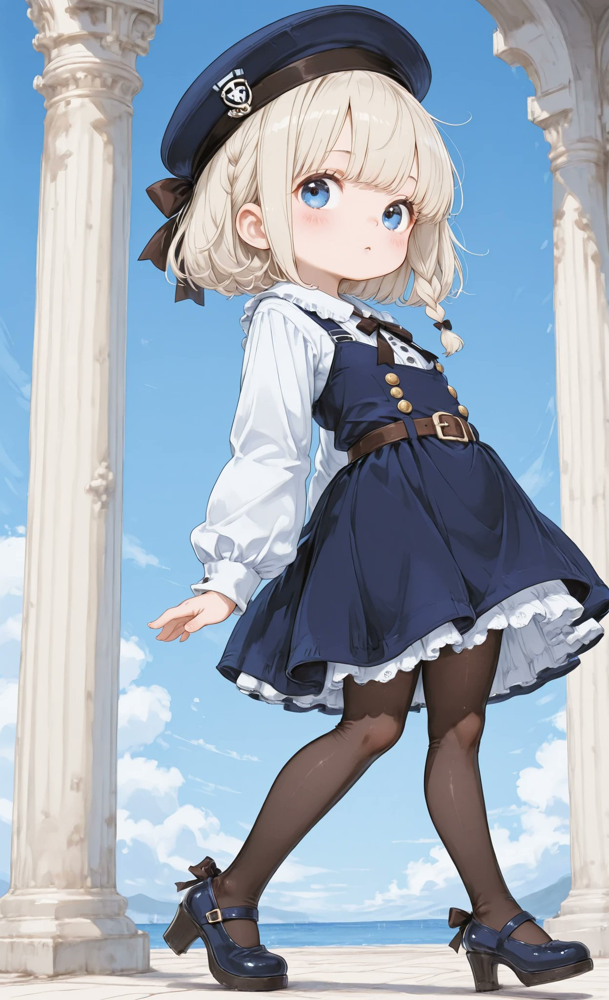
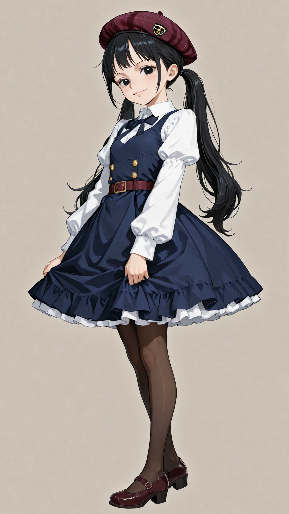
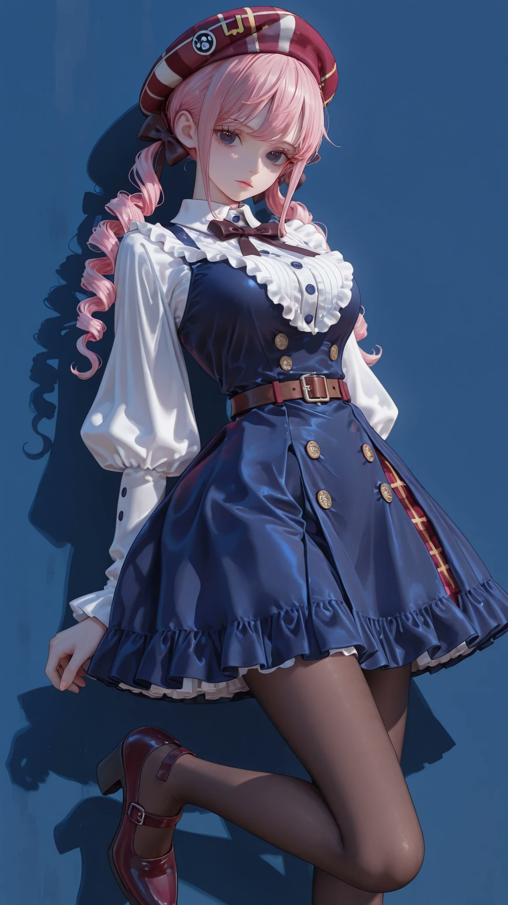

# 藏青背带裙 + 酒红格纹贝雷帽：复古学院风衣装 prompt

- 原帖链接：https://x.com/AliceLavli/status/2120773588823191659
- 作者：アリス服飾店（@AliceLavli）
- 时间：2026-11-12 15:00 (UTC+8 / Asia/Taipei)
- 互动摘要：点赞 129 · 转发 20 · 回复 2 · 引用 5 · 书签 34 · 浏览 2717（采集快照：2026-11-12 20:25 UTC+8）
- 模型/工具：未注明（通用；作者写可用于 SD / SeaArt / PixAI / ChatGPT / Gemini / Grok / Midjourney / niji）
- 标签：二次元
- 媒体路径：
  - `media/images/2120773588823191659_1.jpg`（）
  - `media/images/2120773588823191659_2.jpg`（）
  - `media/images/2120773588823191659_3.jpg`（）
  - `media/images/2120773588823191659_4.jpg`（）
- 入库日期：2026-11-12
- prompt 来源：https://x.com/AliceLavli/status/2120773588823191659
- 备注：prompt 即主帖正文第三段（英文衣装描述），原样摘录；前两段日文为介绍语。

## prompt 原文

```text
navy blue pinafore dress layered over an ivory long sleeved blouse, one piece sleeveless navy blue dress with a full chest covering bodice joined directly to a matching navy blue skirt, broad navy blue shoulder straps connecting the upper bodice to the dress back, straight square neckline across upper chest, continuous solid navy blue dress fabric from chest through waist to below knees, fitted navy blue bodice with four small brass buttons arranged in two columns, softly gathered navy blue skirt attached at natural waist, moderately flared skirt with broad vertical folds, narrow burgundy leather belt around dress waist, thin burgundy stitching near skirt hem, small ivory petticoat ruffle beneath dress hem, ivory blouse collar and shoulder frills visible above navy dress neckline, dark brown ribbon bow at blouse collar, ivory bishop sleeves with fitted buttoned cuffs, burgundy tartan beret, dark brown opaque tights, burgundy rounded toe Mary Jane shoes with buckle straps and low block heels
```

---

个人学习归档，非商业。prompt 与媒体版权归原作者 @AliceLavli，引用请回到原帖。
