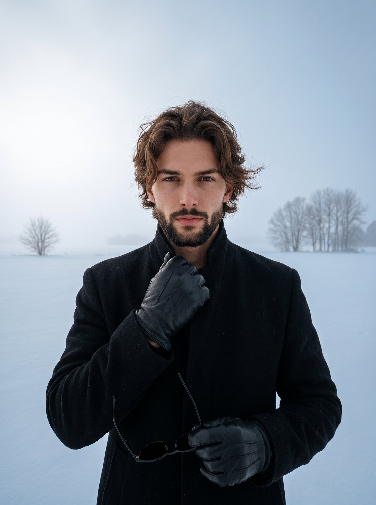

# 雪原黑大衣男士：北欧风奢侈冬装广告人像（含色值与相机参数）

- 原帖链接：https://x.com/pictsbyai/status/2120793218652742104
- 作者：Picts by AI（@pictsbyai）
- 时间：2026-11-12 16:18 (UTC+8 / Asia/Taipei)
- 互动摘要：点赞 20 · 转发 3 · 回复 12 · 引用 1 · 书签 4 · 浏览 458（采集快照：2026-11-12 20:25 UTC+8）
- 模型/工具：Nano Banana 2.1（Gemini App）
- 标签：真人
- 媒体路径：
  - `media/images/2120793218652742104_1.jpg`（）
- 入库日期：2026-11-12
- prompt 来源：https://x.com/pictsbyai/status/2120793218652742104
- 备注：prompt 即主帖正文「Prompt 👇」之后部分，含色值与相机参数，原样摘录。

## prompt 原文

```text
A young adult man with warm tan (#B48870) skin and chestnut brown (#3B2B22) medium-length wavy hair in a layered curtains cut reaching his mid-ear and nape—styled with an off-center part, natural root volume, loose locks, windblown flyaways, and a matte finish—stands centered in a medium-scale, low-angle shot. He faces the camera with a confident, posed expression featuring a neutral mouth, neutral eyebrows, and a direct gaze, while his centered posture and tilted shoulders create an asymmetric balance in a jet-black (#08090C) wool overcoat. His deliberately posed hands are clad in black leather gloves, with his raised left hand gripping the coat collar with curled fingers near his neck and his lowered right hand at the bottom-left lightly gripping dark sunglasses by the frame. Behind him stretches a deep, open snow-covered plain of solid cool snow gray (#AFB7C2) and pale blue-gray snow, where a small dormant bare winter tree on the left horizon and a small cluster of dormant deciduous trees on the right horizon appear as faint gray silhouettes diffused by winter fog beneath a smooth, matte overcast sky transitioning in a pristine gradient from bright misty white (#D7DCE0) at the upper-left to cool gray-blue on the right. Soft, moderate, cool-toned light diffused from the overcast sky above pairs with ambient snow bounce fill to create a dramatic, high-contrast, desaturated monochromatic atmosphere of stoic winter isolation, casting short, soft-edged deep black shadows under his chin, within the coat folds, and along the right side of his face, alongside subtle highlights on his forehead, glove knuckles, snow field, and upper-left sky. Captured as a realistic, minimalist editorial digital photograph influenced by Nordic portraiture and luxury winter menswear campaigns using a 35mm or 50mm lens at f/2.8, 1/1000s, ISO 100, and +0.7 EV snow exposure compensation, the image renders the subject tack sharp with a matte texture against a shallow, blurred background, finished with cool color grading, crushed blacks, and preserved skin warmth, framed in a 3:4 vertical aspect ratio.
```

---

个人学习归档，非商业。prompt 与媒体版权归原作者 @pictsbyai，引用请回到原帖。
