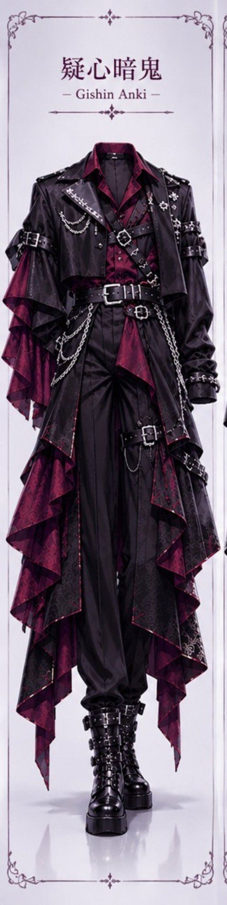
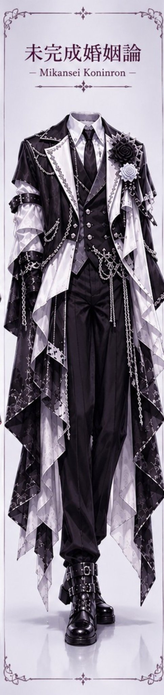
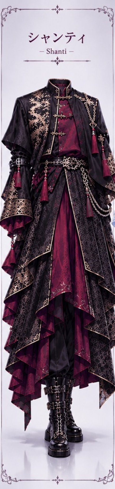
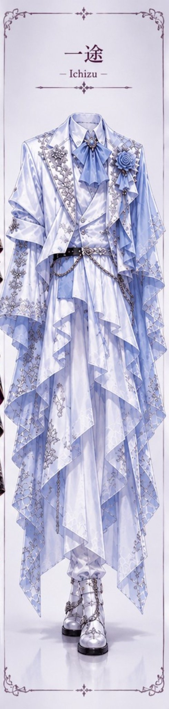

# 「四飼イメソン」印象衣装：哥特朋克 / 黑白贵族 / 东方暗黑 / 冰蓝王子 四套衣装 prompt

- 原帖链接：https://x.com/6phnHE9scQA/status/2120858469238730797
- 作者：シフォン（@6phnHE9scQA）
- 时间：2026-11-12 20:37 (UTC+8 / Asia/Taipei)
- 互动摘要：点赞 42 · 转发 2 · 回复 0 · 引用 0 · 书签 15 · 浏览 1087（采集快照：2026-11-13 20:19 UTC+8）
- 模型/工具：未注明
- 标签：二次元
- 媒体路径：
  - `media/images/2120858469238730797_1.jpg`（）
  - `media/images/2120858469238730797_2.jpg`（）
  - `media/images/2120858469238730797_3.jpg`（）
  - `media/images/2120858469238730797_4.jpg`（）
- 入库日期：2026-11-13
- prompt 来源：https://x.com/6phnHE9scQA/status/2120858469238730797
- 备注：四张图各自的 ALT 文本即对应衣装 prompt（作者说明「プロンプトは各ALTに記載」，仅衣装部分），按图片顺序原样摘录。每段前的「[图N]」为本仓库为对应图片所加的序号标注，非原文。

## prompt 原文

```text
[图1] Dark gothic punk outfit: cropped black leather jacket, burgundy patterned shirt, leather chest harness with silver rings, layered belts and silver buckles, asymmetrical long coat with burgundy inner panels, layered sleeves, silver chains, black wide-leg trousers, black platform combat boots with straps and buckles. Complete full-body outfit replacement from head to toe. Replace all original clothing and footwear completely.

[图2] Black and white gothic aristocratic outfit: fitted black double-breasted waistcoat, white shirt, black necktie, dramatic asymmetrical long tailcoat, oversized white lapels with intricate silver embroidery, black and white rose corsages, translucent layered white panels, silver chains, black wide-leg trousers, black platform combat boots with straps and buckles. Complete full-body outfit replacement from head to toe. Replace all original clothing and footwear completely

[图3] Oriental dark gothic outfit: long black robe with high Mandarin collar, deep burgundy inner shirt, antique gold floral embroidery, gold frog closures, wide layered sleeves with burgundy lining, asymmetrical overlapping robe panels, ornate waist sash, silver chains, long burgundy tassels, black platform combat boots with straps and buckles. Complete full-body outfit replacement from head to toe. Replace all original clothing and footwear completely

[图4] Ice-blue royal prince outfit: elegant white tailored jacket, pale ice-blue ribbon tie, silver brooch, intricate silver floral embroidery, blue rose corsage, translucent chiffon sleeves, flowing asymmetrical white and ice-blue cape panels, silver waist chains, white trousers, silver platform boots with chains. Complete full-body outfit replacement from head to toe. Replace all original clothing and footwear completely
```

---

个人学习归档，非商业。prompt 与媒体版权归原作者 @6phnHE9scQA，引用请回到原帖。
