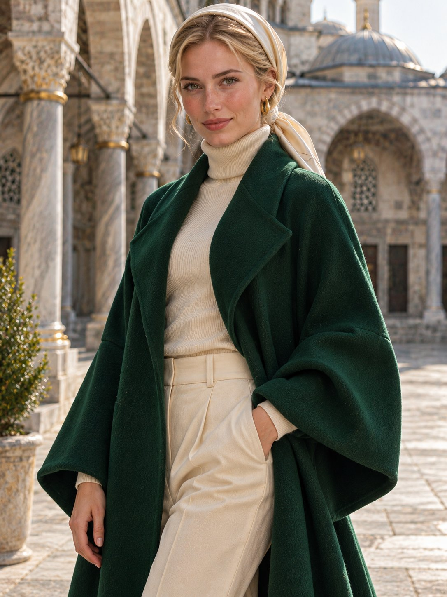

# 翡翠绿羊毛大衣 + 奶油丝巾发髻：石砌拱廊庭院时装大片

- 原帖链接：https://x.com/antrospike/status/2120917034020327786
- 作者：Antrospike（@antrospike）
- 时间：2026-11-13 00:30 (UTC+8 / Asia/Taipei)
- 互动摘要：点赞 25 · 转发 1 · 回复 17 · 引用 0 · 书签 3 · 浏览 434（采集快照：2026-11-13 20:19 UTC+8）
- 模型/工具：未注明
- 标签：真人
- 媒体路径：
  - `media/images/2120917034020327786_1.jpg`（）
- 入库日期：2026-11-13
- prompt 来源：https://x.com/antrospike/status/2120917034569793749
- 备注：prompt 在作者自回复（2120917034569793749），含 Style / Main Prompt / Negative Prompt 三段，原样摘录。

## prompt 原文

```text
Style: Ultra-realistic fashion editorial, warm soft daylight, 85mm lens, rich architectural textures.
Main Prompt: Create an image of a model with blonde hair in a smooth bun wrapped with a cream silk scarf, wearing a long emerald wool coat with wide sleeves over a cream turtleneck and trousers, standing in a stone courtyard with elegant arches and domes behind her. Hands relaxed, calm confident gaze toward the camera. Three-quarter portrait. Vertical portrait format 3:4.
Negative Prompt: no text, no watermark, no extra fingers, no crowds, no logos.
```

---

个人学习归档，非商业。prompt 与媒体版权归原作者 @antrospike，引用请回到原帖。
