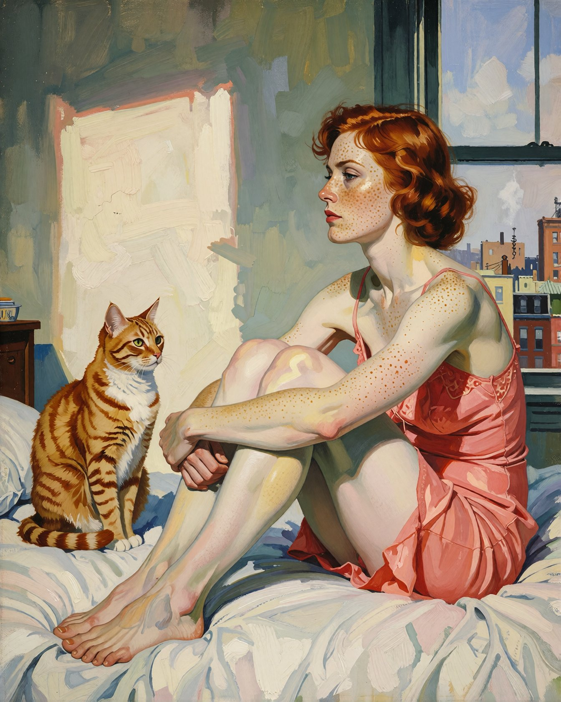

# Edward Hopper 油画风：晨光卧室里与橘猫同姿势的「你的角色」

- 原帖链接：https://x.com/NayaVerseee/status/2120962333862416682
- 作者：Naya（@NayaVerseee）
- 时间：2026-11-13 03:30 (UTC+8 / Asia/Taipei)
- 互动摘要：点赞 27 · 转发 3 · 回复 4 · 引用 3 · 书签 4 · 浏览 333（采集快照：2026-11-13 20:19 UTC+8）
- 模型/工具：未注明
- 标签：其它
- 媒体路径：
  - `media/images/2120962333862416682_1.jpg`（）
- 入库日期：2026-11-13
- prompt 来源：https://x.com/NayaVerseee/status/2120962333862416682
- 备注：prompt 在主帖图片的 ALT 文本中，`[your character]` 为作者留的角色占位符，原样摘录。

## prompt 原文

```text
Oil painting after Edward Hopper, flat clean planes of color, stark morning sunlight, one salmon-pink accent. A bare bedroom with a rectangle of sunlight on the wall: [your character] sits on the bed in a salmon-pink slip, knees drawn up, arms around her legs, gazing out the window at the city rooftops. Beside her an orange tabby cat sits in exactly the same pose, its eyes on her.
```

---

个人学习归档，非商业。prompt 与媒体版权归原作者 @NayaVerseee，引用请回到原帖。
