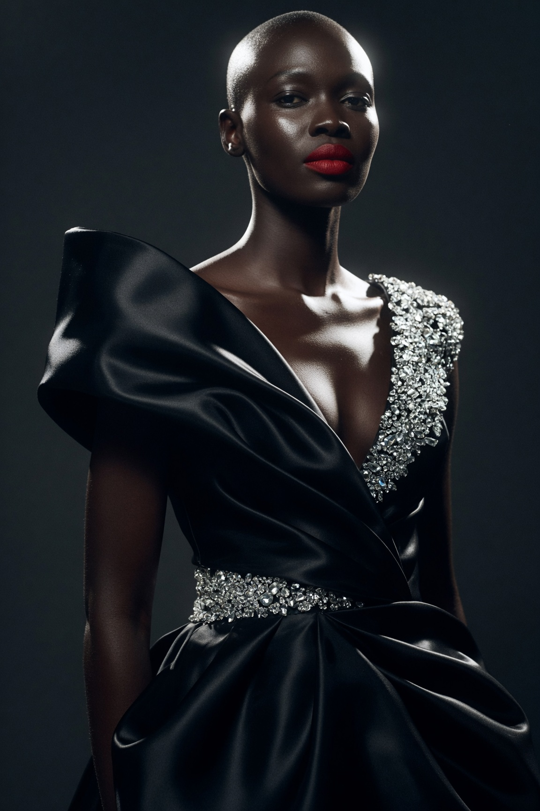

# Vogue 奢华感：黑色雕塑感缎面高定礼服的单侧轮廓光棚拍

- 原帖链接：https://x.com/RockGrokAI/status/2120989511245058189
- 作者：AI Aimee（@RockGrokAI）
- 时间：2026-11-13 05:18 (UTC+8 / Asia/Taipei)
- 互动摘要：点赞 15 · 转发 0 · 回复 0 · 引用 0 · 书签 1 · 浏览 239（采集快照：2026-11-13 20:19 UTC+8）
- 模型/工具：未注明
- 标签：真人
- 媒体路径：
  - `media/images/2120989511245058189_1.jpg`（）
- 入库日期：2026-11-13
- prompt 来源：https://x.com/RockGrokAI/status/2120989511245058189
- 备注：prompt 在主帖图片的 ALT 文本中，原样摘录。

## prompt 原文

```text
Glamorous high-fashion magazine editorial photograph of a stunning dark-skinned Black woman in ultra-swanky all-black haute couture: sculptural satin gown with dramatic shoulder architecture and crystal embellishments. Three-quarter portrait, confident regal pose, glossy skin, bold red lip. Deep charcoal studio background fading to black, single rim light carving her silhouette, Vogue-style luxury mood, sharp focus, cinematic grain, editorial perfection.
```

---

个人学习归档，非商业。prompt 与媒体版权归原作者 @RockGrokAI，引用请回到原帖。
