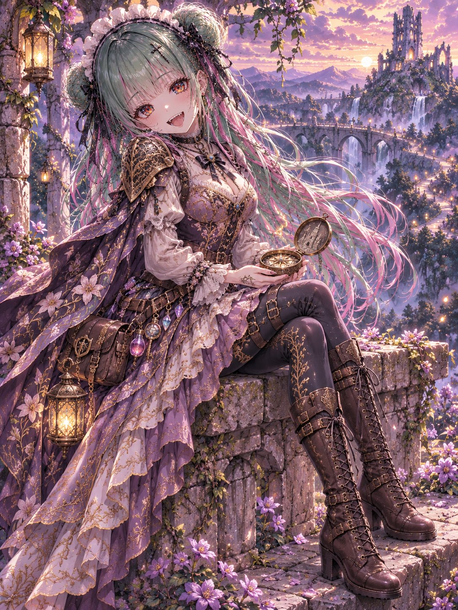
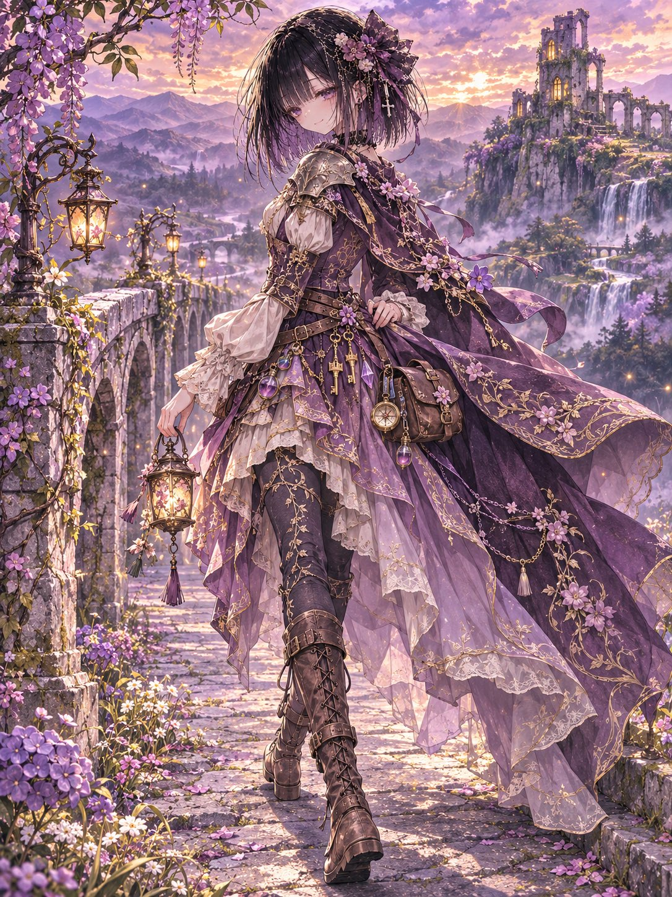
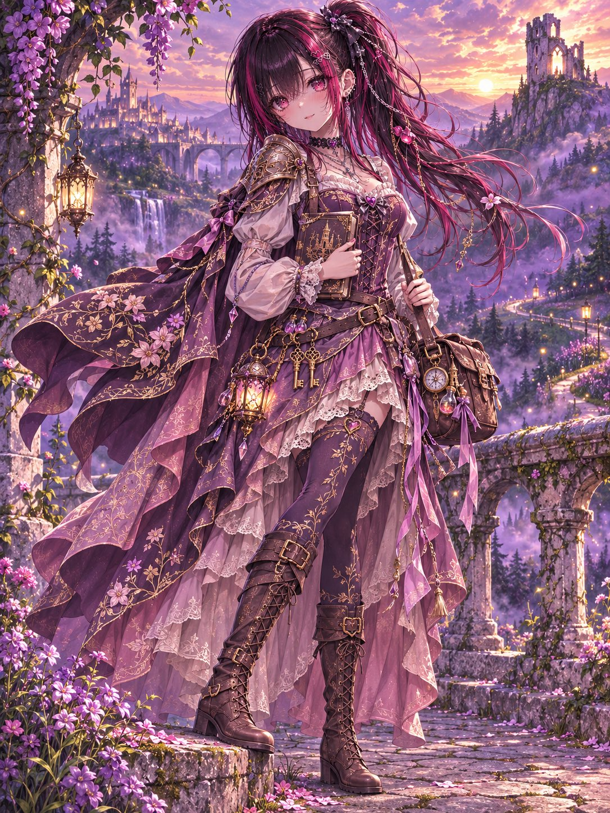
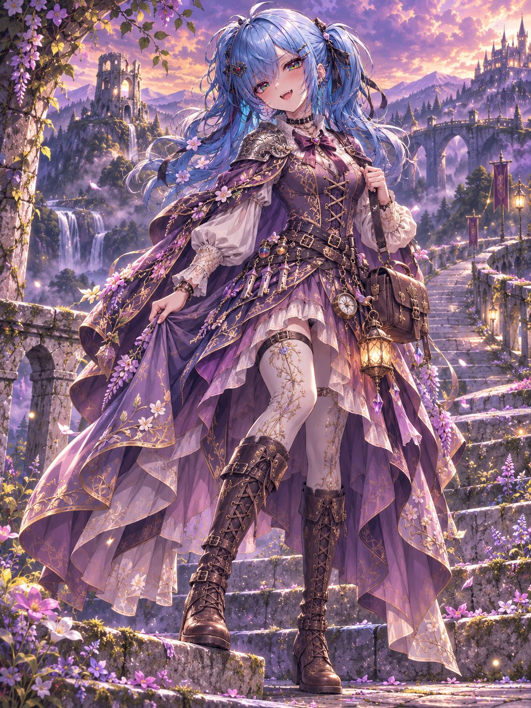

# 流浪的长发公主：魔法旅者衣装（#るん衣装プロンプト 第273弾）

- 原帖链接：https://x.com/ENJU1123PIPI/status/2121007632274297092
- 作者：るんちゃん🦋（@ENJU1123PIPI）
- 时间：2026-11-13 06:30 (UTC+8 / Asia/Taipei)
- 互动摘要：点赞 58 · 转发 21 · 回复 5 · 引用 3 · 书签 3 · 浏览 1159（采集快照：2026-11-13 20:19 UTC+8）
- 模型/工具：未注明（角色参考图驱动的通用衣装 prompt）
- 标签：二次元
- 媒体路径：
  - `media/images/2121007632274297092_1.jpg`（）
  - `media/images/2121007632274297092_2.jpg`（）
  - `media/images/2121007632274297092_3.jpg`（）
  - `media/images/2121007632274297092_4.jpg`（）
- 入库日期：2026-11-13
- prompt 来源：https://x.com/ENJU1123PIPI/status/2121007633608138876
- 备注：prompt 在作者自回复（2121007633608138876），原样摘录。

## prompt 原文

```text
WANDERING RAPUNZEL — THE ENCHANTED WAYFARER

Rapunzel × Wandering Knight × Arcane Wanderer × Fantasy Couture

Use the attached character as the identity reference. Preserve their face, hairstyle, hair length and color, eye color, body proportions, signature accessories, personality, and gender presentation. Redesign only the clothing; add temporary braids, ribbons, or ornaments without replacing the original hairstyle.

CONCEPT
A mysterious adventurer who escaped an enchanted tower and now travels through forgotten kingdoms. Balance: 55% Rapunzel, 25% wandering knight, 20% arcane magic. Adventurous, graceful, independent, and slightly rebellious.

Palette: dusty lavender, antique ivory, muted plum, weathered brown, champagne gold, and subtle emerald accents.

COSTUME
For feminine characters: a lavender-and-ivory medieval travel dress with a gold-embroidered velvet bodice, ornamental lacing, ivory puff-shoulder blouse, lace cuffs, and an asymmetric layered skirt with a short front and long split overskirt. Add embroidered stockings or fitted leggings, tall lace-up leather boots, a floral shoulder cape, and one lightweight shoulder guard engraved with vines and tower motifs.

For masculine characters: an embroidered lavender-and-brown traveling knight’s coat, lightweight shoulder armor, fitted trousers, and ornate leather boots.

Complete the outfit with weathered belts, a satchel, scroll holder, tower-shaped keys, miniature potions, crystal pendants, an enchanted compass, and a small lantern. Integrate the character’s original accessories naturally. Keep the clothing practical, romantic, and modest.

MAGICAL DETAILS
Tiny glowing flowers, vine embroidery, subtle runes along fabric edges, delicate hair ribbons and golden chains, and faint golden light tracing selected strands. Optional: an elegant travel sword, staff, or ancient spellbook. Magic and armor remain secondary to the costume.

COMPOSITION
Full-body illustration, slightly low diagonal three-quarter view. On an ancient stone bridge, one boot rests on a weathered step as the character turns toward the valley. One hand holds a satchel strap or lantern; the other gathers the cape. Hair, ribbons, and layered fabric move in the mountain breeze. Curious, confident expression with a soft mischievous smile.

Alternative: seated on a ruined wall, holding an enchanted compass while looking toward a distant glowing tower. No reaching toward the viewer.

BACKGROUND
An enchanted kingdom at golden twilight: an abandoned forest tower, overgrown ruins, violet-mist mountains, waterfalls, wildflower paths, floating lanterns, fireflies, and a winding road into the distance. Warm sunset light contrasts with cool lavender shadows, evoking freedom, nostalgia, and discovery.

STYLE
High-quality anime illustration with expressive outlines, refined facial linework, dimensional cel shading, multilayered glass-like irises, intricate hair highlights, detailed velvet and leather, elegant embroidery, natural fabric folds, polished metal, and cinematic atmospheric depth.

Vertical 3:4, high resolution. One character only. No text, logos, watermarks, extra limbs, malformed hands, distorted anatomy, oversized armor, excessive machinery, revealing clothing, or gore.
```

---

个人学习归档，非商业。prompt 与媒体版权归原作者 @ENJU1123PIPI，引用请回到原帖。
