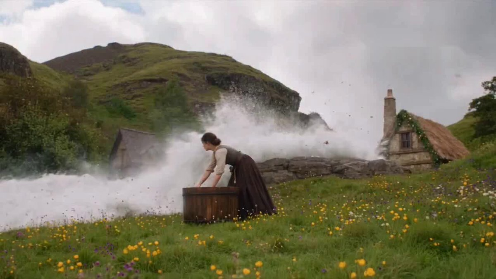

# 《Life With Dragon》Ep 17：木桶漂流 + 粉白幼龙追逐的 25 秒奇幻分时段脚本

- 原帖链接：https://x.com/AiWithSaira/status/2121079227441410210
- 作者：Saira（@AiWithSaira）
- 时间：2026-11-13 11:14 (UTC+8 / Asia/Taipei)
- 互动摘要：点赞 14 · 转发 1 · 回复 5 · 引用 0 · 书签 5 · 浏览 1786（采集快照：2026-11-13 20:19 UTC+8）
- 模型/工具：Seedance 2.5（视频）
- 标签：真人
- 媒体路径：
  - `media/video-stills/2121079227441410210_still.jpg`（视频封面截图，）
  - 视频本体未入库，仅保留原帖链接：https://x.com/AiWithSaira/status/2121079227441410210
- 入库日期：2026-11-13
- prompt 来源：https://x.com/AiWithSaira/status/2121079504391270411
- 备注：prompt 在作者自回复（2121079504391270411），需上传角色 Daisy 与粉白幼龙参考图，原样摘录。视频仅保留原帖链接。

## prompt 原文

```text
Photorealistic Hollywood Fantasy Adventure, 4K Ultra-Realistic Cinematography, 35mm Film Look. A breathtaking green mountain valley with rolling hills, wild yellow flowers, a medieval stone cottage, ancient stone water channels and a massive arched aqueduct stretching across a deep mountain gorge. Dramatic cloudy skies, atmospheric mist, natural daylight transitioning into a warm golden-hour sunset. Match Daisy and the giant baby pink-and-white dragon reference images precisely. Maintain consistent character appearance, dragon anatomy, colors, scale and environment throughout. The dragon must have realistic pink scales, pale pearl-white body, amber eyes, pink spiky crest, powerful wings and a long expressive tail.

0–4s: Wide cinematic establishing shot of a peaceful mountain meadow. Daisy, a young woman with brown hair tied in a bun, wearing a cream blouse, dark brown vest and long skirt, leans beside a large wooden barrel in the grassy field. Suddenly, a powerful torrent of crystal-clear water rushes violently across the meadow, creating enormous white waves and thick mist. The wooden barrel is caught in the rushing current as Daisy struggles to hold on. The pink-white dragon emerges through the mist in the background.

4–8s: Dynamic wide tracking shot: the giant baby dragon runs alongside the rushing water channel near the medieval stone cottage, its wings partially spread and tail swinging naturally. Daisy is swept downstream inside the wooden barrel, desperately holding its rim as water crashes around her. The dragon follows closely, its amber eyes fixed on her. Massive realistic water currents, flying droplets and powerful splashes.

8–12s: Low-angle action shots of the dragon sprinting and bounding beside the narrow stone waterway, its full body, pink claws, folded wings and long tail clearly visible. Daisy's barrel races through the fast-moving water below. The dragon leaps forward beside the channel as the current carries Daisy around a sharp stone bend. Dramatic camera tracking, realistic water turbulence and energetic movement.

12–16s: The barrel rushes toward an ancient stone archway and disappears into a dark medieval tunnel beneath the hillside. Cinematic transition from bright daylight into deep shadow. Daisy crouches inside the barrel, gripping its wooden edges as water rushes beneath her. The dragon's enormous pink silhouette briefly appears above the stone arch, following the barrel.

16–20s: The barrel bursts out of the tunnel into a spectacular elevated stone water channel. The dragon runs across the grassy hillside above the aqueduct, keeping pace with Daisy. A breathtaking aerial tracking shot reveals an enormous medieval aqueduct with multiple stone arches spanning a deep green mountain gorge. Warm golden sunlight breaks through the clouds, illuminating the rushing water and distant mountains.

20–25s: Dramatic wide cinematic reveal of Daisy's wooden barrel speeding along the narrow elevated aqueduct, surrounded by fast-flowing water. Daisy looks back in absolute shock as the giant pink-white dragon appears on the grassy stone embankment beside the aqueduct, its wings opening and its long tail sweeping behind it. Close-up of Daisy's frightened expression as she stretches her arms out to balance herself. Final epic wide shot: the dragon stands beside the ancient aqueduct overlooking the vast mountain valley, with the barrel racing through the water below. End on a breathtaking fantasy adventure moment.

Cinematography & Motion: Epic aerial tracking shots, fast lateral camera movements, dramatic low-angle dragon shots, expressive handheld close-ups, seamless cinematic transitions, realistic character movement, physically accurate flowing water, powerful waves, natural foam, flying water droplets, atmospheric mist and detailed environmental interactions. Maintain consistent character identity and dragon design in every shot. Full-body dragon visibility in wide shots, natural anatomy, realistic proportions, detailed textures, cinematic depth of field, Hollywood fantasy production quality.

Strict Constraints: No character redesign, no dragon color changes, no extra characters, no duplicate dragons, no cartoon appearance, no unrealistic water physics, no teleportation, no sudden scene changes, no frozen movements, no slow motion, no subtitles, no text and no watermark. Preserve Daisy's original outfit and appearance throughout the entire sequence.
```

---

个人学习归档，非商业。prompt 与媒体版权归原作者 @AiWithSaira，引用请回到原帖。
