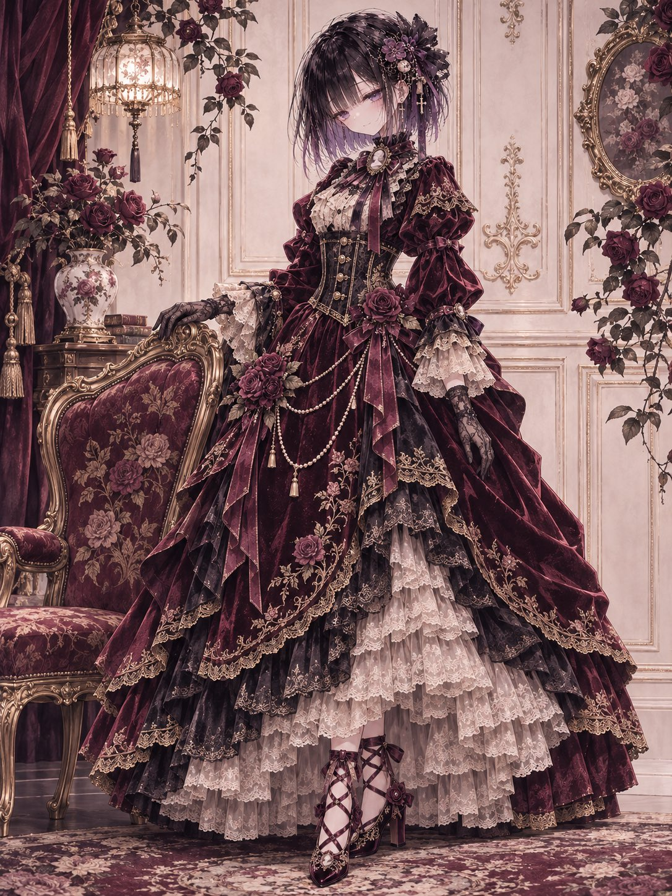
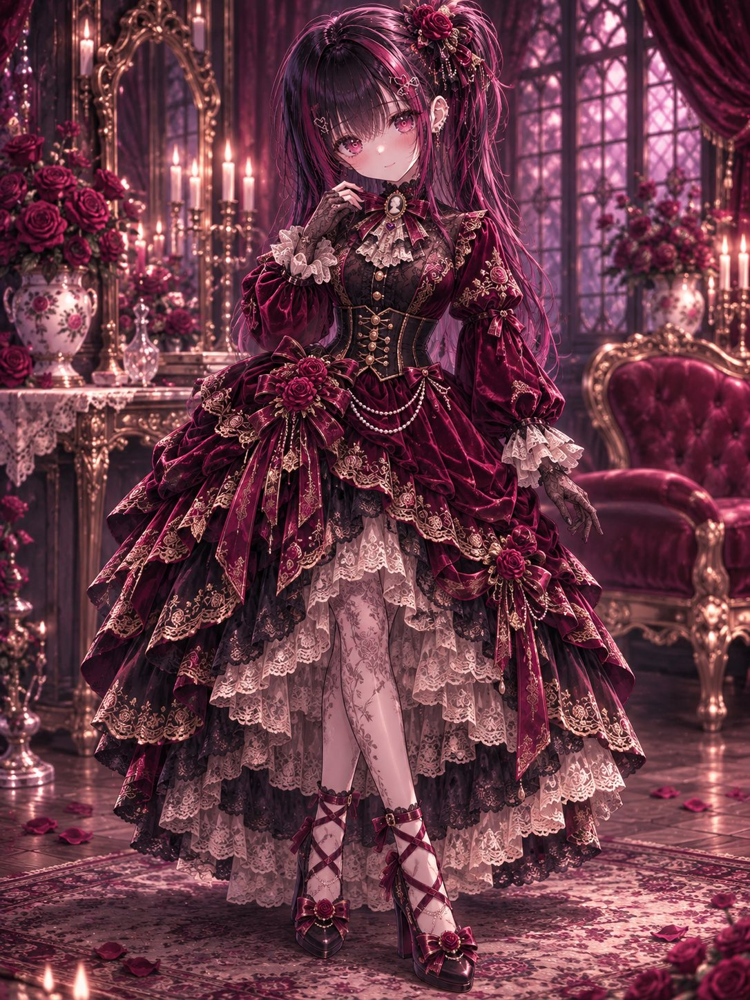
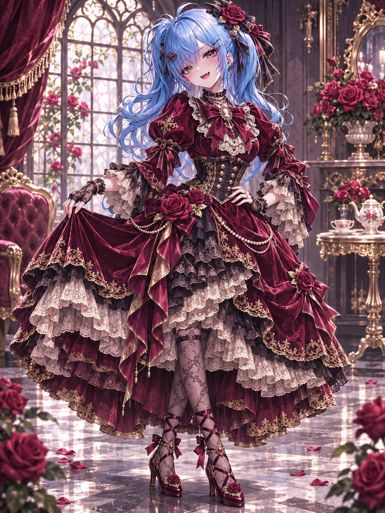
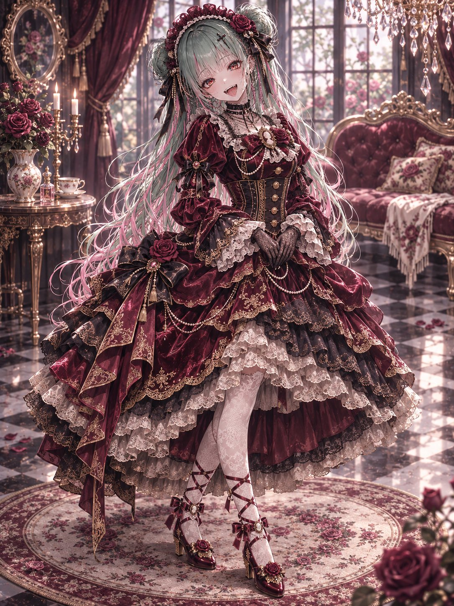

# 深红天鹅绒古典人偶风礼服（#るん衣装プロンプト 第274弾）

- 原帖链接：https://x.com/ENJU1123PIPI/status/2121211477575205355
- 作者：るんちゃん🦋（@ENJU1123PIPI）
- 时间：2026-11-13 20:00 (UTC+8 / Asia/Taipei)
- 互动摘要：点赞 18 · 转发 6 · 回复 2 · 引用 0 · 书签 1 · 浏览 213（采集快照：2026-11-13 20:19 UTC+8）
- 模型/工具：未注明（角色参考图驱动的通用衣装 prompt）
- 标签：二次元
- 媒体路径：
  - `media/images/2121211477575205355_1.jpg`（）
  - `media/images/2121211477575205355_2.jpg`（）
  - `media/images/2121211477575205355_3.jpg`（）
  - `media/images/2121211477575205355_4.jpg`（）
- 入库日期：2026-11-13
- prompt 来源：https://x.com/ENJU1123PIPI/status/2121211478338662841
- 备注：prompt 在作者自回复（2121211478338662841），原样摘录。

## prompt 原文

```text
Use the attached character as the sole subject. Preserve their recognizable face, hairstyle, hair color, eye color, body proportions, signature accessories, and personality.

Dress them in an elegant classical doll-inspired outfit in wine red, black, and antique gold: a fitted velvet bodice with a corset-style waist, gold buttons, rose ornaments, delicate embroidery, puff sleeves, and lace cuffs. Add a gracefully layered skirt with velvet drapes, lace underskirts, ribbons, scalloped hems, and refined ruffles.

Complete the look with a matching rose headpiece or mini bonnet, ribbon choker, lace gloves, cameo brooch, and ribbon-accented lace-up shoes. Optional pearl chains enhance the luxurious, slightly gothic atmosphere.

Show the entire character in a graceful pose with a sweet, poised expression. Frame them against tasteful antique décor, roses, and soft lighting, keeping the outfit clearly visible.

Premium anime illustration, clean expressive linework, refined cel shading, rich fabric textures, polished composition, natural anatomy. No additional characters, text, or watermark.
```

---

个人学习归档，非商业。prompt 与媒体版权归原作者 @ENJU1123PIPI，引用请回到原帖。
