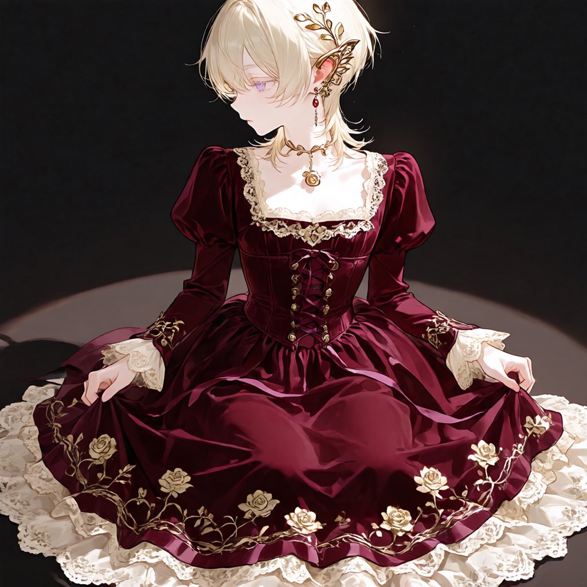
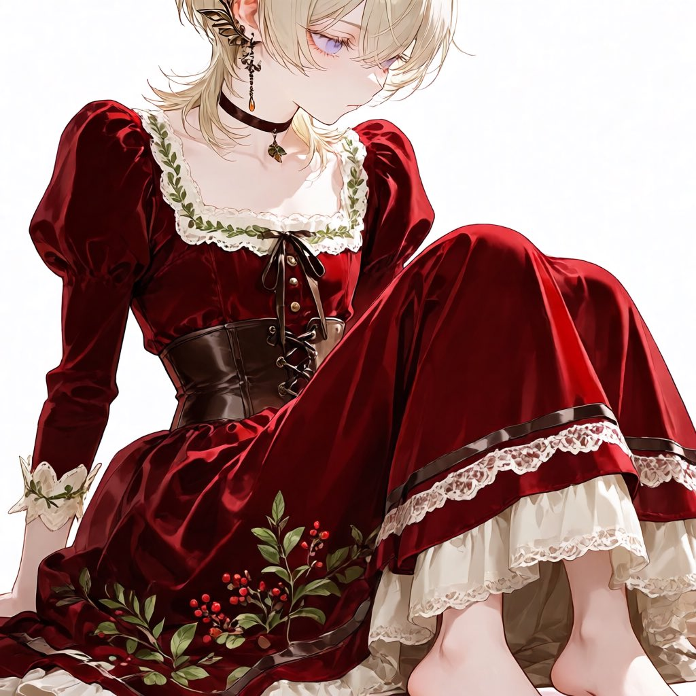
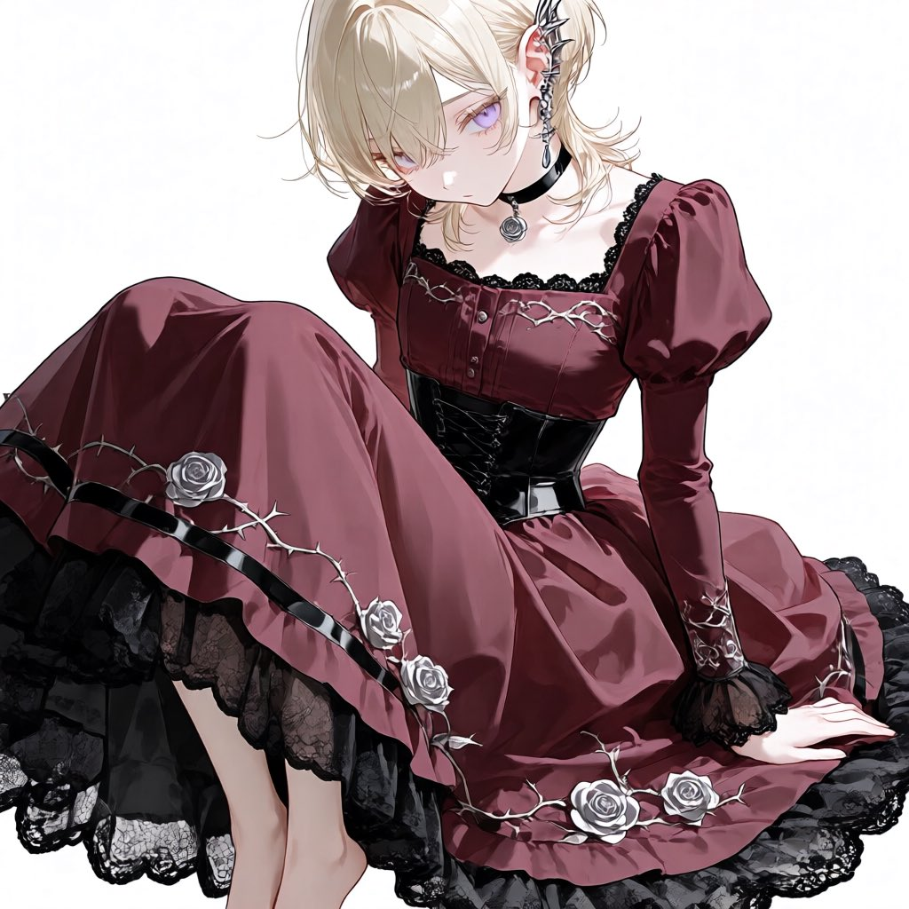

# 精灵植物刺绣古典洛丽塔长裙（ALT 衣装 prompt + 配色方案）

- 原帖链接：https://x.com/hiyoko86637/status/2121398455872655577
- 作者：純粋なヒヨコ86637（@hiyoko86637）
- 时间：2026-11-14 08:23 (UTC+8 / Asia/Taipei)
- 互动摘要：点赞 35 · 转发 4 · 回复 0 · 引用 0 · 书签 19 · 浏览 1601（采集快照：2026-11-16 19:43 UTC+8）
- 模型/工具：未注明
- 标签：二次元
- 媒体路径：
  - `media/images/2121398455872655577_1.jpg`（）
  - `media/images/2121398455872655577_2.jpg`（）
  - `media/images/2121398455872655577_3.jpg`（）
- 入库日期：2026-11-16
- prompt 来源：https://x.com/hiyoko86637/status/2121398455872655577
- 备注：作者说明「ALT1枚＋2枚は衣装プロンプト、3枚目はおすすめカラー」：图 1、图 2 的 ALT 为衣装 prompt，图 3 的 ALT 为推荐配色变量，按图片顺序原样摘录。每段前的「[图N]」为本仓库所加序号标注，非原文。

## prompt 原文

```text
[图1] ## Other
classical lolita tailoring, fitted bodice, voluminous floor-length skirt, botanical embroidery, minimal metallic decoration

## Clothing Upper Body
classical lolita dress with elven botanical details, fitted velvet bodice in [main color], square neckline, structured waist seams, narrow corset-style front lacing in [ribbon color], small satin bows at the neckline,
long fitted sleeves in [main color], softly puffed shoulders, pointed lace cuffs in [lace color], delicate vine embroidery along the sleeve edges in [embroidery color],
scalloped lace trim around the neckline in [lace color], small floral embroidery across the bodice, tiny pearl buttons

[图2] ## Clothing Lower Body
floor-length classical lolita skirt in [main color], fitted high waist, voluminous bell-shaped silhouette supported by a layered petticoat, smooth velvet outer fabric, wide gathered skirt panels,
wide scalloped lace border along the hem in [lace color], embroidered climbing vines and small woodland flowers around the lower skirt in [embroidery color], narrow satin ribbon bands above the hem in [ribbon color],
layered underskirt in [underskirt color], soft cotton fabric, narrow lace edging visible beneath the outer skirt, structured floor-length skirt silhouette

## Footwear
bare feet, no shoes, no socks, no stockings, no ankle accessories

## Accessories
elongated elven-style silver ear cuff, curved leaf-shaped metalwork following the outer ear, fine dangling chains, small teardrop crystal pendants in [gem color], miniature vine ornaments, delicate botanical choker with a small leaf pendant

[图3] 🍷
[main color] = deep wine red
[lace color] = warm cream
[ribbon color] = burgundy
[embroidery color] = antique gold
[underskirt color] = warm cream
[gem color] = garnet red

🥀
[main color] = muted dark rose red
[lace color] = deep black
[ribbon color] = black
[embroidery color] = metallic silver
[underskirt color] = black
[gem color] = smoky gray
```

---

个人学习归档，非商业。prompt 与媒体版权归原作者 @hiyoko86637，引用请回到原帖。
