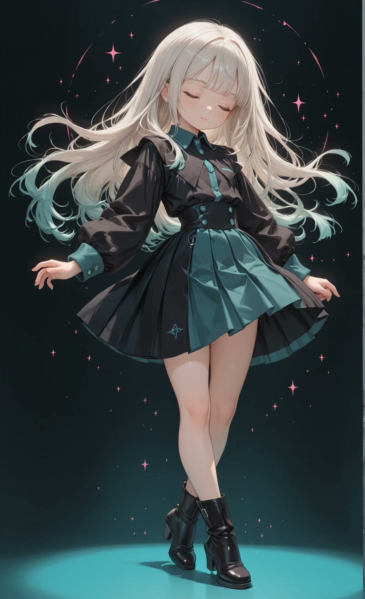
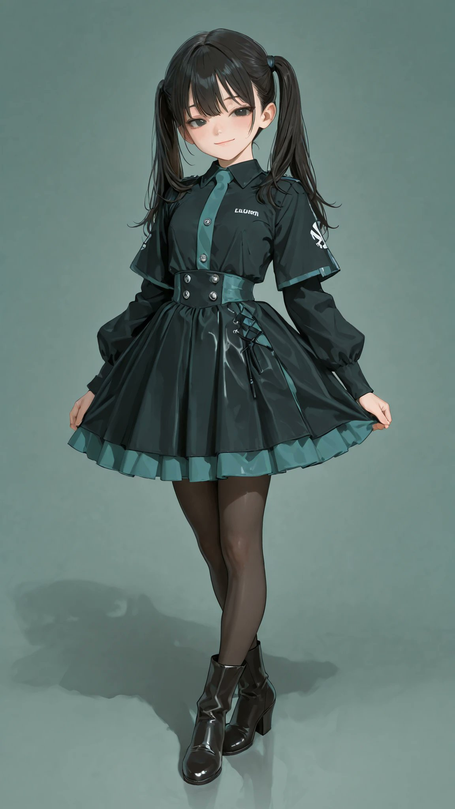
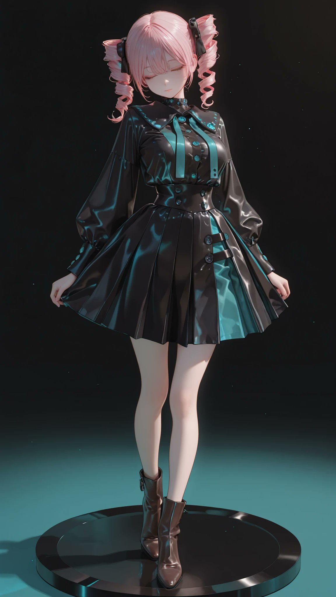

# 黑 × 青拼色长衬衫裙：宽腰封 + 百褶喇叭长裙 + 中筒靴衣装 prompt

- 原帖链接：https://x.com/AliceLavli/status/2121437981202387385
- 作者：アリス服飾店（@AliceLavli）
- 时间：2026-11-14 11:00 (UTC+8 / Asia/Taipei)
- 互动摘要：点赞 219 · 转发 37 · 回复 3 · 引用 13 · 书签 55 · 浏览 7466（采集快照：2026-11-16 09:10 UTC+8）
- 模型/工具：未注明（通用；作者写可用于 SD / SeaArt / PixAI / ChatGPT / Gemini / Grok / Midjourney / niji）
- 标签：二次元
- 媒体路径：
  - `media/images/2121437981202387385_1.jpg`（）
  - `media/images/2121437981202387385_2.jpg`（）
  - `media/images/2121437981202387385_3.jpg`（）
  - `media/images/2121437981202387385_4.jpg`（）
- 入库日期：2026-11-16
- 备注：prompt 在正文最后一段，作者说明可用于多数生成 AI。原样摘录。

## prompt 原文

```text
black and teal color block long shirt dress, black pointed shirt collar, asymmetrical teal upper bodice with a large black overlay panel across one side of chest, black vertical upper button placket with round dark buttons, straight horizontal bodice edge above fitted waist, full length black sleeves with softly gathered volume and wide teal buttoned cuffs, defined natural waist with broad black fabric waistband, long predominantly black flared skirt extending to lower calves, narrow teal skirt button placket running vertically from waist toward hem, small dark buttons evenly spaced down teal placket, broad teal inset panels along both outer skirt sides, deep skirt pleats beneath waistband, long smooth vertical folds through black skirt fabric, simple gently curved skirt hem, matte softly structured woven fabric with clean panel seams, dark brown leather mid calf boots with fitted shafts and subtle vertical stitching, softly squared closed toes, low broad heels and dark rubber soles
```
