# 角色三面图 + 2–3 头身 Q 版 + 细节分格的设定表 prompt（TSUBAKI / SDXL 两版）

- 原帖链接：https://x.com/Lulu_2nya0/status/2121481946534670824
- 作者：蜜（@Lulu_2nya0）
- 时间：2026-11-14 13:54 (UTC+8 / Asia/Taipei)
- 互动摘要：点赞 189 · 转发 23 · 回复 0 · 引用 4 · 书签 188 · 浏览 6056（采集快照：2026-11-16 09:10 UTC+8）
- 模型/工具：TSUBAKI、SDXL（帖内分别给出两版 prompt）
- 标签：二次元
- 媒体路径：
  - `media/images/2121481946534670824_1.jpg`（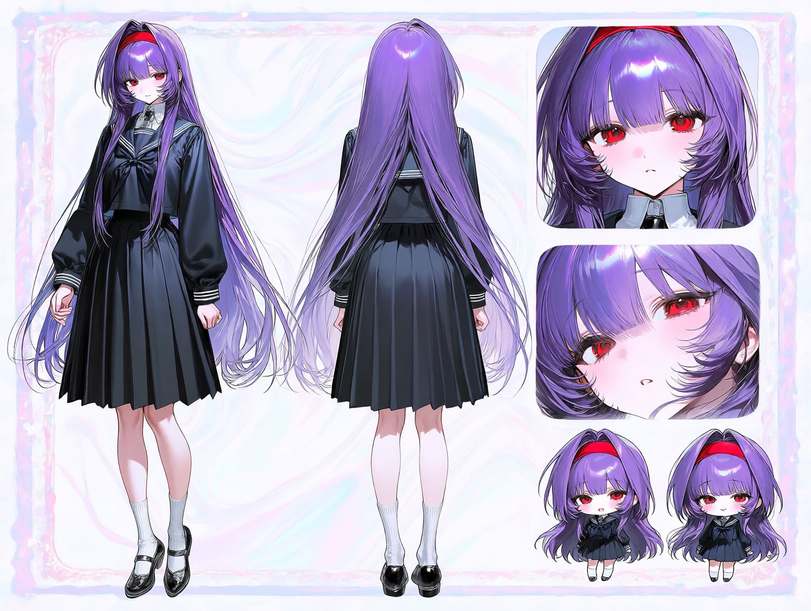）
  - `media/images/2121481946534670824_2.jpg`（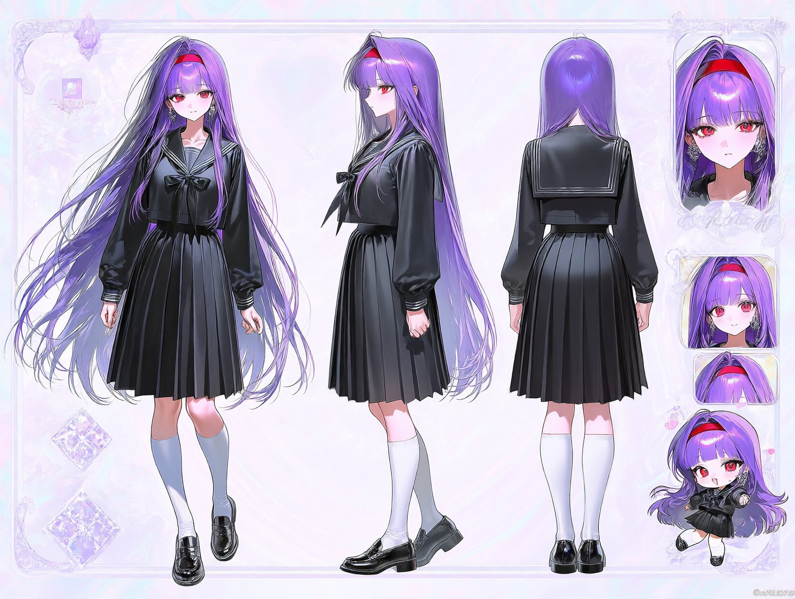）
  - `media/images/2121481946534670824_3.jpg`（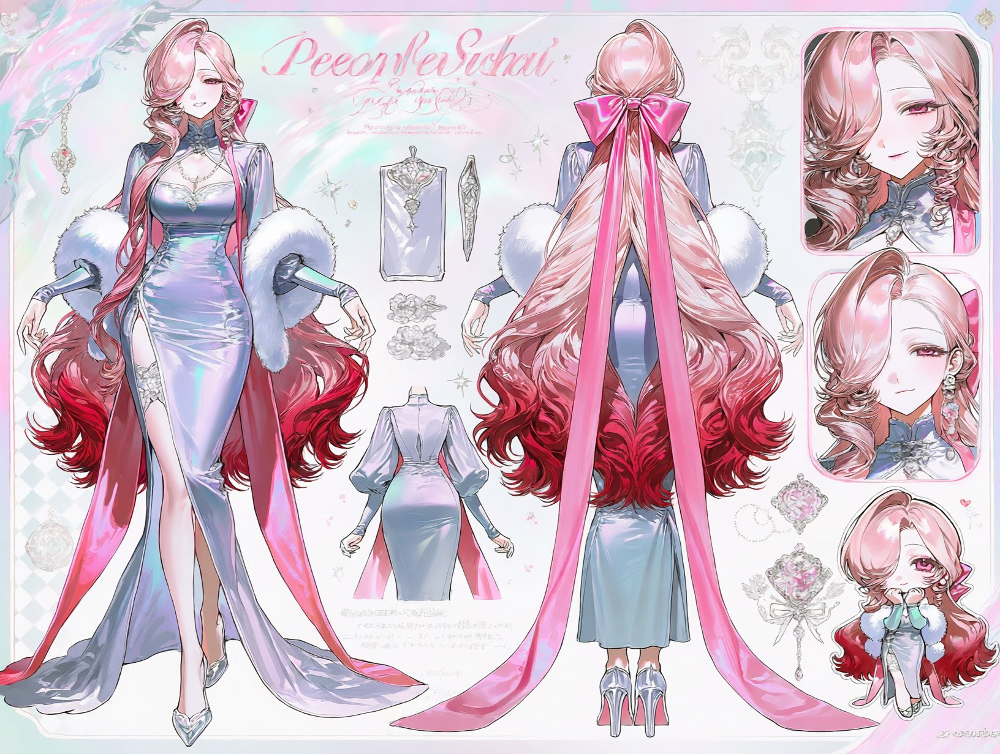）
  - `media/images/2121481946534670824_4.jpg`（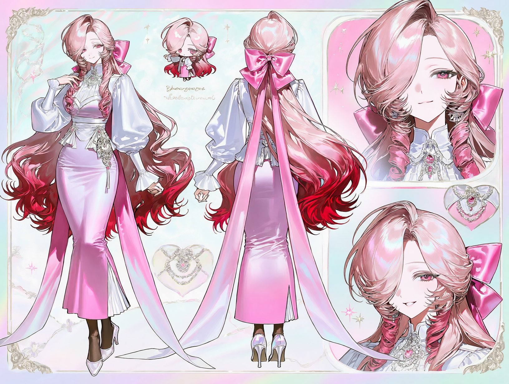）
  - `media/images/2121481946534670824_5.jpg`（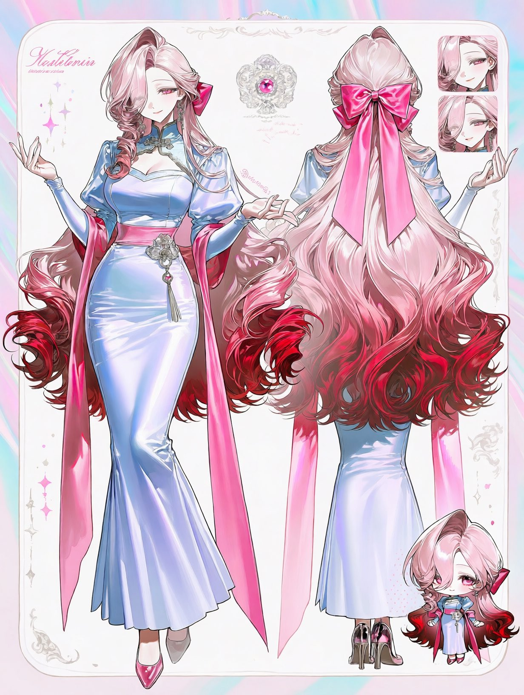）
  - `media/images/2121481946534670824_6.jpg`（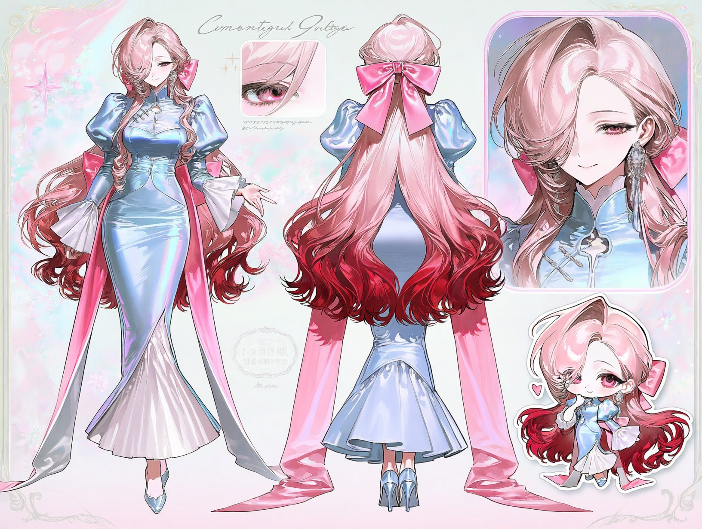）
  - `media/images/2121481946534670824_7.jpg`（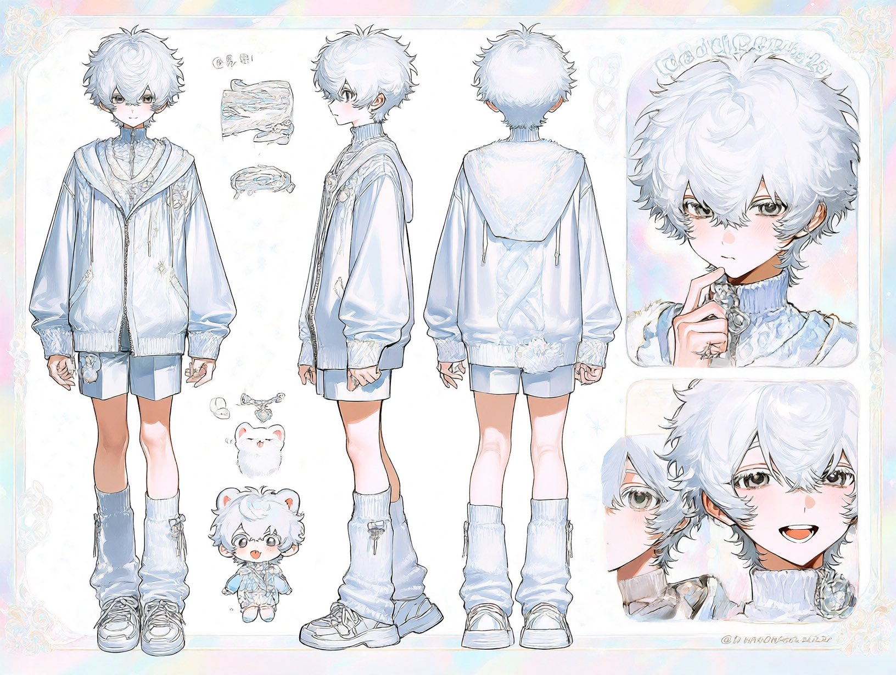）
  - `media/images/2121481946534670824_8.jpg`（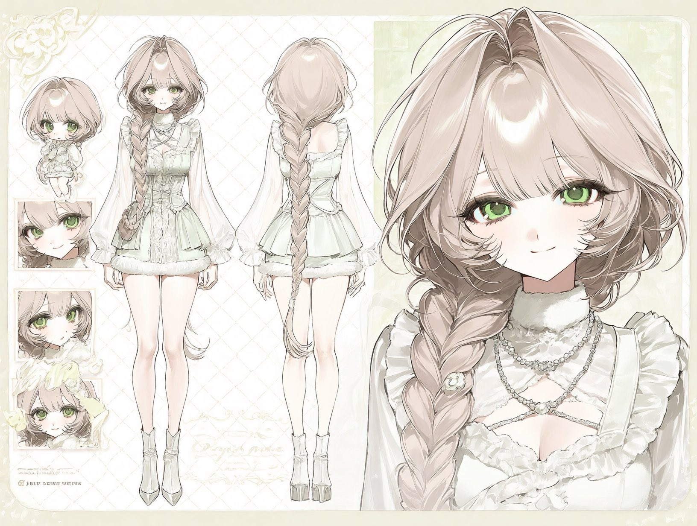）
  - `media/images/2121481946534670824_9.jpg`（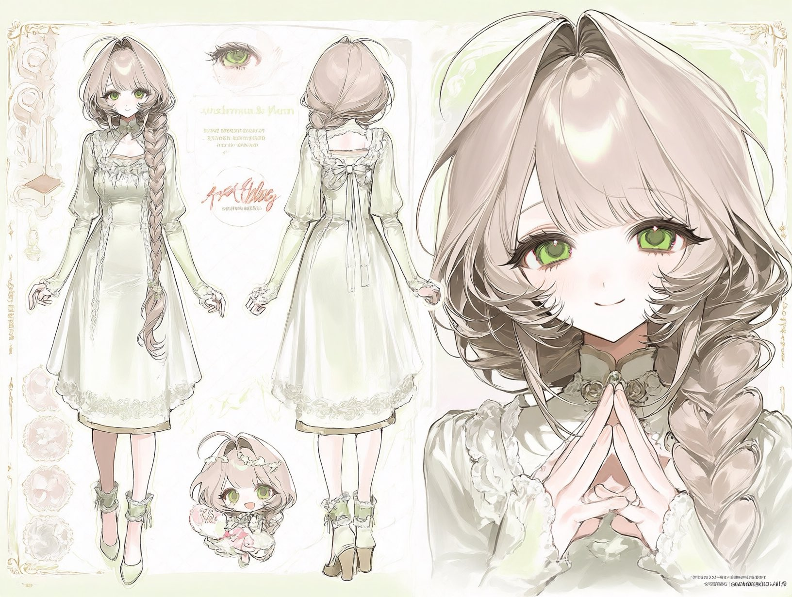）
  - `media/images/2121481946534670824_10.jpg`（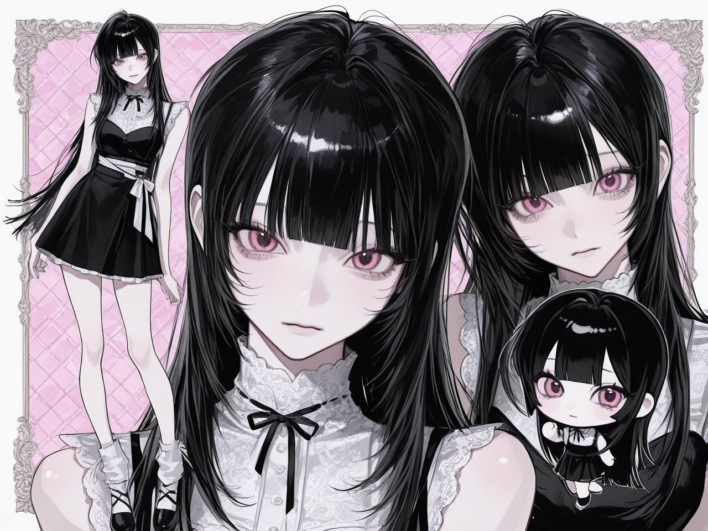）
  - `media/images/2121481946534670824_11.jpg`（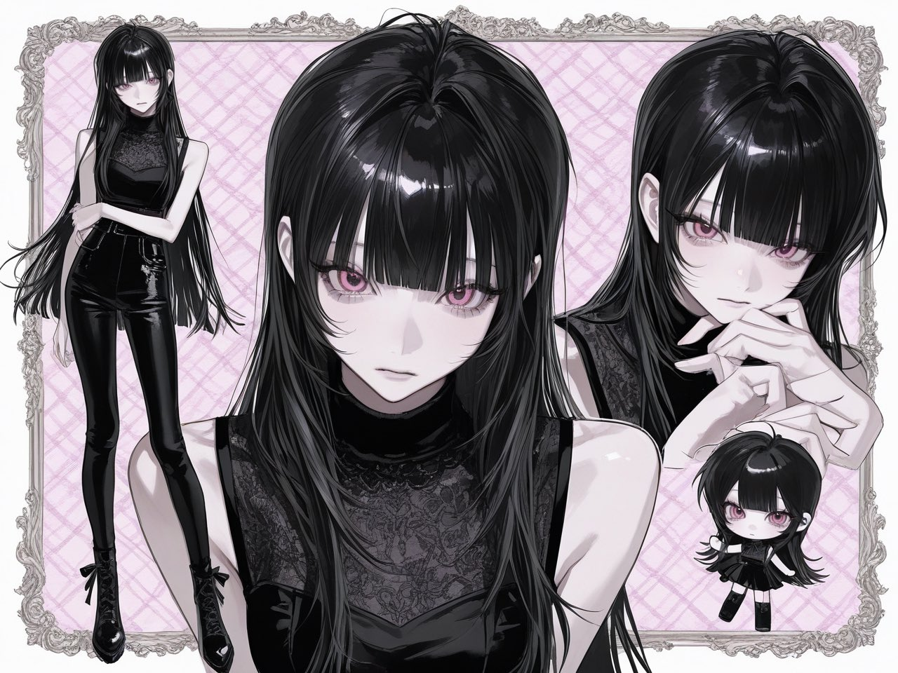）
- 入库日期：2026-11-16
- 备注：prompt 在正文，作者给出 TSUBAKI 用与 SDXL 用两版（#プロンプト配布）。11 张示例图全部入库。原样摘录。

## prompt 原文

```text
TSUBAKI用プロンプト
masterpiece, best quality, ultra-detailed, aesthetic anime character reference sheet, elaborate character design presentation, front side back turnaround views, full body character lineup, consistent character proportions and outfit, cute chibi version, 2-3 heads tall, multiple adorable expressions, detailed close-up panels of eyes, hairstyle, accessories and outfit details, beautifully arranged rounded panels, decorative pastel background, elegant graphic layout, delicate borders, tiny ornamental decorations, stylish typography, cohesive color palette, clean professional character design sheet, highly polished illustration

SDXL用プロンプト
masterpiece, best quality, ultra-detailed, anime character reference sheet, character design showcase, detailed presentation layout, front view, side view, back view, full body turnaround, consistent character design, consistent outfit, chibi version, cute 2-head-tall mini character, adorable pose, multiple detail panels, close-up eyes, close-up hairstyle, outfit details, accessory details, decorative rounded frames, pastel aesthetic, colorful graphic background, cute ornamental elements, ribbons, stars, delicate patterns, elegant panel layout, clean spacing, cohesive color palette, polished anime illustration
```
