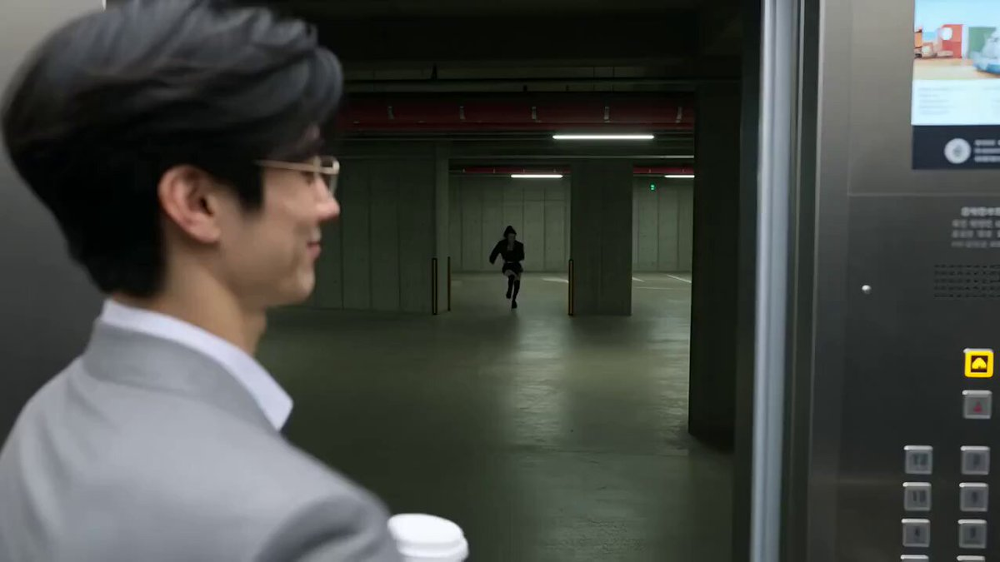

# 电梯里的 30 秒功夫对打：6 段式中式动作片分镜 prompt

- 原帖链接：https://x.com/HeyAirahAi/status/2121583698747548118
- 作者：Airah（@HeyAirahAi）
- 时间：2026-11-14 20:39 (UTC+8 / Asia/Taipei)
- 互动摘要：点赞 88 · 转发 42 · 回复 19 · 引用 1 · 书签 25 · 浏览 8549（采集快照：2026-11-16 19:43 UTC+8）
- 模型/工具：Seedance 2.5（视频）
- 标签：真人
- 媒体路径：
  - `media/video-stills/2121583698747548118_still.jpg`（视频封面截图，）
  - 视频本体未入库，仅保留原帖链接：https://x.com/HeyAirahAi/status/2121583698747548118
- 入库日期：2026-11-16
- prompt 来源：https://x.com/HeyAirahAi/status/2121583705194168330
- 备注：prompt 在作者自回复（2121583705194168330），原样摘录。视频仅保留原帖链接。

## prompt 原文

```text
Create a 30-second ultra-cinematic martial arts action sequence inside a modern elevator.

Scene 1 (0–5 seconds):
A young Chinese man wearing a stylish black outfit walks into a modern high-rise elevator. He presses the floor button and turns toward the closing doors. The elevator doors begin to slide shut.

Scene 2 (5–9 seconds):
Just before the doors close, a young Chinese woman wearing a dark fitted action outfit rushes toward the elevator. She quickly stops the doors and steps inside. The man looks surprised as she gives him an intense stare.

Scene 3 (9–15 seconds):
Without warning, the woman launches a fast martial arts attack. The man blocks her punches and steps backward. They exchange rapid, precisely choreographed punches and defensive moves in the confined elevator.

Scene 4 (15–22 seconds):
The fight becomes more intense. The woman performs a spinning kick, which the man narrowly blocks. He counters with a quick defensive move. They dodge, block, and move around the elevator with realistic martial arts choreography.

Scene 5 (22–27 seconds):
The man catches her next attack and pushes her backward safely against the elevator wall. She quickly recovers and attempts another strike. The elevator lights flicker dramatically as the fight continues.

Scene 6 (27–30 seconds):
Suddenly, the elevator stops. Both characters freeze and stare at each other, breathing heavily. The doors slowly begin to open, revealing a shocked person standing outside. End with a dramatic cinematic freeze-frame.

Visual Style:
Ultra-realistic Chinese action movie aesthetic, Hollywood-level martial arts choreography, dramatic lighting, realistic human movement, fast-paced action, dynamic camera angles, cinematic close-ups, smooth tracking shots, realistic elevator reflections, detailed facial expressions, 4K quality, vertical 9:16 format.

Consistency Rules:
Maintain the same faces, hairstyles, outfits, and body proportions throughout the entire video. Keep the elevator environment consistent. Use realistic physics and believable martial arts movements. No blood, no gore, no graphic injuries, and no unnatural body movements.
```

---

个人学习归档，非商业。prompt 与媒体版权归原作者 @HeyAirahAi，引用请回到原帖。
