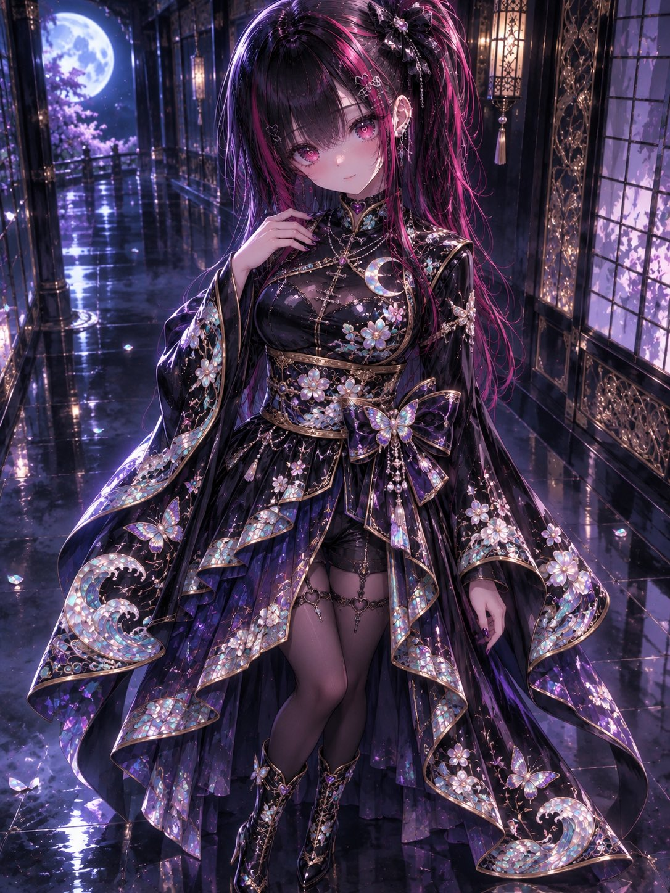
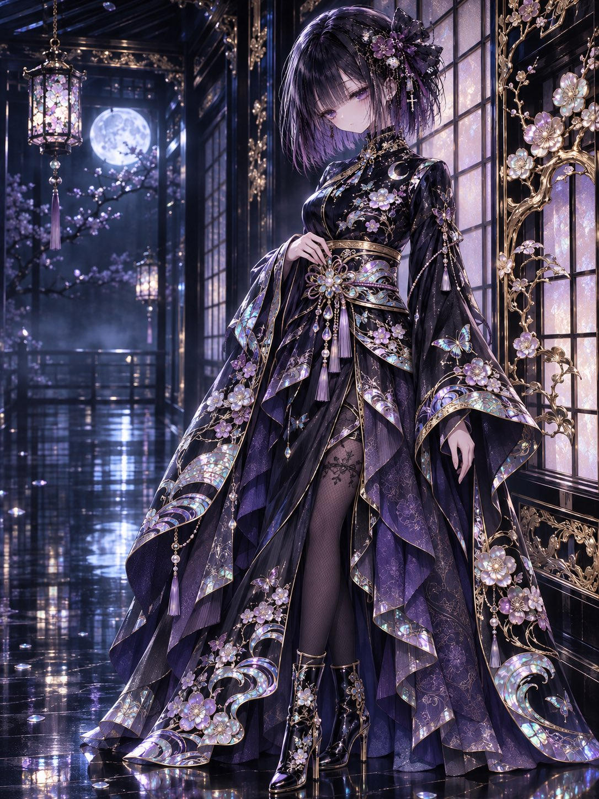
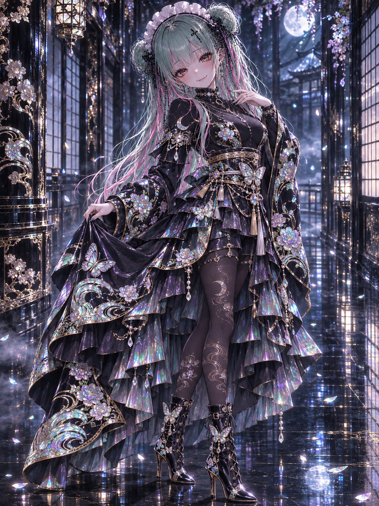
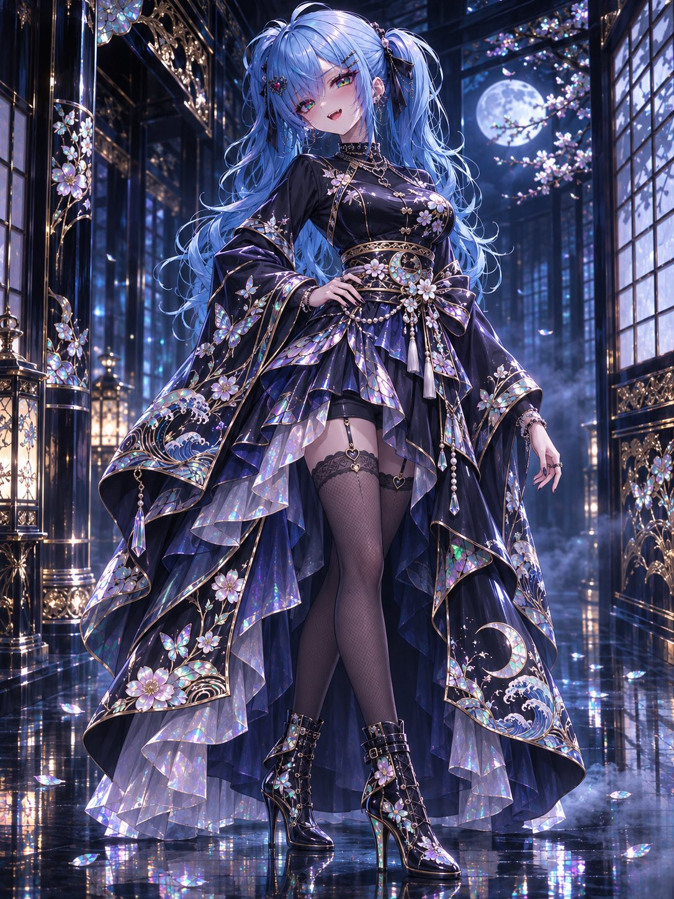

# 螺钿夜光和风哥特礼服（#るん衣装プロンプト 第277弾）

- 原帖链接：https://x.com/ENJU1123PIPI/status/2121732407242150331
- 作者：るんちゃん🦋（@ENJU1123PIPI）
- 时间：2026-11-15 06:30 (UTC+8 / Asia/Taipei)
- 互动摘要：点赞 121 · 转发 41 · 回复 9 · 引用 13 · 书签 26 · 浏览 4922（采集快照：2026-11-16 19:43 UTC+8）
- 模型/工具：未注明（角色参考图驱动的通用衣装 prompt）
- 标签：二次元
- 媒体路径：
  - `media/images/2121732407242150331_1.jpg`（）
  - `media/images/2121732407242150331_2.jpg`（）
  - `media/images/2121732407242150331_3.jpg`（）
  - `media/images/2121732407242150331_4.jpg`（）
- 入库日期：2026-11-16
- prompt 来源：https://x.com/ENJU1123PIPI/status/2121732408185860296
- 备注：prompt 在作者自回复（2121732408185860296），原样摘录。

## prompt 原文

```text
MOTHER-OF-PEARL NIGHT GLOW COUTURE

Use the attached character as the sole identity reference. Preserve their face, hairstyle, hair color, eye color, body proportions, signature accessories, personality, and gender presentation. Completely redesign the clothing.

Create luxurious Japanese gothic couture inspired by raden lacquerware: glossy black and deep navy with antique gold, pearl white, and iridescent teal, violet, emerald, and blue.

For feminine characters: a fitted upper garment, gold-framed obi waist, layered skirt or split overskirt, flowing kimono-inspired sleeves, elegant stockings, and refined heeled boots. Include concealed inner shorts.
For masculine characters: a tailored long coat or haori-inspired jacket, layered panels, fitted trousers, and polished boots.

Physically integrate mother-of-pearl inlays into lacquer-like clothing panels, especially the collar, sleeves, waist, and hem. Use delicate floral, wave, butterfly, or crescent motifs framed by fine gold lines. Add shell-set accessories, pearl ornaments, and subtle crystal accents. The outfit appears dark in shadow and reveals shifting rainbow reflections under moonlight.

Full-body or three-quarter composition. Choose a calm, graceful pose with one hand near the collar or waist and the other resting naturally or lightly holding the outfit. Serene, mysterious, or slightly proud expression.

Set the scene in a moonlit Japanese gothic corridor with black lacquer surfaces, a softly reflective floor, gold ornamentation, shoji or carved panels, faint mist, and sparse shell-like light particles. Keep the character and outfit as the focal point.

Premium anime illustration, clean expressive linework, dimensional shading, layered glass-like irises, realistic lacquer gloss, exquisite iridescent shell rendering, and cinematic moonlight.

One character only. Natural anatomy and correct hands. No collage, text, logos, or watermarks.
```

---

个人学习归档，非商业。prompt 与媒体版权归原作者 @ENJU1123PIPI，引用请回到原帖。
