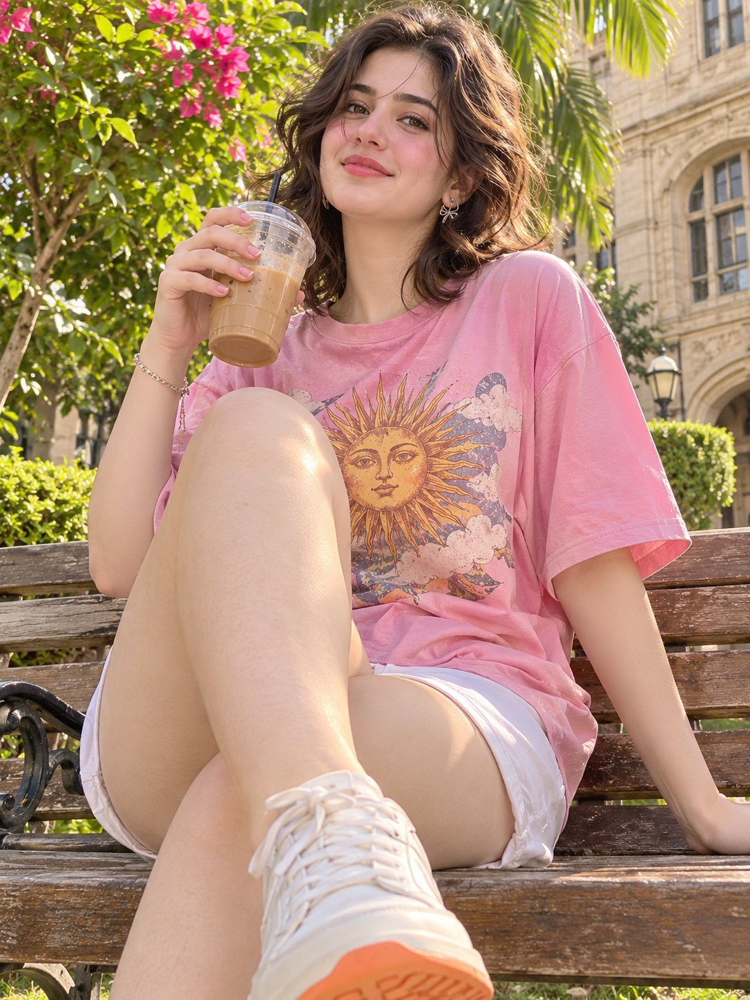

# 植物庭院长椅上的冰咖啡女子：低机位伸腿透视的夏日生活人像

- 原帖链接：https://x.com/xnouraya/status/2121803129956212837
- 作者：Nouraya AI（@xnouraya）
- 时间：2026-11-15 11:11 (UTC+8 / Asia/Taipei)
- 互动摘要：点赞 149 · 转发 25 · 回复 8 · 引用 0 · 书签 21 · 浏览 5745（采集快照：2026-11-16 09:10 UTC+8）
- 模型/工具：Nano Banana Pro
- 标签：真人
- 媒体路径：
  - `media/images/2121803129956212837_1.jpg`（）
- 入库日期：2026-11-16
- 备注：prompt 在正文，纯文生图。原样摘录。

## prompt 原文

```text
Cinematic lifestyle portrait of a cheerful young woman sitting on a rustic wooden bench in a lush botanical courtyard, holding an iced coffee in a clear plastic cup with straw, smiling naturally at camera, short wavy dark brown hair, soft natural makeup, oversized pastel pink graphic t-shirt with vintage sun illustration, white shorts, white chunky sneakers with orange soles, one leg extended toward camera creating dramatic perspective, relaxed summer aesthetic, golden hour sunlight filtering through tropical leaves, luxury university campus or historic garden background with stone architecture and large windows, shallow depth of field, warm tones, candid street photography style, ultra realistic skin texture, cozy youthful vibe, DSLR quality, high detail, photorealistic, dynamic low-angle composition, soft shadows, fashion editorial look, 8k.
```
