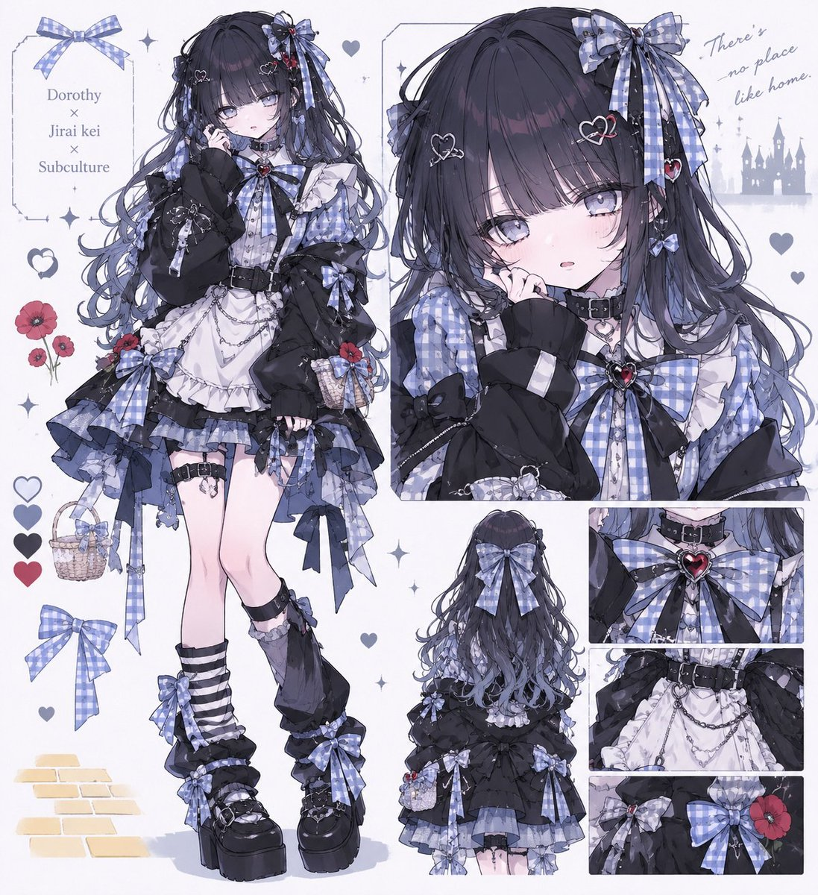

# 《绿野仙踪》多萝西 × 地雷系亚文化衣装 prompt

- 原帖链接：https://x.com/yana_al_/status/2121807906605838359
- 作者：やな（@yana_al_）
- 时间：2026-11-15 11:30 (UTC+8 / Asia/Taipei)
- 互动摘要：点赞 100 · 转发 6 · 回复 1 · 引用 2 · 书签 38 · 浏览 4196（采集快照：2026-11-16 19:43 UTC+8）
- 模型/工具：未注明
- 标签：二次元
- 媒体路径：
  - `media/images/2121807906605838359_1.jpg`（）
  - `media/images/2121807906605838359_2.jpg`（）
  - `media/images/2121807906605838359_3.jpg`（）
  - `media/images/2121807906605838359_4.jpg`（）
- 入库日期：2026-11-16
- prompt 来源：https://x.com/yana_al_/status/2121807908623298562
- 备注：prompt 在作者自回复（2121807908623298562），原样摘录（首行「衣装プロンプト」为作者标题）。

## prompt 原文

```text
衣装プロンプト

Dorothy-inspired jirai kei and Japanese subculture fashion, powder blue and black color palette, blue and white gingham check fabric, oversized black hoodie with gingham ribbon accents, cropped jacket with decorative straps and buckles, white apron-style layered skirt, asymmetrical ruffled skirt panels, oversized bows attached to clothing, layered waist belts, silver chains attached to the outfit, heart-shaped metal buckles, safety-pin decorations, eyelet details, lace-up accents, striped leg warmers, chunky black platform sneakers, red ribbon details, ruby red heart-shaped jewelry, gingham shoulder bag, cute yet edgy street fashion, sweet and slightly dark aesthetic, modern Japanese subculture style, intricate clothing details, all garments and accessories naturally worn on the girl's body, fashionable and distinctive outfit design, full-body character illustration, full-length view, entire body visible from head to toe, both legs and feet clearly shown, shoes fully visible, character completely inside the frame, camera pulled back, no cropping
```

---

个人学习归档，非商业。prompt 与媒体版权归原作者 @yana_al_，引用请回到原帖。
