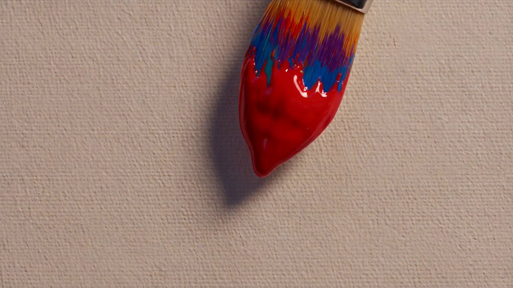

# Paint Explosion：一笔颜料炸出整个世界（同一 prompt 跑 Seedance 2.5 Flash / Seedance 2.0 / Wan 3.0）

- 原帖链接：https://x.com/Dheepanratnam/status/2121887196063940951
- 作者：Dheepan Ratnam（@Dheepanratnam）
- 时间：2026-11-15 16:45 (UTC+8 / Asia/Taipei)
- 互动摘要：点赞 38 · 转发 4 · 回复 24 · 引用 0 · 书签 4 · 浏览 1019（采集快照：2026-11-16 19:43 UTC+8）
- 模型/工具：Seedance 2.5 Flash、Seedance 2.0、Wan 3.0（主帖三段视频对比；作者另在回复区贴了 Kling 4.0、Grok Imagine、Minimax H3 的结果）
- 标签：其它
- 媒体路径：
  - `media/video-stills/2121887196063940951_still.jpg`（视频封面截图，）
  - 视频本体未入库，仅保留原帖链接：https://x.com/Dheepanratnam/status/2121887196063940951
- 入库日期：2026-11-16
- prompt 来源：https://x.com/Dheepanratnam/status/2121887305266807020
- 备注：主帖正文只有截断的 prompt 开头，完整版在作者自回复（2121887305266807020，开头写「Full prompt」），原样摘录。主帖含 3 段视频，仅保存第 1 段封面截图，视频仅保留原帖链接。

## prompt 原文

```text
Full prompt 

Paint Explosion World Hook: An artist flicks a brush—and the paint becomes an entire living world. Extreme close-up: a loaded paintbrush touches a blank canvas. A violent burst of red, blue, yellow, and violet paint explodes toward camera. Paint morphs into birds, waves, mountains, and clouds. Camera flies through the colour explosion into a painted landscape. A painted river carries glowing boats through a canyon. Villages made from brushstrokes light up one by one. A child on a hill flicks their wrist, sending colours across the sky. Final pull-back: the whole world is inside a framed painting in a gallery. Why it shows 4K: fluid detail, pigment texture, saturated colour, and seamless world-building.
```

---

个人学习归档，非商业。prompt 与媒体版权归原作者 @Dheepanratnam，引用请回到原帖。
