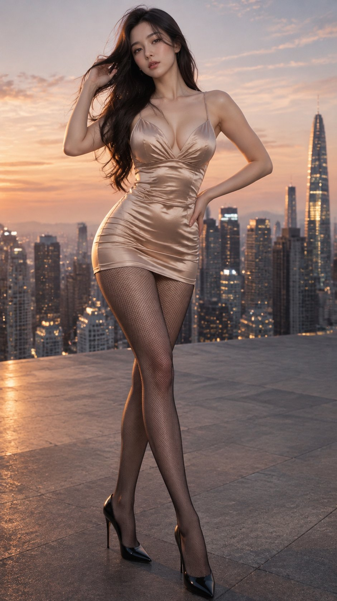

# 黄金时刻摩天楼天台：香槟金缎面包臀裙 + 渔网丝袜的都市时尚写真（中文结构化 prompt）

- 原帖链接：https://x.com/GenRyoma/status/2121906806209314865
- 作者：YLL·Hara（@GenRyoma）
- 时间：2026-11-15 18:03 (UTC+8 / Asia/Taipei)
- 互动摘要：点赞 55 · 转发 1 · 回复 5 · 引用 0 · 书签 15 · 浏览 2614（采集快照：2026-11-16 09:10 UTC+8）
- 模型/工具：未注明
- 标签：真人
- 媒体路径：
  - `media/images/2121906806209314865_1.jpg`（）
- 入库日期：2026-11-16
- 备注：prompt 在正文（首行「想要问问你敢不敢」为配文，未计入）。prompt 明确设定 25 岁成年女性，并在负面提示词中排除未成年人。原样摘录。

## prompt 原文

```text
画幅与风格

9:16竖版，超写实真人高级时尚人像摄影，高楼天台，傍晚黄金时刻，电影感都市写真，真实相机抓拍质感。

人物设定

一位25岁成年东亚女性模特，身高170cm，身材高挑纤细，腰臀比例自然，双腿修长。黑棕色长发自然披散，气质成熟、冷艳、自信。

服装造型

连衣裙： 香槟金色低胸修身包臀短裙，采用丝质缎面材质，深V领口，胸口有精致的立体褶皱设计，胸部完整包覆。裙身贴合腰臀曲线，裙摆简洁利落。
丝袜： 黑色细密渔网连裤丝袜，采用均匀的小网格编织，细腻贴合双腿，网格纹理清晰。
鞋履： 黑色尖头细高跟鞋，鞋跟纤细，皮革具有自然光泽。
不佩戴夸张首饰，保持整体造型简洁。

核心姿势

模特站在高层建筑天台的开阔区域，身体侧向城市天际线约30度。

一条腿自然承重，另一条腿略微向前伸出。
一只手轻扶腰侧，另一只手自然拨弄长发。
腰背挺直，肩颈舒展。
头部转向镜头，眼神冷艳、自信，带有轻微妩媚感。
裙摆和长发随高空微风自然摆动。

场景与安全空间

现代摩天大楼顶层露台，背景为密集城市天际线、远处高楼和开阔天空。

画面不出现可见护栏，采用经过安全布置的封闭式摄影区域及隐藏式防护设施。模特站在远离实际楼顶边缘的宽阔区域，利用镜头构图营造无护栏的视觉效果。

地面采用深灰色防滑石材，保留少量自然反光。

摄影机位与构图

摄影机位于人物正前方偏低位置，采用略微仰拍的全身人像构图。

85mm人像镜头，人物完整入镜，城市天际线作为远景背景。

模特占据画面约65%，重点突出香槟金裙装、细密渔网丝袜、修长腿部和都市天际线之间的视觉对比。

光线与调色

傍晚黄金时刻，夕阳从人物侧后方照入，形成柔和金色轮廓光。

城市背景略微虚化，人物服装细节清晰。整体采用香槟金、深灰和低饱和蓝灰色调，轻微胶片颗粒，不过度磨皮。

负面提示词

未成年人、走光、私密部位裸露、透明裙装、丝袜网格不均匀、丝袜破损、腿部畸形、额外肢体、人物悬空、危险边缘动作、AI网红脸、塑料皮肤、过度磨皮、CG渲染、文字、水印。
```
