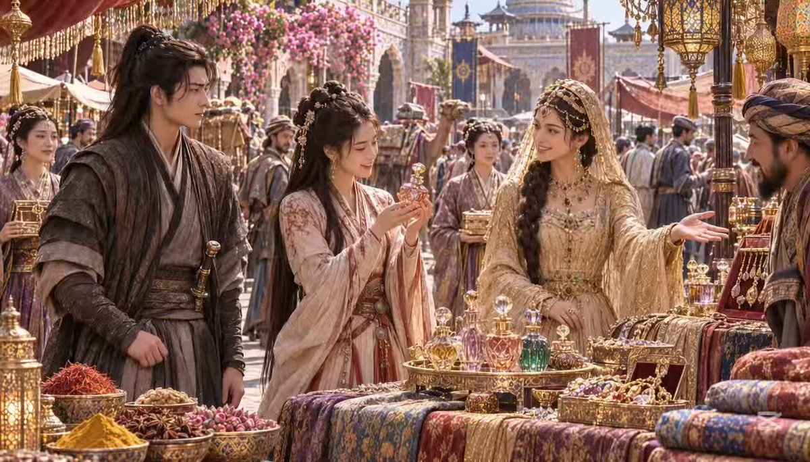

# 西域市集「公主的香水邀约」：古装喜剧电影剧照式情境图 prompt（含中文负面提示词）

- 原帖链接：https://x.com/Ling_1055Tw/status/2121959669489119373
- 作者：LingTian594888（@Ling_1055Tw）
- 时间：2026-11-15 21:33 (UTC+8 / Asia/Taipei)
- 互动摘要：点赞 30 · 转发 9 · 回复 9 · 引用 1 · 书签 2 · 浏览 1927（采集快照：2026-11-16 09:10 UTC+8）
- 模型/工具：未注明（帖内只写「情境圖片提示詞」；成片为视频）
- 标签：真人
- 媒体路径：
  - `media/video-stills/2121959669489119373_still.jpg`（视频封面截图，）
  - 视频本体未入库，仅保留原帖链接：https://x.com/Ling_1055Tw/status/2121959669489119373
- 入库日期：2026-11-16
- 备注：prompt 在正文，为成片的情境图提示词；视频本体未入库，仅保留原帖链接。人物设定均为 22 岁成年人与中年商人。原样摘录。

## prompt 原文

```text
4K ，16:9 ，真人超寫實古代西域喜劇電影劇照，古裝電影美學，Photorealistic Cinematic Film Still。ARRI ALEXA 35 Xtreme，ARRI Signature Prime 35mm 電影鏡頭，平視中景，自然互動抓拍，細膩 35mm 彩色膠片顆粒，明亮溫暖的金色陽光。

場景設定：陽光灑落在熱鬧繁華的古代西域市集。遠方是一座宏偉華麗的西域皇宮，藍金色圓頂、雕花拱門與高聳尖塔點綴天際。街道兩旁懸掛紅色與深藍色王室旗幟、金色宮燈和彩色布幔，粉紅色花藤從建築上垂落。
背景有身穿西域服飾的商人與行人，以及一匹載著貨物的駱駝；人物自然穿梭，呈現絲綢之路市集的繁盛氣氛。

主要人物與情節：
畫面左側是一位 22 歲俊美東方男俠，白皙肌膚，修長精緻的臉龐，黑色長髮高束馬尾。身穿深棕黑色多層古袍、寬腰帶與皮革護腕，腰間自然佩掛長劍。他站在兩位女子身旁，神情溫柔專注地望向她們。

中央是一位 22 歲美麗東方古裝女子，白皙肌膚，精緻鵝蛋臉，黑色長髮半束，以金色髮簪和流蘇點綴。身穿象牙白與淡粉色花卉刺繡古裝，搭配暗紅色腰帶。她雙手小心捧著一瓶精緻的粉色琉璃香水，低頭微笑欣賞。

右側是一位 22 歲美麗中亞西域公主，五官精緻，黑色長髮編成側辮，佩戴華麗的金色寶石頭飾與薄紗頭巾。身穿香檳金色寶石刺繡長裙，搭配金色項鍊、耳環與腰飾。她微笑看向東方女子，一手輕扶攤位，另一手自然伸向右側商人，像是在熱情介紹市集中的香水與珠寶。

最右側是一位戴著西域花紋頭巾、留有鬍鬚的中年商人，笑容親切地招呼客人。後方有兩位身穿紫金色服飾的西域侍女，各自捧著精緻金色寶盒。

前景細節：前方攤位鋪滿深藍、酒紅、紫色與金色花紋的西域織錦。金色托盤上排列粉紅、琥珀金、紫色與翠綠色琉璃香水瓶，旁邊擺放鑲嵌寶石的首飾盒、項鍊與金色飾品。畫面左下角可見盛放藏紅花、薑黃、八角、香料與乾燥玫瑰花蕾的彩繪陶碗。

暖金色陽光照亮人物面容、薄紗與琉璃瓶，珠寶呈現細緻而自然的光澤。人物表情生動，衣料、髮絲和皮膚保留真實質感，畫面華麗而溫馨。

負面提示詞：動漫風、卡通臉、塑膠皮膚、過度磨皮、五官變形、多餘手指、多餘肢體、手部錯亂、人物重疊、香水瓶變形、過度曝光、過度發光、模糊、文字、字幕、水印、Logo。
```
